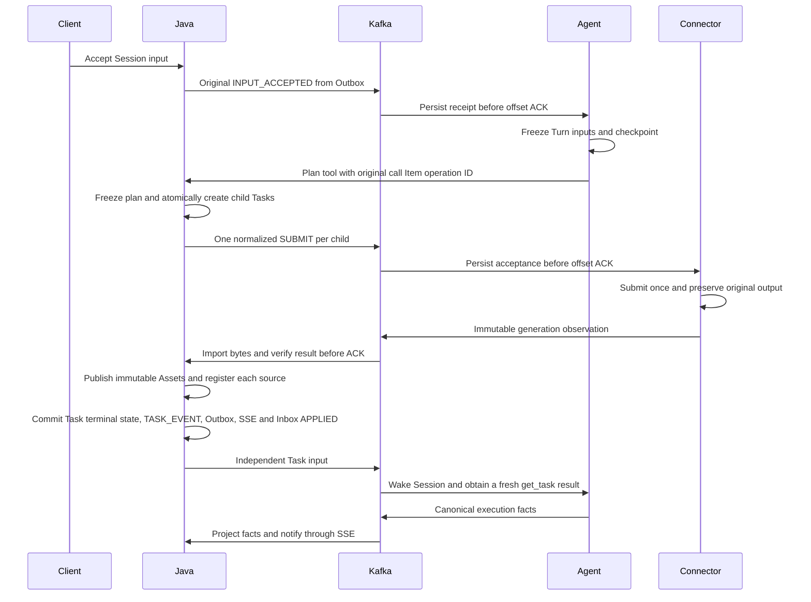

# Lux Cross Project Integration Readiness and Test Plan

**Goal:** Verify the current Java, Agent and Connector boundaries, identify incomplete recovery paths, and prepare local integration acceptance without invoking paid providers.

**Architecture:** Java owns business admission and projections. Agent owns Session execution, direct ChatOpenAI model invocation and model receipts/recovery. Connector owns BytePlus media generation and retained results. Integration acceptance must use those real components together; model and provider boundaries may use deterministic test adapters.

**Tech stack:** Java 17, Maven, Spring Boot 4.1.1, MySQL 8.4, Kafka v2 topics, SeaweedFS S3, Python 3.14, FastAPI, LangGraph and native SQLite checkpoints.

## Scope and conclusion

The user-approved boundary is implemented locally: Agent directly uses ChatOpenAI through ModelExecutor and preserves model receipts/recovery; Connector owns Seedream/Seedance submission, polling and retained results. The read-only recovery blocker, authorized Agent image/video-frame observations, audited original-evidence attachment and Java Seedance reference-ratio admission are implemented. Four exact BytePlus catalog/routes and Java Asset reference transport are in place. Final local component/process results are recorded below; real provider account access, output quality and billing wait for API keys and separate live acceptance.

This report covers the October 13, 2026 filesystem implementation, not a commit-qualified release. Java and Agent have no accessible Git metadata; Connector has metadata but its current project files are untracked. Local production code, tests, SDK dependency and documentation were updated. Agent extends its owned v2 SQLite schema additively; existing stores are not reset. No live provider calls, deployment, instruction-file changes, branches or commits were performed.

## Ownership and interaction rules

| Component | Owned state and decisions | Cross-project boundary |
| --- | --- | --- |
| Java backend | Users, Sessions, immutable inputs, HTTP operation receipts, generation plans/focus/catalog, Tasks, private Assets, source projections, SSE | Agent commands and source observation/repair; plan/Task HTTP tools; generation commands and result import |
| Python Agent | Run/Turn decisions, native Session context/checkpoints, model/tool execution receipts, canonical facts, pending intents | Java HTTP tools and authoritative plan context; Kafka Session commands and execution facts |
| Model Connector | Durable acceptance, exact provider/account/request binding, one original submission, polling/reconciliation, retained result objects, immutable observations | Kafka generation commands/events; private result gateway consumed by Java |
| Python Utils | Process health scaffold only; no current business caller | No participation in the generation loop is required by the present implementation |

Tasks belong to an owner and Session, with plan provenance where applicable. They do not acquire foreign keys to transient Run/Turn/Item execution. Task completion creates one independent `SYSTEM/TASK_EVENT` input containing `task_id`; a later `get_task` creates a fresh immutable observation. It does not rewrite the original submit ToolResult.



The following rules are already represented in code and local tests:

- Java input, HTTP receipt, Outbox and SSE acceptance commit together; Java creates no Run when accepting input.
- Agent receipt precedes Kafka offset acknowledgment. Checkpoint incorporation precedes Inbox `APPLIED`. Checkpoint intents are removed only after canonical event/counter/publication persistence.
- Each Session has one local driver. Store and native checkpoint files are a paired lifecycle, with separate transaction boundaries and reconciliation.
- Generation plan freeze, ordered child Tasks, child Outboxes and original parent receipt share a Java transaction. Replaying the same parent operation returns the original children.
- Connector success means original output has been retained. Java business success follows actual byte import and verification, then exactly one terminal Session input.
- Stable IDs and original envelopes survive delivery retries. Source revision, Session input sequence, Python event sequence, Item stream sequence and Java SSE cursor remain distinct.
- Stop finishes an already started Turn and cancels its Run; unconsumed Session inputs remain eligible for a later Run.

Primary code: `SessionService.java`, `GenerationPlanService.java`, `TaskService.java`, `TaskResultService.java`, `InboxProcessor.java`; Agent `runtime.py`, `store.py`, `delivery.py`; Connector `store.py`, `execution.py`, `results.py`, `delivery.py`.

## Recovery status and activation gates

### R1 Read-only recovery: resolved locally

The earlier P1 marked a transport-failed `get_task` UNKNOWN despite lacking an original read operation receipt. UNKNOWN blocked stop and later input, and checkpoints restored the block. Timeout/503 now settles a confirmed original ToolError saying no snapshot was observed. Persisted IN_FLIGHT/UNKNOWN reads settle as interrupted reads without querying a later snapshot under the original call. Mutation/model UNKNOWN rules are preserved.

The [regression script](../../../scripts/integration/reproduce_get_task_timeout.py) now asserts one read, original call/error pairing, CANCELLED then COMPLETED Runs, later input incorporation and Store/checkpoint restart. Exit zero means recovery assertions passed.

### R2 Model execution/reconciliation: implemented locally

Agent directly uses ChatOpenAI `gpt-6-luna`; lifecycle wires the same component as ModelExecutor and ModelReconciler. Provider identity is saved before dependent fragments. Known IDs recover by original GET only. Definitive pre-acceptance HTTP400/401/403 rejection becomes confirmed failure; unknown acceptance is not resubmitted. Opt-in execution and a runtime API key are required. Actual account/retention/transport behavior remains unverified.

### R3 BytePlus normalized registrations: implemented locally

Java catalog/routes and Connector registry share four exact model/profile/revision/provider/adapter registrations. Java admission and Connector execution default disabled. Image versions preserve distinct formats/flags/presets. Seedance acceptance ID is saved before polling. Connector validates decoded retained bytes, and Java independently verifies imported output. The [contract script](../../../scripts/integration/verify_byteplus_contracts.py) exercises actual Java-frozen JSON through Connector parsing/registration/translation.

### R4 Asset references and observation: implemented locally

Connector resolves owner-scoped Java Asset metadata/content, checks immutable bytes and sends bounded PNG/JPEG data URIs. Initial reference caps are 14/3 MiB for 4.5/Lite, 10/4 MiB for Pro and 30/1.5 MiB for Seedance. Maximum counts fit the inline transport budget. Java's optional typed `aspect_ratio_range` capability now rejects Seedance references outside inclusive 2:5..5:2 using actual Asset dimensions before freeze/Task/outbox creation; Connector independently checks decoded reference dimensions and ratio. Old omitted-field JSON remains readable; advertise the extension only with coordinated Java/Agent readers.

Agent observes both uploaded Assets and fresh Task result Assets through Java's scoped endpoints. Compact immutable descriptors retain source Item/Task version/checksum; actual SDK invocation hydrates bounded JPEG image blocks and uniformly sampled timestamped video frames without persisting presentation bytes or rewriting original ToolResults. Successful observations survive checkpoint reopening and tool turns. Invalid media does not poison later text input. Images/videos require local FFmpeg tools; audio observation, video/audio generation references and provider portrait authorization remain outside this initial path. See the [Agent README](../../../../lux-python-agent/README.md) for exact limits and configuration.

### R5 Unknown acceptance without original provider identity: audited manual recovery implemented

With a saved OpenAI response ID or Seedance Task ID, only original lookup is allowed. Default-disabled Bearer-protected routes now accept proven original response/task IDs or typed original Seedream receipts, with trusted server-side operator/account scope, exact original owner/Session/operation/hash/provider binding and atomic audit. Same evidence replay is idempotent; terminal/conflicting or undispatched evidence is rejected. Normal dispatcher/worker recovery performs original GET/preservation only, without a new provider POST or direct Java business-success update.

Agent records a false provider dispatch phase before hydration and true immediately before SDK create. Cancelled/crashed false-phase work settles confirmed `MODEL_NOT_SUBMITTED`; migration defaults existing receipts to true to preserve uncertainty. OpenAI's supported `X-Client-Request-Id` carries the original execution UUID solely for operator/vendor correlation. Manual evidence still requires attestation: local hashes cannot prove a provider ID belongs to that request or discover a lost ID. Synchronous Seedream has no automated original-result lookup. Without evidence, acceptance remains UNKNOWN/RUNNING; age, lease expiry or an absent listing never authorizes another paid submission.

### Explicit policies to preserve or review separately

- Java currently treats source HTTP 5xx, GET failures and read failures as terminal `IMPORT` failures. `TaskResultServiceTests.java:50` explicitly protects this policy. Connector gateway storage unavailability can return 503, so this policy can produce Java `FAILED` after Connector `SUCCEEDED`. Test that behavior explicitly; changing transient-source classification requires a separate behavior decision.
- Plan HTTP precondition/envelope rejection before receipt persistence can leave Agent polling a missing receipt. Include this failure classification in integration cases. No valid current Python invocation was demonstrated to mismatch Java's decoder.
- Internal owner paths provide scope selection, not authentication. The current deployment boundary is trusted local/private networking.
- Single-process file/Session locks do not establish distributed execution fencing. Multi-replica operation is outside the implemented baseline.

## Verification performed

| Check | Result and scope |
| --- | --- |
| Java complete tests and package | 266 passed, zero skips; `./mvnw verify` BUILD SUCCESS with actual isolated MySQL8.4/Kafka4.0.2/SeaweedFS4.47 and explicit Mockito agent |
| Agent pytest | 158 passed; actual ChatOpenAI offline image/frame/SSE/HTTP fixtures plus native SQLite/LangGraph recovery and production lifespan wiring |
| Connector pytest | 417 passed, zero skips; actual isolated MySQL8.4/Kafka4.0.2, including atomic audits and pending-receipt/attachment convergence |
| Utils pytest | 1 passed again after implementation; unchanged health scaffold |
| Python lint, format and dependency consistency | Ruff check/format and pip check passed for Agent/Connector; Utils baseline passed |
| Read-only regression | One read, original confirmed error, cancellation/later input/restart assertions passed |
| Java-to-Connector contracts | Four actual frozen Java JSON requests resolved exact routes and translated provider payloads without external IO |
| Independent review | Media cancellation and receipt-normalization findings fixed and re-reviewed; final broad review has no remaining actionable findings |
| Real Java/MySQL/S3 reference admission | Invalid 300x751/751x300 references preserve draft and reject submit without Task/Outbox; inclusive 300x750/750x300 references freeze successfully |
| Real Java Kafka workflow | Six WorkflowIntegrationTests passed; Java test PythonConsumers remain contract doubles, separate from the real-process gate |
| Connector production boto3 S3 adapter | Actual bytes/hash/MIME/metadata, full/ranged reads, anonymous403, fresh-store recovery, conflicting source rejection and exact object deletion404 passed |
| Real Java/Agent/Connector processes | Complete harness passed: actual image/video loops, original-ID attachment/restart/GET, actual media input blocks, HTTP scope/SSE/range/ratio and cross-database assertions |

Corrections covered by new regressions: definitive OpenAI rejection is confirmed rather than unrecoverable UNKNOWN; corrupt PNG and MP4 with no media samples cannot become generation success; maximum reference count/bytes cannot guarantee an oversized inline request.

Existing WorkflowIntegrationTests use Java FakePythonConsumers, and GenerationPlanIntegrationTests use synthetic routes. The separate production-process harness uses actual Java HTTP/JPA, Agent runtime/ChatOpenAI/checkpoints, Connector workers/stores, Kafka and S3, substituting only model/provider HTTP. This report identifies its executed cases separately from the 32-case broader matrix. None of these local proofs establishes live account activation, provider output quality or billing. Provider bindings and limits are recorded in the [implemented design](../specs/2026-10-13-provider-integration-design.md).

Fresh MySQL acceptance exposed non-Boolean nullable CHECK predicates in the active V1 baseline; explicit `= TRUE` comparisons now preserve constraints and migrate successfully on MySQL8.4. This changes that baseline's checksum: no already-applied schema was repaired/reset, and an existing installation needs an explicit migration decision. Real repeatable-read concurrency also exposed a stale Hibernate version check before a Session lock refresh; directly refreshing the already owner-scoped entity with `PESSIMISTIC_WRITE` now obtains the current row before allocation. Existing substantive concurrency tests reproduce and verify that path.

Docker Desktop's normal proxy socket stalled container startup. The raw daemon socket allowed actual starts; no daemon/shared-service restart was performed. Parallel test stacks later exceeded this VM's 3.828 GiB memory and killed one owned MySQL; the contended Java run had one workflow timeout. After removing only owned resources, bounding MySQL/Kafka/S3 to 768/512/384 MiB and running stacks serially, all 266 Java tests passed in 85 seconds, including the workflow in 2.327 seconds. Do not run complete component and process stacks concurrently on this environment.

## Local acceptance environment

| Service | Isolated requirement |
| --- | --- |
| Java | Fresh v2 database, both active session-storage migrations, workers enabled for process acceptance; loopback HTTP 8080 |
| Agent | Fresh private Store/checkpoint pair; one process, no reload; HTTP 8000; configured backend and source synchronization |
| Connector | Separate fresh schema; MySQL test account only; HTTP 8001; dedicated Kafka group; provider execution remains disabled in admission-only acceptance |
| Utils | Optional health-only check on 8002 to avoid Connector's 8001 port |
| Kafka | Four v2 topics; 32 MiB record/request/partition capacity and 64 MiB aggregate fetch; distinct workload groups and fresh owner/Session/Task identities |
| S3 | Dedicated private test buckets for Connector retained outputs and Java Assets; separate prefixes and ownership |
| Video inspection | Real `ffprobe` when exercising actual video bytes |

Set `LUX_BACKEND_URL=http://127.0.0.1:8080` for Agent and `LUX_AGENT_BASE_URL=http://127.0.0.1:8000` for Java repair. Configure the Connector result base URL so Java can reach its retained-object gateway. Keep credentials in private environment/configuration files.

Agent restart/rebalance cases retain the same paired Store/checkpoint owner. Independent replicas with separate local stores require a different, explicitly designed execution-fencing boundary.

The existing Compose file provisions Java's database, not a separate Connector schema. Enabled Connector provider execution also requires its packet-capacity check: at least 257 MiB for the default 128 MiB response budget; the documented provision is 512 MiB. Use a dedicated test server if changing this setting.

Do not reset existing schemas, shared topic data, named Compose volumes or old Store files. Each fixture may clean up only resources it creates. No live API key or cloud credential is needed for deterministic acceptance. Real model/provider calls require a separately agreed target, budget, limits and retry/stop policy.

## Acceptance matrix

Cases below are prepared assertions. Existing component coverage is listed separately; a case is not considered passed until its stated real boundaries execute together.

| ID | Trigger and real boundary | Required observable result | Current entry or missing harness |
| --- | --- | --- | --- |
| I01 | Concurrent Java message acceptance | Contiguous independent input numbers; one original repair envelope per input; no Java-created Run | `WorkflowIntegrationTests` |
| I02 | Same HTTP identity, same/different body | Exact original response replay; changed body conflicts; no duplicate input/Task | Java HTTP idempotency tests plus process HTTP runner |
| I03 | Java Outbox commit then process restart before publish | Original input reaches real Agent once logically; IDs/content unchanged | Real three-process runner required |
| I04 | Agent receipt persisted then Kafka commit failure/rebalance | Redelivery deduplicates; no skipped offset; one context incorporation | Agent delivery tests plus real broker fault injection |
| I05 | Deliver inputs 1 and 3, then admit 2 through Java repair | Context freezes 1/2/3 in order at a Turn boundary | Real Agent/Java repair HTTP runner |
| I06 | New input while model is streaming | Current Turn context unchanged; next Turn includes new input | Agent runtime tests plus process Kafka |
| I07 | Stop during Turn, then new input/continue | Finish started Turn, cancel one Run, preserve input and wake later Run | Agent runtime tests plus process HTTP/Kafka |
| I08 | Reordered snapshots and fragment gap, then replay | Source shells valid; unrelated projections advance; final replacement wins; no late reopening | `WorkflowIntegrationTests`, source recovery tests |
| I09 | Items page then SSE reconnect after its cursor | No missing notification; stable Item positions; original SSE replay | `WorkflowIntegrationTests` plus real streaming HTTP |
| I10 | Agent calls catalog/read/create/update/focus tools | Scope/hash/original operation identity match Java; immutable receipts enter conversation | Real BackendClient against Java required |
| I11 | Stale plan/focus revision or dependent tool batch | Proven nonexecution; no child Task; fresh authority required | Plan service and Agent generation-plan tests |
| I12 | Submit synthetic valid plan with count 3 | One freeze, three distinct Tasks/child operations, three normalized commands, one original parent receipt | `GenerationPlanIntegrationTests` plus real Connector admission |
| I13 | Parent response timeout/restart, then original receipt lookup | Exact ordered children restored; no additional generation command/submission | Real Agent/Java receipt recovery required |
| I14 | Second child acceptance technical failure | Freeze, first child, notifications, Outboxes and parent receipt roll back together | `GenerationPlanIntegrationTests` |
| I15 | Real Connector receives duplicate/conflicting SUBMIT | One accepted execution; durable physical receipts/conflict evidence; ACK after commit | Opt-in Connector MySQL/Kafka tests |
| I16 | Test provider produces image receipt or video ID | Exact prepared request and marker precede one POST; polling never becomes re-POST | Provider worker tests plus real Connector store |
| I17 | Lose provider response after original dispatch marker | No repeated POST across restart; original operation reconciled or recorded unresolved | Authenticated original-evidence attachment and worker recovery tests; process Seedance case |
| I18 | Retained-object PUT succeeds, SQL receipt write fails, URL later expires | Reuse immutable retained object and original source index; one output | Connector preservation tests plus real S3 |
| I19 | Connector emits terminal success through Kafka/gateway | Java imports/validates before ACK; correct private Asset; one Task terminal input | New normalized real three-process path required |
| I20 | Duplicate terminal events and restart during Java import | Stable Asset IDs/bytes; one terminal Task input; fresh get_task leaves submit receipt unchanged | Existing Task tests plus real DB/broker/object fault injection |
| I21 | get_task timeout or HTTP 503, then service recovers | Original call settles explicitly; later stop/input and restart can progress | Passing local runtime/checkpoint regression; real process fault injection still required |
| I22 | Model unknown outcome through configured ASGI lifespan | Original response reconciliation available; no second stream call; Run can progress | Passing lifecycle/ChatOpenAI original GET regression; real provider acceptance still required |
| I23 | Wrong owner/Session/Task/Asset/focus binding | No foreign data or bytes; no external submission; scoped error/receipt | SQL/controller checks plus real HTTP/locator |
| I24 | Java Asset reference reaches normalized adapter | Locator receives complete identity; authorized content resolved; cross-owner reference rejected | Real locator implemented; HTTP fixture passes; process Java/Connector acceptance still required |
| I25 | Model receives image/video Asset input | Actual provider media block contains authorized bytes/URL/frames; ID text alone insufficient | Actual ChatOpenAI image/frame transport tests, native checkpoint recovery and process observations |
| I26 | Real PNG/JPEG/MP4 wrong size/format/duration/audio or multiple files | Independent Java byte verification rejects; verified partial Assets preserved | Real media fixtures/ffprobe plus result gateway |
| I27 | Empty success sources versus multiple normalized sources | Empty list rejected at Kafka ingress; multiple nonempty files cause GENERATION / OUTPUT_FILE_COUNT_MISMATCH before import | `EventProtocol` and normalized Task tests protect different boundaries |
| I28 | Source gateway 503/read truncation versus ambiguous object/database failure | Current source policy ends Task with IMPORT failure; ambiguous publication/DB failure remains unacknowledged for same-identity recovery | TaskResult tests plus actual gateway fault injection |
| I29 | Oversized UTF-8 input/completion near 31 MiB | Java admission rollback; observed Agent receipt retained; no truncation or repeated execution | Messaging budget tests plus configured broker limit checks |
| I30 | Wrong topic/key/version, same event ID with changed body | Durable rejected/conflicting evidence; no business mutation; offset classification verified | Java/Python protocol tests plus real broker |
| I31 | Plan HTTP rejection before receipt, then receipt lookup 404 | Explicitly classify proven nonexecution versus uncertainty; no accidental duplicate mutation | Fault-injection case; no demonstrated valid-schema mismatch |
| I32 | Utils health while other services run | Independent process health on nonconflicting port; no generation dependency | Existing Utils ASGI test plus optional process probe |

## Execution order and commands

### Step 1 Repeat the offline baseline

- [x] Run the updated suites, Ruff and dependency checks. Local implementation changes are covered; external-service gates remain separate.

```bash
cd /Users/xuwenjie/lux-java-backend
./mvnw -o '-Dtest=*Tests,!*IntegrationTests,!LuxBackendApplicationTests' \
  '-DargLine=-javaagent:/Users/xuwenjie/.m2/repository/org/mockito/mockito-core/5.23.0/mockito-core-5.23.0.jar' verify

cd /Users/xuwenjie/lux-python-agent
.venv/bin/python -m pytest
.venv/bin/python -m ruff check .
.venv/bin/python -m ruff format --check .
.venv/bin/python -m pip check

cd /Users/xuwenjie/lux-python-model-connector
env -u LUX_CONNECTOR_TEST_CONFIG .venv/bin/python -m pytest
.venv/bin/python -m ruff check .
.venv/bin/python -m ruff format --check .
.venv/bin/python -m pip check

cd /Users/xuwenjie/lux-python-utils
.venv/bin/python -m pytest
.venv/bin/python -m ruff check .
.venv/bin/python -m ruff format --check .
.venv/bin/python -m pip check
```

The explicit Mockito path matches this environment's cached managed version. Re-resolve the JAR if Maven's managed version changes. `-o` requires cached Maven dependencies.

### Step 2 Verify original recovery and cross-project contracts

- [x] Cover read timeout/503, original ToolResult pairing, stop/new input and native checkpoint restart.
- [x] Cover model lifecycle, earliest response ID, stream disconnect, original GET recovery, definitive rejection and no resubmission.
- [x] Serialize actual Java-frozen requests and resolve/translate them through the populated Connector registry.
- [x] Verify accepted Seedance ID persistence before polling and decoded media/reference validation.

```bash
cd /Users/xuwenjie/lux-python-agent
.venv/bin/python /Users/xuwenjie/lux-java-backend/scripts/integration/reproduce_get_task_timeout.py

cd /Users/xuwenjie/lux-java-backend
./mvnw -o -Dtest=BytePlusCatalogTests test

cd /Users/xuwenjie/lux-python-model-connector
.venv/bin/python /Users/xuwenjie/lux-java-backend/scripts/integration/verify_byteplus_contracts.py
```

Both scripts assert their stated local boundaries and fail on regression. They make no provider or object-store calls. The four JSON fixtures are generated under Java target/integration by the catalog test.

### Step 3 Establish isolated infrastructure acceptance

- [x] Resolve the local Docker startup failure through the working raw socket and execute actual isolated MySQL/S3 tests.

```bash
cd /Users/xuwenjie/lux-java-backend
env -u LUX_TEST_S3_ENDPOINT ./mvnw -o \
  '-Dtest=GenerationPlanIntegrationTests,ChatSchemaIntegrationTests,S3IntegrationTests' \
  '-DargLine=-javaagent:/Users/xuwenjie/.m2/repository/org/mockito/mockito-core/5.23.0/mockito-core-5.23.0.jar' test
```

- [x] Execute Java's complete suite with actual Kafka4.0.2 and isolated services. This creates its own bounded test infrastructure and does not reset Compose volumes.

```bash
cd /Users/xuwenjie/lux-java-backend
DOCKER_HOST="unix://$HOME/Library/Containers/com.docker.docker/Data/docker.raw.sock" \
TESTCONTAINERS_DOCKER_SOCKET_OVERRIDE=/var/run/docker.sock \
NO_PROXY=127.0.0.1,localhost \
./mvnw '-DargLine=-javaagent:/Users/xuwenjie/.m2/repository/org/mockito/mockito-core/5.23.0/mockito-core-5.23.0.jar' verify
```

- [x] Run Connector's opt-in tests against dedicated disposable MySQL/Kafka servers. The existing fixture creates and drops only unique `lux_connector_test_*` schemas; its account needs CREATE/DROP DATABASE privileges.

Store this schema in a private `/private/tmp/lux-connector-test-services.json` with actual test-only credentials and restrictive file permissions:

```json
{
  "host": "127.0.0.1",
  "port": 3307,
  "user": "connector_test_admin",
  "password": "test-only-password",
  "kafka": "127.0.0.1:9092"
}
```

```bash
cd /Users/xuwenjie/lux-python-model-connector
LUX_CONNECTOR_TEST_CONFIG=/private/tmp/lux-connector-test-services.json .venv/bin/python -m pytest
```

### Step 4 Build and run the real production-process acceptance path

- [x] Implement the real Java HTTP/JPA, Agent driver/checkpoints/ChatOpenAI/Kafka, Connector store/worker/Kafka and S3 result-gateway path. Substitute only OpenAI/BytePlus HTTP with a loopback fixture. Existing Java FakePythonConsumers remain a separate component proof.
- [x] Exercise exact production Lite/Seedance bindings with scripted responses that observe current plan/focus, create a plan, submit in a later response, and obtain a fresh Task snapshot after the terminal input.
- [x] Complete the fresh final process run, including image/video media observation, Seedance/OpenAI lost-ID restart/attachment and no second POST, HTTP scope/SSE/range/ratio cases and final cross-database assertions.
- [ ] Broader I03–I31 fault combinations not explicitly executed by that harness remain prepared matrix cases; do not label the entire matrix passed.

The reproducible scripts and commands are in [local process acceptance](../../../scripts/integration/README.md). Component suites and the process runner require separate fresh broker instances and serial execution on this VM. Test substitutions remain in integration scripts, with fixture credentials and an environment allowlist; the production provider endpoints remain fixed.

## Executed production-process evidence

The final driver exited zero on October 13, 2026. The process runner used the Java jar from the successful full verify, current production Agent lifecycle/ChatOpenAI/Java tools and Connector worker/store/provider client, actual MySQL8.4/Kafka4.0.2/SeaweedFS4.47, and local OpenAI/BytePlus HTTP fixtures. It did not use Java FakePythonConsumers or synthetic generation registrations.

| Executed path | Evidence |
| --- | --- |
| Uploaded reference -> image plan -> Connector -> Java import -> Agent observation | Exact Lite binding and reference hash, one original image POST, actual retained/imported PNG bytes, successful Task, fresh immutable Task observation and real SDK image blocks |
| Uploaded reference -> video plan -> lost acceptance ID -> Connector restart | No success before evidence; unauthenticated401 and mismatched binding409; original ID attach/replay, one original video POST and one original GET, successful verified MP4 import |
| Fresh video Task observation | Seven distinct uniformly sampled frame timestamps plus one retained input image, at most eight presentations per invocation; compact saved request contains no presentation data URI |
| Lost OpenAI ID -> Agent restart and operator attachment | One original create POST for that execution, one original response GET, one atomic audit, completed original Run; no repeated create |
| HTTP negative and projection paths | Wrong owner/Session Task/Asset denial, full/ranged byte equality, SSE replay after cursor and invalid 751x300 reference rejected before business execution/provider work |
| Cross-database closure | Two SUCCEEDED Tasks, two imported Assets, two FROZEN plans and two SUCCEEDED Connector executions; original normalized request/operation identities match between Java and Connector; eight delivered Java Outbox records and 125 applied Inbox records; one audit in each service |

Private evidence directory: `/private/tmp/lux-process-final-01a1357d/process-5f64835fa385`, containing `acceptance-evidence.json`, `database-evidence.json`, private process configuration/logs and `process-pids.json`. Driver output: `/private/tmp/lux-it-01a1357d/process-final-acceptance-retry.log`. Java full verification: `/private/tmp/lux-java-serial-final-verify.log`. The temporary paths are machine-local and contain private runtime configuration; do not publish the directory indiscriminately. All six process incarnations have recorded shutdown exit codes. Ownership-checked cleanup removed all task-owned containers and anonymous volumes after retaining evidence. The final running-container inventory contains only the four pre-existing shared services; shared services/data and historical Created containers are preserved. No shared service was explicitly restarted or reconfigured.

The launcher now verifies authenticated SQL readiness and packet capacity. A pre-handshake startup race was retried only with bounded read-only probes before any schema/process/provider submission. DDL and provider writes are never retried by that readiness guard. Earlier partial attempts and the resource-contended run are not counted as final acceptance. The broader matrix remains a list of prepared assertions; its unexecuted crash/rebalance/transport combinations are not claimed passed.

## Executed container acceptance

The subsequent October 13 containerization task retained the existing repositories
and added the unified entrypoint under `deploy/local`. Its default six-service
startup and deterministic full generation/recovery run both passed. All three
business services now execute inside Docker with MySQL, Kafka and S3; only provider
HTTP is replaced. The full run also restarts each original business container,
verifies unchanged checkpoint keys/blob hashes and admits later video observation
in the same Session, then verifies Java Task/Asset/bytes/SSE persistence after restart.

See the separate [container acceptance report](2026-10-13-compose-container-integration-report.md)
for actual image identities, counters, artifacts and cleanup. Its two Tasks/Assets/
plans, nine delivered Java Outbox records and 145 applied Inbox records are a fresh
run, not a rewrite of the host-process evidence above. The broader unexecuted fault
matrix and live-provider limits remain applicable.

## Acceptance evidence and stop rules

Each executed case records owner/Session, parent operation and ordered child Task identities; original command/event IDs and relevant sequences; HTTP receipt/state; provider/model attempt count; persisted execution/checkpoint state; Asset identity/source index/content hash; terminal Session input count; SSE cursor; and the expected versus observed outcome. Redact tokens, capability URLs and credentials.

Stop a case on unresolved submission identity, unexpected additional provider/model invocation, or a failing ownership assertion. Reconcile the original receipt; do not restart paid work. Bound waits by the configured call/import budgets, and end an infrastructure attempt if startup cannot advance. Cleanup only that case's isolated resources.

Production generation acceptance additionally requires a real model executor/reconciler, verified Java/Connector registrations, authorized media resolution/observation where used, real media fidelity evidence, and an agreed live-call scope. Passing the local gates establishes component/transport behavior within their stated limits.
