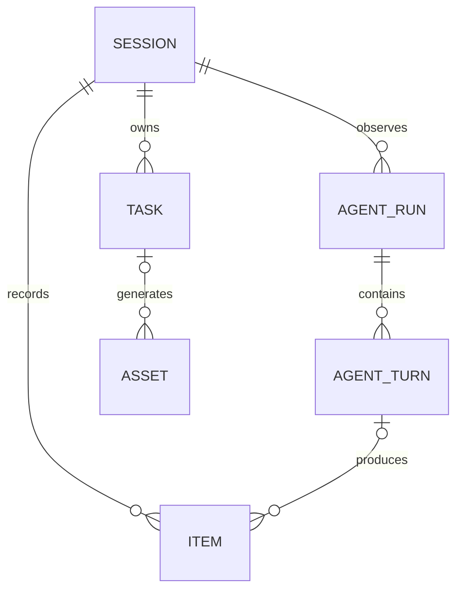

# Session, Run, Turn, and Item Storage Design

Original proposal: 2026-10-09

Revised design: 2026-10-12

Status: Java backend and Python agent implementation added on 2026-10-12. The fresh-schema baseline is separate from historical migrations; no existing database has been reset. See the [active v2 contract](../../api-contract-v2.md) and repository READMEs for activation and verification limits.

## 1. Basis and storage ownership

This proposal follows the [revised pre-schema audit](2026-10-09-session-run-turn-item-design-audit.md). Session manages the conversation; inputs exist independently; Run and Turn organize Agent execution and output. Python decides execution lifecycle. Java persists accepted inputs and observed execution facts.

Python creates and ends Runs and Turns, generates their stable IDs and source ordering fields, selects context, and owns recovery. It does not ask Java to approve a Run's completion or successor. Java accepts Session inputs, Tasks and Assets, publishes reliable input/control events, stores Python facts, and serves frontend projections. Java's observed state may lag and does not schedule execution.

The Java database target remains MySQL 8.4/InnoDB. Python retains the existing single-process, exclusively owned local SQLite store and adds a persistent LangGraph checkpointer. The agent integrates native LangGraph StateGraph and AsyncSqliteSaver with synchronous checkpoint durability; model execution remains an injectable adapter. Redis is not required for correctness. Distributed Python takeover, branching, input editing/withdrawal, and Task retries remain outside this version. Existing development history does not need preservation.

The recommended storage approach remains relational identity/state fields plus named JSON variants. Input content has one business copy in `item.payload`; no `session_input` table is introduced. Inbox, Outbox, and canonical event records have separate receipt, delivery, and recovery responsibilities and may retain their transport snapshots. Known business payloads require explicit named types in Java and Python.

Java may immediately persist and display out-of-order facts. Complete source snapshots update their own entity independently; source revisions prevent stale overwrite. Missing text deltas only hold back assembly of the affected Item. Repair remains available without making one global event gap block every later display update.

## 2. Relationships and identity



Input Items always have null `run_id` and `turn_id`, including after context incorporation. Every Agent Item has both fields, including assistant text, commentary, reasoning summaries, tool calls, tool results, and the final answer. Classification uses source and kind: a TOOL_RESULT remains an AGENT Item. No Item role is stored; Python constructs provider-specific roles and call/result structures at its model adapter boundary. The Run, Turn, Item, Session, and owner identities must agree.

Java creates input Item IDs. Python creates Run, Turn, and Agent Item IDs. Java materializes those execution identities from facts; it does not pre-register them through HTTP before execution. Python's checkpoint alone owns input incorporation and execution progress. Java has no required first-consumption association.

Stopping is a Session control, with no caller-specified Run. Python completes the already-started Turn, ends the stopped Run, and retains pending inputs. A new user input received after stop triggers a new Run after that Turn finishes; it never overrides the stop or reopens the old Run. Task terminal notifications retain their confirmed automatic-wake behavior.

### Common column conventions

- `UUID`: `CHAR(36) CHARACTER SET ascii COLLATE ascii_bin`; FK definitions match exactly.
- `HASH`: `CHAR(64) CHARACTER SET ascii COLLATE ascii_bin`, containing a canonical SHA-256 digest.
- `TIME`: `DATETIME(6)` in UTC, with explicit application/connection conventions.
- Nonnegative `BIGINT` counters begin at zero; allocated ordering fields begin at one.
- Business enums use bounded `VARCHAR` with explicit value and nullability checks.
- Source error_code is limited to 64 characters. Source error_message and GenerationError.message must fit 65,535 UTF-8 bytes for TEXT storage; oversized input is rejected with its original envelope retained, never silently truncated.
- Complete v2 UTF-8 envelopes have a 31 MiB budget; new topics and Java/Python clients use 32 MiB record/request/partition-fetch capacity and 64 MiB aggregate fetch. Existing topics require matching configuration. Java rejects oversized submissions before acceptance commits; Python retains an oversized response receipt/intent and blocks materialization before tools, without dropping or reinvoking it. Provider adapters must honor this complete-fact budget; changing it requires coordinated budget/broker/client limits.
- `created_at` and `updated_at` are Java/local record timestamps. Python execution timestamps are separate facts; receipt time must not be substituted for them.
- Java `version BIGINT NOT NULL DEFAULT 1` is local concurrency metadata. Python `source_revision` is the version of a complete source entity snapshot and is not an ORM version or an ordering index.
- For Agent projections, source_revision=0 identifies an identity-only shell; unknown status/content remain null. Positive revisions require validated complete snapshots. Run, Turn, and Item have no source_hash. Equal revisions compare original source fields. A PARTIAL Item's original payload is the required empty array, so reconstruct that source view while preserving its temporary fragment array; terminal/nonstreaming Items compare stored full payload directly. An accepted input is complete and has source_revision=0.
- Owner/Session-scoped business FKs remain. Out-of-order entity references carry actual source identities/indices and may establish identity-only parent records. No fabricated lifecycle state or cascading business deletion is introduced.
- Nullable shape checks explicitly use `IS NULL`/`IS NOT NULL`; a CHECK evaluating to unknown cannot substitute for required-field validation.

### Independent ordering and revision fields

| Field | Owner and purpose |
| --- | --- |
| `agent_run.run_index` | Python; stable Run order within a Session |
| `agent_turn.turn_index` | Python; stable Turn order within a Run |
| `item.item_index` | Python; stable Agent Item order within a Turn; null for inputs |
| `item.sequence_no` | Java; immutable first-registration position within a Session, used for pagination and timeline segment boundaries; not Python execution order |
| `item.input_sequence_no` | Java; consecutive input order and read-only repair cursor; null for Agent output |
| `run_event.sequence_no` | Python; Session-wide canonical execution-event order, including across Runs; gap/replay information, not a global display barrier |
| `source_revision` | Python; independent complete-snapshot revision for each Run, Turn, or Agent Item |
| `command.ordinal` | Python local Inbox; first durable admission order for inputs and controls, including stop/wake ordering |
| `session_event.sequence_no` | Java; frontend SSE replay order |
| Kafka partition/offset | Broker; physical receipt coordinates |

The default Session timeline uses Java Item registration positions to interleave independent inputs and Agent output. Adjacent Agent entries from the same Run form a presentation segment; a USER/SYSTEM input or another Run separates segments. If M2 arrives during R1, newly registered R1 output after M2 appears after M2 in another R1 segment. Updates to an existing streamed Item keep that Item's original position. A segment is derived presentation state, with no segment table and no input-to-Run/Turn consumption association.

Within a segment, use `turn_index` and `item_index`; Run metadata uses `run_index`. Late data may reorder output inside its registration-derived segment, but cannot move it across an independent input boundary. Shell registration preserves the same position when content becomes available. The API exposes both ordering domains and does not claim a single Python/Java causal clock or infer which input a Turn consumed. Missing entities may leave source-index gaps. Its SSE cursor remains based on Java notification publication, independently of source order.

Input content enters model context in ascending `input_sequence_no`, with known gaps repaired before freezing the next batch. The separate Inbox `ordinal` orders control and wake decisions: a repaired input retains an existing admission ordinal, or receives its first ordinal when newly admitted. It does not retroactively change a stop's effect. This preserves input order without making Java decide execution boundaries.

### Complete database inventory and review boundaries

This comparison covers every pre-refactor Java/Python application table, including retained and removed tables. It describes repository declarations rather than an inspected running database. Historical V1 creates twelve Java tables and V2 adds five version columns. The implemented fresh baseline also has twelve tables, with message/run_input replaced by item/agent_turn. Section 12 retains the complete old declarations for review and links the active implementation.

| Pre-refactor Java table | Target disposition | Responsibility / target definition |
| --- | --- | --- |
| `user` | Retain all columns | Local ownership; section 5.6 |
| `http_request` | Retain all columns; extend message-send use | HTTP idempotency and original response; section 5.5 |
| `session` | Revise | Conversation identity and Item registration; section 3.1 |
| `agent_run` | Revise | Python lifecycle projection; section 3.2 |
| `message` | Replace with item | Unified input/output records; section 3.4; current structure in section 12 |
| `run_input` | Remove | Old Java input-claim association; current structure in section 12 |
| `run_event` | Revise ordering/routing | Session-wide immutable execution journal; section 5.1 |
| `task` | Revise | Session-owned generation business state; section 4.1 |
| `asset` | Retain columns; strengthen shape checks | Durable uploaded/generated objects; section 4.2 |
| `outbox_event` | Retain all columns | Reliable Java publication; section 5.2 |
| `inbox_event` | Retain all columns | Durable technical receipt/conflict processing; section 5.3 |
| `session_event` | Retain all columns; revise allocation | Frontend SSE notification/replay; section 5.4 |
| No current table | Add agent_turn | Python Turn projection; section 3.3 |

| Pre-refactor Python Agent table | Target disposition | Responsibility / target definition |
| --- | --- | --- |
| `command` | Revise | Logical Session input/control Inbox; section 7.1 |
| `receipt` | Revise | Physical Kafka receipt; section 7.2 |
| `run` | Simplify | Local stable Run registration; section 7.3 |
| `event` | Revise ordering/routing | Canonical Session execution facts; section 7.4 |
| `publication` | Revise | Ordered publication and explicit replay; section 7.5 |
| No current table | Add session_event_counter | Canonical Session event allocation; section 7.4 |
| No current table | Add execution_receipt | External model/tool outcome reconciliation; section 7.6 |

The pre-refactor Agent had five application tables; the implemented AgentStore has seven. Section 12 retains the complete old inline schema. SQLite sqlite_sequence and MySQL flyway_schema_history remain framework/database metadata. Native LangGraph checkpoints/writes are now integrated as a separate framework-owned store, described in section 7.7; their schema is initialized by the saver rather than copied into Lux DDL.

The other two Lux modules currently declare no application database tables: lux-python-utils is a utility scaffold, and lux-python-model-connector is a connector scaffold. The latter has a separate design-only proposal for generation_execution and outbox_event in its model-connector design; those names belong to its independent store and do not refer to Java's outbox_event. They are not created by this storage revision. See the module source/design links in section 12.

Only the confirmed simplifications and previously approved schema changes are proposed here. Listing an existing table does not authorize changing its business behavior. Item retains its independent source_revision; Session event ordering does not replace it. Item source_hash, input_schema_version, input_occurred_at, and last_included_delta_sequence_no are removed. Original input metadata remains in the retained Outbox envelope, and temporary stream progress is derived from the strict fragment-array shape below.

## 3. Java conversation tables

Java stores Session inputs and projects Python's execution facts. Python creates Run/Turn identities and indexes, decides execution and cancellation, and may start another Run before Java has observed the previous Run's terminal fact. Java does not approve completion, allocate execution slots, schedule Runs, or bind inputs to the Turn that consumed them.

### 3.1 `session`

| Column | Type / nullability | Meaning |
| --- | --- | --- |
| `id` | UUID, PK | Conversation identity |
| `user_id` | UUID, required | Resource owner |
| `title` | `VARCHAR(255)`, required | Display title |
| `next_item_seq` | `BIGINT`, required, default 0 | Last allocated Java Item registration position; replaces current next_message_seq |
| `version`, `created_at`, `updated_at` | Common fields | Local mutation coordination and timestamps |

Constraints/indexes:

- `UNIQUE(user_id, id)`; owner FK to `user`.
- Listing index `(user_id, created_at, id)`.
- `next_item_seq` is nonnegative. Item registration uses the Session mutation transaction. SSE sequence allocation uses the Session row lock and existing `session_event` records as defined in section 5; no SSE counter is stored on Session.
- Remove `next_event_seq`, `active_run_id`, its FK, `accepted_input_seq`, `incorporated_input_seq`, `pending_wake`, `queue_paused`, `next_message_seq`, and `task_update_seq`. Do not replace them with another execution slot or input-consumption watermark.

The highest observed `agent_run.run_index` identifies the most recent observed Run. Its state may be unknown or stale; this is not a statement that Java knows Python's current execution state.

### 3.2 `agent_run`

| Column | Type / nullability | Meaning |
| --- | --- | --- |
| `id` | UUID, PK | Python-created stable Run identity |
| `user_id`, `session_id` | UUID, required | Owner and conversation |
| `run_index` | `BIGINT`, required | Python-assigned Session-local Run index, starting at one |
| `source_revision` | `BIGINT`, required, default 0 | Python's complete Run snapshot revision; zero identifies an identity shell |
| `status` | `VARCHAR(24)`, nullable | Python lifecycle state; null until a complete snapshot is observed |
| `started_at` | TIME, nullable | Python-reported execution start time |
| `finished_at` | TIME, nullable | Python-reported terminal time |
| `final_item_id` | UUID, nullable | Python-selected final assistant Item, if any |
| `error_code` | `VARCHAR(64)`, nullable | Named failure classification |
| `error_message` | `TEXT`, nullable | Diagnostic detail |
| `last_seen_at` | TIME, required | Java receipt time of the latest valid Run identity/snapshot observation; not an execution decision |
| `version`, `created_at`, `updated_at` | Common fields | Java row concurrency and local registration timestamps |

Statuses: `RUNNING`, `COMPLETED`, `FAILED`, `CANCELLED`.

| Status | Meaning |
| --- | --- |
| `RUNNING` | Python has created the Run and has not finalized it; includes preparation, Turn execution, stop handling, and recovery blocking |
| `COMPLETED` | Python has normally finalized the Run and selected its final assistant Item |
| `FAILED` | Python has confirmed that execution cannot continue and finalized the Run with failure |
| `CANCELLED` | Python has finalized the Run according to the Session-stop rules |

Constraints/indexes:

- `UNIQUE(user_id, id)`, `UNIQUE(user_id, session_id, id)`, and `UNIQUE(session_id, run_index)`; composite Session FK.
- Session display index `(session_id, run_index)`; observation scan `(last_seen_at)`.
- `run_index > 0`; `source_revision >= 0`.
- At revision zero, `status`, lifecycle times, final Item, and failure fields are null. The shell records only real identity/ordering facts and local receipt metadata.
- At a positive revision, a declared status is required. `finished_at` is present exactly for `COMPLETED`, `FAILED`, or `CANCELLED`.
- A complete `COMPLETED` snapshot requires `final_item_id`. A cancelled or failed Run may have no final answer.
- Python selects `final_item_id` and includes its complete `final_item: AgentItemIdentity` reference in the Run completion snapshot. Java validates ownership, execution association, and the referenced content when available, then persists the reference; it never derives it from the last currently received Item.
- Once a terminal Run snapshot has established its final Item selection, that nullable selection is immutable at every later revision. An identity shell may be filled and the selected Item's content may arrive later; neither permits selecting a different final Item.
- Final Item FK `(user_id, session_id, id, final_item_id)` references `item(user_id, session_id, run_id, id)` after Item creation. A full final Item identity may create a revision-zero Item shell first. Validate AGENT source, MESSAGE kind, and complete status when its snapshot is available; absence of that content does not block the Run snapshot.
- Remove `active_session_guard` and its nonterminal unique constraint. Remove Java's required-input boundary, context boundary, cancellation cutoff, close boundary, and close-decision fields.

Python owns the lifecycle. RUNNING means not finalized, not that a model call is currently in flight. Preparation, stop intent, input waiting, and recovery blocking are explicit Python checkpoint phases/control effects rather than additional Run statuses. A new Run's first complete snapshot is RUNNING; an identity shell remains null, not an invented lifecycle state. No timeout, process restart, or missing fact proves FAILED or another terminal state. A higher snapshot revision cannot reverse an already observed terminal state. Java may temporarily display more than one observed RUNNING Run because facts arrive out of order; it does not use this observation to permit or prevent execution.

### 3.3 `agent_turn`

| Column | Type / nullability | Meaning |
| --- | --- | --- |
| `id` | UUID, PK | Python-created stable Turn identity |
| `user_id`, `session_id`, `run_id` | UUID, required | Owner, conversation, and source Run |
| `turn_index` | `BIGINT`, required | Python-assigned Run-local index, starting at one |
| `source_revision` | `BIGINT`, required, default 0 | Python's complete Turn snapshot revision; zero identifies an identity shell |
| `status` | `VARCHAR(24)`, nullable | `PREPARED`, `RUNNING`, `INTERRUPTED`, `COMPLETED`, `FAILED`, `CANCELLED`; null for a shell |
| `started_at` | TIME, nullable | Python-reported model invocation start time |
| `finished_at` | TIME, nullable | Python-reported Turn completion, failure, or pre-start cancellation time |
| `error_code`, `error_message` | Same types as Run, nullable | Failure/reconciliation detail |
| `version`, `created_at`, `updated_at` | Common fields | Java row concurrency and local registration timestamps |

Constraints/indexes:

- `UNIQUE(run_id, turn_index)` and `UNIQUE(user_id, session_id, run_id, id)`; composite Run FK.
- `turn_index > 0`; `source_revision >= 0`.
- At revision zero, `status`, lifecycle times, and failure fields are null. The parent Run may itself be a revision-zero shell built from a real RunIdentity.
- At a positive revision, a declared status is required. `finished_at` is present exactly for `COMPLETED`, `FAILED`, or `CANCELLED`.
- `CANCELLED` applies only before invocation (`started_at IS NULL`). Python completes an already started Turn normally or reports its failure before stopping the Run.
- Remove `active_run_guard` and its unfinished-Turn unique constraint. Java does not store Turn input-consumption boundaries or first-consumption bindings.

A Turn contains one model invocation, its corresponding tools, and post-processing. Its full snapshot is independent of the parent Run's snapshot revision. A terminal Run does not prevent Java from accepting a previously missing or newer snapshot for one of its Turns.

### 3.4 `item`

| Column | Type / nullability | Meaning |
| --- | --- | --- |
| `id` | UUID, PK | Stable input/output identity |
| `user_id`, `session_id` | UUID, required | Owner and conversation |
| `sequence_no` | `BIGINT`, required | Immutable first Java registration position; pagination and timeline segment boundaries, not Python execution order |
| `source` | `VARCHAR(16)`, required | `USER`, `AGENT`, or `SYSTEM`; USER/SYSTEM are Session inputs, AGENT is execution output |
| `kind` | `VARCHAR(32)`, nullable | `MESSAGE`, `REASONING_SUMMARY`, `TOOL_CALL`, `TOOL_RESULT`, `TASK_EVENT`; may be unknown for an Agent shell |
| `run_id`, `turn_id` | UUID, nullable | Source execution; both required for every AGENT Item and both always null for every input Item |
| `item_index` | `BIGINT`, nullable | Python-assigned Turn-local Item index, starting at one; required for AGENT Items only |
| `source_revision` | `BIGINT`, required, default 0 | Python's complete Agent Item snapshot revision; zero for a shell and for Java-owned inputs |
| `input_sequence_no` | `BIGINT`, nullable | Consecutive Session input position; input Items only |
| `status` | `VARCHAR(16)`, nullable | `PARTIAL`, `COMPLETED`, `INTERRUPTED`; null only for an Agent shell |
| `call_id` | `VARCHAR(255)`, nullable, case-sensitive | Original model-protocol call identity shared by TOOL_CALL and its TOOL_RESULT |
| `tool_name` | `VARCHAR(255)`, nullable | Tool name on TOOL_CALL only |
| `task_id` | UUID, nullable | Terminal Task identity on TASK_EVENT only |
| `payload` | JSON, nullable | Named content variant; required for inputs and positive-revision Agent snapshots, null for identity shells |
| `completed_at` | TIME, nullable | Complete content time; Java acceptance time for inputs, Python snapshot fact for Agent output |
| `version`, `created_at`, `updated_at` | Common fields | Java row concurrency, registration, and projection timestamps |

Constraints/indexes:

- `UNIQUE(session_id, sequence_no)`, `UNIQUE(user_id, id)`, `UNIQUE(user_id, session_id, id)`, `UNIQUE(user_id, session_id, run_id, id)`, and `UNIQUE(user_id, session_id, run_id, turn_id, id)` for reference targets.
- `UNIQUE(turn_id, item_index)` preserves Python's Item order. Inputs leave both columns null. Source indexes order Agent children within a presentation segment; `sequence_no` supplies Java registration order, segment boundaries, and stable pagination.
- `UNIQUE(turn_id, kind, call_id)` permits one TOOL_CALL and one TOOL_RESULT for each actual call. Both kinds require a nonempty call ID; all other kinds leave it null. Call identity comparisons and the unique key are case-sensitive. HTTP input request uniqueness belongs to http_request, not Item.
- `UNIQUE(session_id, input_sequence_no)` supports input recovery pagination. Each immutable input has exactly one InputAccepted event, whose event ID equals the Item's primary key; no additional input-event identity column or unique key is needed.
- `UNIQUE(user_id, task_id)` provides one terminal Task notification. Task IDs inside historical tool-result payloads do not populate this column.
- Session FK; composite Agent execution FK `(user_id, session_id, run_id, turn_id)` to `agent_turn(user_id, session_id, run_id, id)`.
- Correlate TOOL_RESULT with the actual TOOL_CALL by the same owner/Session/Run/Turn and exact call ID. There is no result-to-call Item FK. Persist and display an otherwise admissible result even when its call has not arrived; validate the pair when the call arrives and during restart/synchronization repair by querying retained Items. The unresolved relation must not depend on an in-memory marker. A call ID alone cannot create an invented call Item identity or shell. Derive the tool name from the matched call when available.
- Task FK `(user_id, session_id, task_id)` to `task(user_id, session_id, id)`.
- CHECK source is USER/AGENT/SYSTEM. A known kind is one of MESSAGE/REASONING_SUMMARY/TOOL_CALL/TOOL_RESULT/TASK_EVENT; only an AGENT identity shell may have null kind. Valid source/kind pairs follow the table below.
- sequence_no > 0; source_revision >= 0. AGENT Items require positive item_index; input_sequence_no is positive when present.
- Remove role, message_phase, call_item_id and its self-FK, client_request_id, request_hash, input_event_id, input_event_hash, the Item's operation_id, source_hash, input_schema_version, input_occurred_at, last_included_delta_sequence_no, producer_run_id, producer_turn_id, all consumed_* fields, and incorporated_at. The only Run/Turn relationship on Item is its source execution. Do not relocate the removed hash, input metadata, or stream counter into Item.payload.

Input/output classification is determined by source and kind. The source enum is exactly USER/AGENT/SYSTEM, and no role exists in Item, accepted-input content, or Agent snapshots. A TOOL_RESULT remains an AGENT output with non-null Run/Turn. USER and SYSTEM inputs keep both execution fields null permanently. Source is immutable; an input cannot be promoted to an Agent output or a user prompt to a system instruction. An Agent shell may acquire its previously unknown kind, but an established kind cannot change at a higher revision. Python alone constructs the appropriate model-protocol role/variant.

Python's explicit Run final_item_id selects the Run's final assistant answer. Item does not separately label a message COMMENTARY or FINAL. Java cannot determine the selected final answer before it observes that Run fact, and it never infers the answer from message arrival order. Removing the phase does not delay streaming display of assistant messages.

At revision zero, an AGENT shell requires its real identity, owner/Session, Run/Turn, and Item index. Its status, payload, and completed_at are null; unknown subtype fields may remain null. The shell is an unresolved reference, not a fabricated message or lifecycle fact. Its input_sequence_no is null. Skip checks that depend on an unknown subtype until a complete snapshot arrives.

At a positive Agent revision, kind, status, and payload are required. Complete inputs and positive-revision Agent snapshots enforce the following shapes:

| Kind/source | Required shape / named payload |
| --- | --- |
| MESSAGE / USER | OrderedContent; input_sequence_no present; Run/Turn/index, call, and task fields absent; COMPLETED |
| MESSAGE / SYSTEM | OrderedContent; input_sequence_no present; Run/Turn/index, call, and task fields absent; COMPLETED |
| MESSAGE / AGENT | OrderedContent; Run/Turn/index present; input_sequence_no, call, and task fields absent |
| REASONING_SUMMARY / AGENT | OrderedContent; Run/Turn/index present; input_sequence_no, call, and task fields absent |
| TOOL_CALL / AGENT | ToolCallContent named argument variant; Run/Turn/index, call ID and tool name present; input_sequence_no and task fields absent; COMPLETED |
| TOOL_RESULT / AGENT | ToolResultContent named outcome variant; Run/Turn/index and original call ID present; tool name, input_sequence_no, and task fields absent; COMPLETED |
| TASK_EVENT / SYSTEM | TaskEventContent containing only task_id; task ID and input_sequence_no present; Run/Turn/index and call fields absent; COMPLETED |

Every USER/SYSTEM input has input_sequence_no, complete non-null content, and source_revision=0. Its InputAccepted.event_id equals its id; the original event metadata is retained only in its Outbox envelope. Every AGENT Item has null input_sequence_no. For known content, completed_at is present exactly when status is COMPLETED. Only AGENT MESSAGE and REASONING_SUMMARY support text deltas; tool calls/results have no stream counter or coverage field.

For the current single-Task submit_generation tool, operation_id equals the original TOOL_CALL Item.id. Python persists that Item identity and its execution binding before any submission request and reuses it during recovery or uncertain-outcome reconciliation. Item and AgentItemSnapshot carry no separate operation_id field; Task, execution_receipt, and the named submission request retain their operation_id fields with the same UUID value. Java does not require the call Item to have arrived and does not add an Item FK to Task. One call submitting multiple Tasks or multiple independent side effects is outside this contract. Model call_id remains a separate protocol correlation identity.

#### Snapshot and streaming projection rules

Run, Turn, and Agent Item revisions are independent Python-owned counters. Python persists a revision with changed source state before exposing it; retransmission/recovery do not increment unchanged snapshots. A higher revision replaces projected source fields only after shape/lifecycle validation. Equal revisions compare original source fields directly: identical content is idempotent, different content is a protocol conflict. No entity stores a source snapshot hash. Older snapshots remain journaled without overwriting newer projections; immutable identity/index/ownership mismatches are conflicts at every revision. An observed terminal state cannot return to a nonterminal state or another terminal outcome.

For an Item, compare its real identity/parent indices, source, kind, status, payload, completed_at, call_id, and tool_name, excluding Java sequence/version/timestamps and outer transport metadata. Terminal and nonstreaming payloads are immutable, so use the stored full payload. First validate an incoming PARTIAL source snapshot as MESSAGE/REASONING_SUMMARY with source_revision=1, blocks=[], and completed_at null; later PARTIAL versions or nonempty PARTIAL source snapshots are invalid. To compare that initial revision after Java has appended fragments, reconstruct the current row's original AgentItemSnapshot with payload.blocks=[] and all other stored source fields unchanged. Do not normalize an invalid incoming nonempty payload into an accepted empty one. Equal initial snapshots leave the actual temporary array intact. The strict shape makes this comparison deterministic without a stored hash or a mandatory journal lookup. Source-sync snapshots use the same rules; Java temporary projections are not Python source snapshots.

Run comparison covers `RunIdentity`, `status`, `started_at`, `finished_at`, `error_code`, `error_message`, and the nullable complete `final_item: AgentItemIdentity`. Turn comparison covers complete `TurnIdentity`, `status`, `started_at`, `finished_at`, `error_code`, and `error_message`. Identity references recursively compare their real IDs and source indexes, not the referenced entities' later status, content, or revision. Exclude Java `last_seen_at`, `version`, `created_at`, `updated_at`, outer delivery `event_id`, `event_seq`, `occurred_at`, and Inbox/SSE metadata. Enclosing owner/Session and immutable identities/indexes are validated at every revision. No Run/Turn snapshot hash is required.

MESSAGE and REASONING_SUMMARY share OrderedContent, an ordered array of TextBlock and AssetReferenceBlock. Both kinds may reference uploaded or generated Assets belonging to the owner. A block has no id or independent ordering field; array order is display order. Asset references retain real asset_id and ownership/existence validation. Reasoning summaries contain only exposed summary content, not private model reasoning.

Before invocation, Python checkpoints candidate Item bindings; only an actually observed Item may publish its initial snapshot. The ordered emitter commits and publishes the one initial PARTIAL AgentItemSnapshot before that Item's first text delta, with source AGENT, source_revision=1, and OrderedContent.blocks=[]. Unused candidates are not published, synchronized, or displayed. The empty array is required, not an optional example. During PARTIAL, each consecutive ItemTextDelta appends exactly one TextBlock at the temporary array tail. Neither persistence nor frontend state may merge, remove, reorder, or insert other blocks, add Asset blocks, or install another full PARTIAL payload. Rendering may concatenate the blocks visually while preserving their stored boundaries. Deltas do not change source_revision; Java increments its local version when temporary payload changes.

Consequently, a PARTIAL Item's persisted blocks.length is exactly its contiguous applied stream_seq N. Derive the next sequence as N+1 instead of storing another counter. An event at or below N is already represented; an event above N+1 is retained in the canonical journal until the gap is filled. Once N+1 is available, append it and any newly consecutive buffered fragments under the existing Item/Session mutation transaction, with their SSE records and Inbox application markers. Never infer progress from the highest received sequence. Restart derives N from the same persisted array and drains retained journal fragments; no memory-only cursor or extra table is needed. The original initial snapshot establishes kind/routing; an identity shell cannot manufacture content. A duplicate initial snapshot cannot reset an already extended array.

Each newly applied consecutive delta commits the temporary Item payload and a Session SSE record carrying ItemTextDelta in the same Java transaction. The frontend performs the same ordered tail append without waiting for model, Turn, or Run completion, deriving N from its PARTIAL array length. Duplicate deltas do not append or notify twice; buffered gaps publish when applicable. Preserve fragment text exactly, including spaces and newlines. Only text is streamed through this path; Assets and final segmentation arrive in the full terminal payload. Item status PARTIAL marks the temporary representation; no partial flag, hash, or stream counter is added to blocks/payload.

When hydrating or refreshing the frontend, a Java PARTIAL projection carries the persisted temporary blocks; its length derives N. A refresh must not overwrite a newer local prefix with a shorter stale one at the same source_revision. Accept only a longer matching prefix, buffer a higher delta until its prefix is known, and diagnose divergent prefixes. A Python source-sync initial PARTIAL snapshot is always empty and remains an idempotent source observation, not an instruction to clear rendered text. A higher-revision terminal replacement takes precedence over any in-flight PARTIAL refresh. SSE replay uses its normal Session cursor together with this Item-local prefix rule.

#### Full model response and final payload replacement

After normal model response completion, Python drains all fragment writes and durably saves the entire original response with its stable Item bindings in execution_receipt. It then checkpoints the finalized per-Item snapshots and a stable ModelResponseCompleted outbound intent, and reliably materializes that event through the canonical event/Outbox transaction. It carries the original model_execution_id, Turn identity, and complete snapshots of every model-produced Item ordered by item_index. Each snapshot contains the original Item identity, source AGENT, kind, final payload, COMPLETED status/time, and increased source_revision; it carries no snapshot hash or included-delta boundary. Tool results produced afterward remain separate Items/facts. Completion does not create an extra display Item, change a Turn/Run status, or select Run.final_item_id.

Java journals the event even if deltas are missing. It validates common response/Turn ownership and every Item binding before mutation, then applies each snapshot by its revision and original-source-content rules. Replace each newly accepted Item's entire temporary payload, save COMPLETED, and append ItemContentReplaced carrying the full snapshot in the same projection transaction. Do not append final response text to the fragment array. All applicable members/SSE commit together; stale or equal/identical members are skipped. A true identity/content conflict rejects the bundle projection with diagnostics. Real parent identities establish missing shells without waiting for earlier lifecycle events. No new response table or per-Item journal event is required.

The frontend upserts the same Item and atomically replaces payload, status, and source_revision without a second answer. Equal revision/content is idempotent; an old revision cannot replace a newer Item. After a terminal snapshot, all late deltas remain journaled but cannot change final content, regardless of stream_seq. The frontend likewise ignores every post-terminal delta and stale refresh/replacement during SSE replay. A full final payload repairs missing fragments by replacing them altogether. Terminal arrays can have any valid text/Asset segmentation; their length is never interpreted as a stream position.

A response may finish with messages, exposed summaries, and TOOL_CALL Items while its tools and post-processing remain pending. ModelResponseCompleted establishes full model output, not Turn or Run completion. Python emits their lifecycle snapshots only at their respective boundaries; Run.final_item_id still selects the whole Run's final answer explicitly.

| Event for one Item | Visible OrderedContent.blocks | Source revision / status |
| --- | --- | --- |
| Initial snapshot | Empty array; derived N=0 | 1 / PARTIAL |
| Delta 1: Hello | TextBlock("Hello"); derived N=1 | 1 / PARTIAL |
| Delta 2: space plus world | TextBlock("Hello"), TextBlock(" world"); derived N=2 | 1 / PARTIAL |
| Full response snapshot | TextBlock("Hello world"), AssetReferenceBlock(A1), in final array order; no stream position | 2 / COMPLETED |
| Repeated completion or any late delta | Same final array | 2 / COMPLETED |

The same rules apply to a REASONING_SUMMARY Item. A1 references an already durable uploaded/generated Asset. Final blocks may combine fragments or include Asset references that never appeared in the temporary streaming array.

A full COMPLETED or INTERRUPTED snapshot replaces temporary content over any delta gap and seals the Item. Nonempty or newer replacement PARTIAL snapshots are outside this stream contract. Late deltas remain journaled but never append to terminal content. Completed call arguments/results are immutable; known call ID, tool name, and original bindings cannot change. Submission operation identity remains derived from the original call Item ID. A terminal parent Run/Turn does not suppress an independently valid late Item snapshot or missing content.

An external outcome still awaiting reconciliation keeps the affected Item PARTIAL. Its Run remains RUNNING with a checkpointed recovery-blocked phase, while its Turn may be INTERRUPTED. Emit terminal Item INTERRUPTED only after confirming that no original response can still complete that Item; UNKNOWN alone does not establish that finality.

For references whose parent is missing, a complete RunIdentity/TurnIdentity/AgentItemIdentity may create revision-zero shells within the projection transaction. If identity or required ordering information is absent, keep only that entity pending and request synchronization; unrelated projections continue. Shell registration assigns `sequence_no` once and later snapshots reuse the same Item. The UI may show unknown parent state or an unresolved reference, but must not invent shell content/status.

### 3.5 Input acceptance and replay in `item`

The input subset of item is the ordered business input log. Business input content is stored in item.payload; original transport metadata lives in the already existing outbox_event.envelope, not in Item columns. No session_input, run_input, claim table, first-consumption binding, or Java incorporation watermark is introduced.

In a Session input-acceptance transaction, first acquire the Session row lock shared by all input/SSE writers. Read the latest input position with a current/locking read of the Session's input index, for example `ORDER BY input_sequence_no DESC LIMIT 1 FOR UPDATE` restricted to non-null input positions, and allocate its successor; an empty input log starts at one. Do not allocate from an unlocked or earlier snapshot maximum. Allocate the Java Item/SSE positions, save immutable content and event identity, and append the original InputAccepted Outbox snapshot in that same transaction. Request idempotency prevents repeated allocation. Task terminal notifications use the same input pipeline; the first terminal Task transition and its unique TASK_EVENT/input/Outbox/SSE records commit together. Neither operation creates or selects a Run.

HTTP message sends use the existing http_request table and idempotency component. Map the frontend client_request_id to http_request.request_id within the owner scope. Its request digest covers the operation/route, target Session, and original named request content. The HTTP receipt, accepted input Item, Outbox, SSE, and saved InputAcceptanceResponse commit in one local transaction. An identical retry returns the original response without allocating a new Item, input position, event, or SSE record; reusing the key with changed scope/content is a conflict. The response does not select or report a Java-created Run. Item stores neither the request key nor its digest.

Input sequence, identity/type fields, and content are immutable after acceptance. The original Outbox envelope is immutable as well; only its technical delivery state changes. Input Items' Run/Turn fields remain null even after Python uses the input. Python checkpoint/Inbox state records consumption and decides whether input belongs to another Turn in the same Run or requires a new Run. Java never writes that consumption fact back onto the input Item.

At acceptance, construct InputAccepted once with event_id equal to Item.id and the original protocol schema_version/occurred_at, owner/Session/Item identities, positions, and accepted input variant. Persist the complete original envelope with the input Item in the same transaction. Kafka redelivery, HTTP retry, and repair reuse this envelope and identity. Exclude mutable Java version/updated_at and execution/dispatch state. Item stores no input event ID/hash, protocol version, or original event time. The wire envelope retains schema_version/occurred_at as transport fields; removing their duplicate Item columns does not delete them from Kafka contracts. Technical Inbox checks compare the original envelope/content or its canonical event_hash. Same identity with different original content remains a conflict. Do not regenerate event metadata, upgrade schema_version, or serialize a latest frontend Item DTO as a replay event. This one-input/one-event identity rule does not apply to mutable Agent Items, whose snapshots and deltas retain independent event IDs.

Retain each InputAccepted Outbox row for the lifetime of the Session's retained input history, including after delivered_at is set. Repair selects input Items by input_sequence_no, joins outbox_event.event_id = item.id within the same owner/Session, and returns the saved original typed envelope. Validate that it agrees with the immutable input Item. Missing or conflicting Outbox evidence is a repair-integrity error, not permission to synthesize a replacement event. This baseline does not clean up these input Outbox rows; any future cleanup must preserve equivalent original envelopes before deletion. The Outbox remains transport evidence rather than a second authoritative business input table.

HTTP input repair takes after_input_sequence_no, a fixed through_input_sequence_no, and bounded limit, returning retained original Outbox envelopes in ascending Item input order. Obtain the repair high-water mark from the Item index, not a new Session accepted/consumed counter. Exclude output Items, enforce ownership, and never assign a Run or change consumption during repair. Retain the decoders/canonicalization rules for the envelope's original protocol version.

## 4. Java Task and Asset tables

### 4.1 `task`

| Column | Type / nullability | Meaning |
| --- | --- | --- |
| `id` | UUID, PK | Business generation identity |
| `user_id`, `session_id` | UUID, required | Owner and conversation only |
| `operation_id` | UUID, required | Caller submission identity; for submit_generation, equals the original TOOL_CALL Item.id |
| `file_type` | `VARCHAR(16)`, required | IMAGE/VIDEO media category; not a MIME type or filename extension |
| `payload` | JSON, required | Immutable named generation request variant (`ConnectorRequest`) |
| `status` | `VARCHAR(24)`, required | CREATED/SUBMITTED/RUNNING/IMPORTING/SUCCEEDED/FAILED |
| `provider_event_seq` | `BIGINT`, required, default 0 | Accepted connector lifecycle progress |
| `result_sources` | JSON, nullable | Ordered `ResultSourceManifest` for importing complete connector output; fixed once accepted |
| `error_stage` | `VARCHAR(16)`, nullable | GENERATION/IMPORT for FAILED |
| `error_code` | `VARCHAR(64)`, nullable | Classified failure |
| `error_message` | `TEXT`, nullable | Diagnostic detail |
| `finished_at` | TIME, nullable | Immutable terminal transition time |
| `version`, `created_at`, `updated_at` | Common fields | Concurrency and snapshots |

Constraints/indexes:

- `UNIQUE(user_id, id)`, `UNIQUE(user_id, session_id, id)`, and `UNIQUE(user_id, operation_id)`.
- Composite Session FK; index `(user_id, session_id, created_at, id)`.
- Unfinished-generation scan `(status, updated_at, id)`; interrupted result import recovers through uncommitted Kafka records, with no import scan index or lease.
- Terminal status iff `finished_at` is present; FAILED requires `error_stage`; SUCCEEDED has no failure fields.
- Remove `origin_run_id`, `tool_call_id`, their FK/unique key, `request_hash`, `provider_task_id`, `last_seen_at`, `last_reconcile_at`, `import_lease_until`, `import_attempts`, and retry-oriented `next_import_at`.

Task file_type/payload map to the existing named submission arguments and connector wire fields kind/request. This is a target storage rename; it does not silently rename the current v1 tool or connector protocol. Provider task IDs, submission receipts, polling, and uncertain provider-outcome reconciliation belong to the model connector. Java stores its own Task identity and accepts connector observations using provider_event_seq, which denotes the connector's per-business-Task sequence rather than a native provider counter. No provider ID is required in Java's Task or new business event contract.

ResultSourceManifest is an internal import handoff, not the final Asset list: each ordered ResultSource contains url, filename, and media_type. The connector supplies a complete, durable/recoverable output manifest. Java saves it before importing and uses each array position as Asset.source_index. After a crash, the manifest identifies every expected output, while verified Asset metadata/bytes identify which outputs are already stored. Keep the accepted manifest immutable; duplicate identical manifests are idempotent and changed sources/order are protocol conflicts. Queries expose verified Asset references rather than source URLs. This target retains result_sources; removing its Task column would require an explicitly retained equivalent manifest and recovery lookup in the technical Inbox.

Existing read-only connector status/replay repair may inspect pre-result CREATED/SUBMITTED/RUNNING Tasks by status and updated_at. It does not process IMPORTING Tasks or recover result downloads. Task has no separate last-observation or last-reconciliation clocks. Concurrent or repeated observations are deduplicated by stable event identity and connector sequence; query timing/throttling belongs to the worker. A query/replay never submits another generation, and a replay without a business change need not update updated_at.

An import worker may recover an interrupted, unconfirmed import operation and reuse verified existing Assets. A recorded generation/import failure ends the Task; there is no FAILED-to-IMPORTING transition, business resubmission, or retry linkage. Outbox redelivery and reconciliation preserve the original operation ID and do not authorize another provider generation.

The Java worker receiving a connector result event downloads/imports before confirming Kafka consumption. There is no predesignated importer, Task import-lease column, or result-import Inbox polling. Kafka redelivery resumes interrupted work through the same processing entry point; section 4.3 defines its processing and commit boundaries.

No terminal-notification pointer is required on Task. `item.task_id` uniqueness plus the Task terminal transaction supplies the notification invariant without creating a Task-to-Item dependency.

The caller's operation identity and Java-created Task identity remain distinct. For an existing owner/operation, directly compare the immutable session_id, file_type, and complete original payload using their defined typed/JSON-value equality; matching values return the original Task and changed values are conflicts. Ignore later Task status, connector progress, import results, version, and timestamps in this comparison. No Task request hash is required; HTTP and execution-receipt digests retain their separate scopes. Concurrent first submissions rely on UNIQUE(user_id, operation_id); after a uniqueness race, compare the winning original Task rather than creating another submission intent. Reusing the call Item UUID as the operation value does not create a Task-to-Item FK or make an Agent fact a prerequisite for Task acceptance. Asset upload operations retain their separate existing caller identities.

### 4.2 `asset`

Retain the existing fields and types; this table has no ORM version or updated_at column.

| Column | Type / nullability | Meaning |
| --- | --- | --- |
| `id` | UUID, PK | Durable Asset identity |
| `user_id` | UUID, required | Resource owner |
| `task_id` | UUID, nullable | Generating Task; null for uploads |
| `source_index` | `INT`, nullable | Stable zero-based result-source position within a Task |
| `operation_id` | UUID, nullable | Existing caller upload identity; not a generation call identity |
| `filename` | `VARCHAR(255)`, required | Original or declared filename |
| `media_type` | `VARCHAR(128)`, required | Validated media type |
| `size_bytes` | `BIGINT`, required | Verified stored byte count |
| `sha256` | `CHAR(64) CHARACTER SET ascii`, required | Digest of stored bytes; retains the existing column declaration |
| `created_at` | TIME, required, default current time | Java persistence time |

Retain owner/task FKs, `UNIQUE(user_id, id)`, `UNIQUE(user_id, operation_id)`, and `UNIQUE(task_id, source_index)`. Add explicit shape checks: generated Assets have Task/source index and no upload operation ID; uploaded Assets have upload operation ID and no Task/source index. Size/source index cannot be negative.

Assets represent validated durable objects only. A failed Task retains any already valid partial Assets. Its status communicates failure; partial assets do not make the Task SUCCEEDED. Existing storage-object key derivation remains owned by the Asset store; no Run/Turn/Item association is added.

### 4.3 Event-triggered result import

The receiving Java worker completes result import and its durable business outcome before acknowledging the Kafka record. Recovery uses Kafka's uncommitted offsets and redelivery, with no separate Task/Inbox import scanner or MySQL named lock. Inbox remains receipt, deduplication, and diagnostic evidence. Workers that may receive redelivery share the Java database and Asset byte store.

1. Use the same generation consumer group and owner/Task partition key. Disable Kafka auto-commit and process records serially within each assigned partition; different partitions may progress concurrently. The initial implementation uses bounded synchronous record processing. Do not dispatch a background download and return success before it finishes.
2. Validate and save the original event identity/content in Inbox without acknowledging Kafka. An identical RECEIVED event resumes processing; duplicate event identity alone is not proof of completion. A compatible APPLIED event or intentionally persisted REJECTED diagnostic can complete consumption without repeating business effects.
3. Validate Task/owner/Session, connector progress, and the complete accepted manifest. In a short transaction save its immutable manifest and IMPORTING state with applicable frontend invalidation, while Inbox remains RECEIVED. Redelivery of this accepted event with matching manifest resumes IMPORTING even though its connector sequence was already recorded. A compatible terminal Task completes its pending Inbox marker without downloading, reopening the Task, or publishing another terminal notification.
4. Download outside database transactions and database retry callbacks. Reuse deterministic Task/source_index Asset identities, verify existing bytes/metadata, and save newly verified metadata in short transactions. Publish complete generated objects immutably: atomically create an absent final object, or verify/reuse the existing one; conflicting bytes never overwrite it. Use per-attempt temporary files/objects until publication. Duplicate downloads can occur after a crash or rebalance; stable IDs and SQL uniqueness alone do not protect stored object bytes.
5. Once every expected Asset is durably verified, commit Task SUCCEEDED, its single SYSTEM/TASK_EVENT input, frontend notification, Outbox intent, and this Inbox APPLIED together under the Session row lock. A confirmed import failure instead commits FAILED with IMPORT detail and the same notification/APPLIED boundary, retaining valid partial Assets. Use Task version/status conditions and existing uniqueness constraints so competing completions cannot reopen a terminal Task or publish a second notification. No database connection or transaction is held throughout the download.
6. Only after that transaction commits may the listener confirm consumption. Commit only the completed prefix of each partition, never past an unfinished record or to the latest fetched position while work remains. If the database committed but offset commit failed, redelivery reuses the recorded outcome. Technical failures or incomplete checks must propagate to Kafka's controlled redelivery path without acknowledgment; recording Inbox retry metadata and returning normally is insufficient. A confirmed business FAILED outcome is completed processing and is acknowledged after persistence; it does not trigger a Task retry.
7. A crash before confirmation leaves the record available for another consumer. Redelivery revalidates the original envelope and resumes its accepted manifest/verified Assets, including the case where Task is IMPORTING and its sequence is already saved. Generic Java Inbox drain excludes generation callbacks, so it cannot start a second import outside Kafka consumption. Existing Java Agent-fact and Python input/control Inbox recovery boundaries remain separate.

Bound the total processing time of a polled batch, including all downloads, validation, and database work, below max.poll.interval.ms with a margin; choose a bounded batch size. Consumer heartbeat alone does not remove this poll requirement. On partition revocation or technical interruption, stop further work and do not classify loss of ownership as a Task failure. Rebalance does not guarantee an old downloader has already stopped, so immutable objects, Task state/version conditions, and notification uniqueness remain necessary. No MySQL session lock or connection reserved across I/O is required. See the [Kafka consumer contract](https://kafka.apache.org/41/javadoc/org/apache/kafka/clients/consumer/KafkaConsumer.html).

Kafka retention must cover the intended recovery window. If required records are no longer available, diagnose and explicitly repair/replay the original connector outcome rather than silently skipping unprocessed offsets. This path provides recoverable, idempotent processing; Kafka offsets, MySQL transactions, and object publication remain separate commits. It does not change Python's single decision-maker/checkpoint boundary.

Classify failures before choosing the Kafka completion path. This baseline does not retry a confirmed Task import failure; recovery of a technically interrupted attempt remains the same operation.

| Observation | Durable outcome / offset rule |
| --- | --- |
| A valid result callback's source GET returns a non-success HTTP status, times out connecting/reading, or yields empty, truncated, oversized, or invalid content | Confirm IMPORT failure, retain valid partial Assets, commit FAILED/notification/APPLIED, then acknowledge; HTTP 5xx does not introduce a Task retry |
| Object publication definitively fails with no possible completed object | Confirm IMPORT failure using the same terminal transaction; never overwrite an existing object |
| Database work has not committed, process/control execution is interrupted, or consumer ownership is lost | No Task terminal decision and no acknowledgment; controlled redelivery resumes the same event and stable Assets |
| Object publication's outcome is uncertain | Verify the original deterministic object and metadata before deciding; keep the record unacknowledged while recovery is unresolved |
| Invalid ownership/identity, incompatible terminal observation, or event-content conflict | Persist REJECTED diagnostic without mutating the original Task; acknowledge only after that diagnostic commits |
| A read-only connector query times out or cannot find an execution | Diagnose the observation failure; it is not a GenerationFailureOutcome and cannot manufacture a Task terminal transition |

## 5. Java delivery, replay, and HTTP idempotency

Reuse the current table names while changing the execution journal's ordering scope:

| Table | Retained contract / changes |
| --- | --- |
| `run_event` | `id` is event ID. Store owner/Session, Session-wide Python `sequence_no`, event type, original time, canonical `event_hash`, and immutable typed envelope/content. Unique `(session_id, sequence_no)` and event ID. Keep nullable `run_id` with a lookup index, but do not require a Run FK for durable fact receipt. Retain the owner/Session FK. The journal stores all valid received execution facts and deltas, including out-of-order facts and facts whose entities are not yet projected; duplicate delivery reuses the existing logical event. |
| `outbox_event` | Existing identity, owner/Session, topic/key, canonical typed envelope, technical attempts/backoff, delivered time, error, and creation time. Unique event ID; partition-ordered sending. Input and control have distinct named envelope variants; neither requires a Run FK. |
| `inbox_event` | Existing `(source, event_id)` identity, hash, original/conflicting envelope, RECEIVED/APPLIED/REJECTED, technical attempts/backoff and timestamps. Execution-fact projection and APPLIED are one Java transaction when applicable. Generation result events remain RECEIVED through Asset import; terminal outcome and APPLIED commit before Kafka acknowledgment under section 4.3. Generic Inbox recovery excludes generation callbacks; unrelated gaps do not block self-contained facts. |
| `session_event` | Independent SSE notification/replay records with owner/Session FK, positive `sequence_no`, and unique `(session_id, sequence_no)`. Named SessionItemNotification wraps Item projections/deltas/replacements with their Java registration position; Run/Turn/Task invalidation payloads remain separate. Allocate sequence under the Session row lock in the same transaction as insertion; no `session.next_event_seq` column. Java's SSE cursor reflects notification order, independently of Python's source event sequence and entity snapshot revisions. |
| `http_request` | Existing `(user_id, request_id)` digest and saved typed response, now also the single HTTP idempotency mechanism for message sends. Map frontend client_request_id to request_id; include operation/route, target Session, and request content in the digest. Commit the receipt and original response with input Item/Outbox/SSE; identical retries return that response and conflicting identity reuse is rejected. Item has no duplicate request key/digest columns. A saved input/control acceptance response is not proof that Python has executed it. |
| `user` | Unchanged current local ownership model; no authentication redesign. |

Every Java SSE writer first acquires the same Session row lock in its mutation transaction, reads that Session's latest committed SSE sequence, and inserts the next `session_event` before committing. An empty log starts at one. Reading the highest indexed row in descending sequence order must use a current/locking read, for example `ORDER BY sequence_no DESC LIMIT 1 FOR UPDATE`, rather than an earlier transaction snapshot. Multiple notifications in one transaction receive successive positions. The unique constraint remains a backstop; an unlocked maximum query is not an allocator. Business changes and their SSE records commit together. See [MySQL locking reads](https://dev.mysql.com/doc/refman/8.4/en/innodb-locking-reads.html).

This baseline retains SSE records and never resets or reuses a sequence within the same Session. A future pruning policy must preserve the highest allocated position and define the replay boundary; deleting the tail or emptying the log cannot implicitly restart allocation. Java SSE allocation is distinct from Python's retained `session_event_counter` for canonical execution facts.

Python allocates one Session execution `event_seq` across Runs only when it atomically appends the canonical journal record and Outbox publication. Retransmission/replay preserves the original event ID, Session sequence, occurrence time, and content hash. Checkpoint intentions and entity revisions do not reserve transport sequence numbers.

For an ObservedTextFragment, that same append transaction also allocates the Item-local `stream_seq` and materializes ItemTextDelta. The original observed intention contains neither allocated sequence.

Java persists a valid fact immediately and projects any self-contained entity snapshot without waiting for globally contiguous receipt. Older snapshots and out-of-order deltas remain journaled. Parent identity shells preserve business ownership FKs; insufficient identity defers only the affected entity. Malformed or conflicting records are retained in the Inbox conflict/rejection path, rather than silently replacing an existing journal event.

Run/Turn/Item source indexes determine execution order and children inside each timeline segment. Java Item registration position determines segment boundaries and remains stable when an earlier source entity is discovered later; SSE order is independently stable. A gap in Python's Session event sequence is a replay/synchronization signal, not a global projection barrier or evidence that execution has completed.

Session-scoped replay/synchronization exposes a fixed canonical event high-water mark, range pagination, and named current Run/Turn/Agent Item snapshots. Interior sequence gaps and a missing tail relative to that high-water mark both trigger repair. A full snapshot can restore current projection content when a historical event is permanently unavailable; do not fabricate the missing journal event or infer lifecycle completion. Initial implementation does not delete input history or intermediate replay events. Any later cleanup requires an explicit retention policy.

### 5.1 `run_event`

Retain the name, but replace the old per-Run journal with a Session-wide immutable execution-fact journal. The canonical payload is a complete named ExecutionFact envelope, not a mutable frontend Item DTO.

| Column | Type / nullability | Meaning |
| --- | --- | --- |
| `id` | UUID, PK | Original Python event ID; each snapshot/delta has its own ID |
| `user_id`, `session_id` | UUID, required | Validated owner and Session routing |
| `run_id` | UUID, nullable | Source Run lookup; not a required parent FK |
| `item_id` | UUID, nullable | Source lookup for a single Item snapshot/delta; null for a multi-Item response event; no projection FK |
| `sequence_no` | `BIGINT`, required | Original Session-wide Python event_seq |
| `stream_seq` | `BIGINT`, nullable | Original Item-local sequence for a text delta only |
| `event_type` | `VARCHAR(64)`, required | Named execution-fact variant |
| `occurred_at` | TIME, required | Original Python fact time |
| `event_hash` | HASH, required | Canonical complete ExecutionFact digest |
| `payload` | JSON, required | Immutable original typed ExecutionFact envelope |
| `created_at` | TIME, required, default current time | Java journal insertion time |

- Retain the owner/Session FK; remove the old mandatory Run FK. Missing projections cannot prevent durable journal insertion.
- Replace UNIQUE(run_id, sequence_no) with UNIQUE(session_id, sequence_no). The primary key deduplicates event identity; UNIQUE(item_id, stream_seq) detects conflicting fragment-position reuse.
- Index (user_id, session_id, sequence_no), (run_id, sequence_no), and (item_id, stream_seq). Single-Item snapshots/deltas carry item_id; stream_seq is positive and present only for ItemTextDelta. ModelResponseCompleted always leaves top-level item_id/stream_seq null and stores its complete Item snapshots inside payload.body.items; run_id comes from its common Turn identity. Repair/current-snapshot extraction reads those nested members rather than relying only on the single-Item index. Other variants leave irrelevant lookup fields null.
- Validate all indexed routing/sequence/type/time fields against the stored original envelope. Different content for one event ID or Session/fragment position is a conflict, not a replacement. There is no Java ORM version on this immutable journal.

### 5.2 `outbox_event`

Retain every current column and the V2 version field. This is reliable publication state, not another business input table.

| Column | Type / nullability | Meaning |
| --- | --- | --- |
| `id` | `BIGINT`, PK, auto-increment | Local publication selection key |
| `event_id` | UUID, required | Logical event identity; InputAccepted reuses its input Item.id |
| `user_id`, `session_id` | UUID, required | Validated routing and ownership |
| `topic` | `VARCHAR(128)`, required | Kafka destination topic |
| `partition_key` | `VARCHAR(128)`, required | Session key for Agent input/control; owner/Task key for generation delivery |
| `envelope` | JSON, required | Original named immutable wire envelope |
| `attempts` | `INT`, required, default 0 | Technical publication attempt count |
| `next_attempt_at` | TIME, required, default current time | Publication backoff boundary |
| `delivered_at` | TIME, nullable | Kafka acknowledgment time |
| `last_error` | `VARCHAR(1000)`, nullable | Last publication diagnostic |
| `created_at` | TIME, required, default current time | Local insertion time |
| `version` | `BIGINT`, required, default 1 | Java concurrency metadata added by V2 |

- Retain UNIQUE(event_id), the owner/Session FK, and indexes (delivered_at, next_attempt_at, id) and (topic, partition_key, delivered_at, id).
- Persist the business mutation and Outbox row in one transaction. Send pending rows in partition order; retransmission keeps event ID and original envelope. Delivery attempts are not Task retries.
- Delivered InputAccepted rows remain retained while their corresponding input history is retained. Input repair reads their original envelopes by event_id equal to Item.id; delivery acknowledgment does not make these rows disposable.
- This existing table has no event_hash column; do not confuse its archived envelope with the Inbox/journal digest fields. It has no updated_at column.

### 5.3 `inbox_event`

Retain the existing technical receipt/conflict schema, including its deliberately non-FK user_id representation for untrusted envelopes.

| Column | Type / nullability | Meaning |
| --- | --- | --- |
| `source` | `VARCHAR(128)`, PK component | Event source/deduplication namespace |
| `event_id` | UUID, PK component | Original logical event identity |
| `user_id` | `VARCHAR(128)`, required | Archived ingress owner identifier; may describe rejected input |
| `event_hash` | `CHAR(64) CHARACTER SET ascii`, required | Canonical original envelope digest |
| `envelope` | JSON, required | Original received envelope |
| `conflict_envelope` | JSON, nullable | Conflicting reuse of the same identity |
| `status` | `VARCHAR(16)`, required, default RECEIVED | RECEIVED/APPLIED/REJECTED |
| `error_message` | `VARCHAR(1000)`, nullable | Rejection/application diagnostic |
| `attempts` | `INT`, required, default 0 | Technical processing attempt count |
| `next_attempt_at` | TIME, required, default current time | Processing backoff boundary |
| `received_at` | TIME, required, default current time | Durable ingress receipt time |
| `processed_at` | TIME, nullable | Completed application/rejection time |
| `version` | `BIGINT`, required, default 1 | Java concurrency metadata added by V2 |

- Primary key (source, event_id), index (status, next_attempt_at, received_at), and status CHECK remain. This table has no Session column or business ownership FK; validation occurs before business projection.
- Execution-fact projection and APPLIED commit together. For a generation result, preliminary manifest/IMPORTING admission can commit while Inbox remains RECEIVED, without acknowledging Kafka; import completion or confirmed failure commits its terminal outcome and APPLIED before acknowledgment under section 4.3. Generation callback redelivery resumes RECEIVED records; generic Inbox polling does not process this source. Intentionally rejected malformed/conflicting messages require durable diagnostics before acknowledgment. Other Agent-fact Inbox receipt/recovery rules remain separate, and unrelated gaps do not block a valid self-contained projection.

### 5.4 `session_event`

Retain all current columns; allocation changes as specified above.

| Column | Type / nullability | Meaning |
| --- | --- | --- |
| `user_id` | UUID, required | Session owner |
| `session_id` | UUID, PK component | Frontend conversation |
| `sequence_no` | `BIGINT`, PK component | Positive Java SSE notification/replay cursor |
| `event_type` | `VARCHAR(64)`, required | Named frontend notification variant |
| `payload` | JSON, required | Named SessionItemNotification or Run/Turn/Task invalidation |
| `created_at` | TIME, required, default current time | Notification persistence time |

- Retain primary key (session_id, sequence_no), owner/Session FK, and index (user_id, session_id, sequence_no). This immutable notification log has no ORM version or updated_at column.
- The Session row lock serializes allocation; insertion shares the business mutation transaction. Python event_seq is not this cursor. Retain records/high-water position so restart or replay cannot reuse a cursor.

### 5.5 `http_request`

Retain all existing columns and the V2 version field. Extend the existing component's use to message sends; no additional Item request-key/hash columns remain.

| Column | Type / nullability | Meaning |
| --- | --- | --- |
| `user_id` | UUID, PK component | Request owner/deduplication scope |
| `request_id` | UUID, PK component | Caller request key; frontend client_request_id for a message send |
| `request_hash` | `CHAR(64) CHARACTER SET ascii`, required | Canonical operation/route, target, and typed request digest |
| `response` | JSON, nullable | Saved original typed HTTP response; provisional null while the transaction executes |
| `created_at` | TIME, required, default current time | Local request receipt time |
| `version` | `BIGINT`, required, default 1 | Java concurrency metadata added by V2 |

- Retain primary key (user_id, request_id) and owner FK to user. There is no Session FK or updated_at column; the typed request digest includes the target Session where applicable.
- A successful acceptance commits the receipt, original response, and related business/Outbox/SSE mutation together. Reusing the owner/key with different operation, target, or content is a conflict. A receipt is not proof of Python execution or provider completion.

### 5.6 `user`

Retain the complete current ownership table; this proposal adds no authentication behavior.

| Column | Type / nullability | Meaning |
| --- | --- | --- |
| `id` | UUID, PK | Local owner identity |
| `display_name` | `VARCHAR(128)`, required | Display name |
| `created_at` | TIME, required, default current time | Local creation time |
| `updated_at` | TIME, required, default current time, on update current time | Last local modification time |
| `version` | `BIGINT`, required, default 1 | Java concurrency metadata added by V2 |

The primary key is the only current unique key. Owned business rows retain their existing owner references; transport Inbox rows do not obtain a new owner FK.

## 6. Named JSON contracts

JSON columns hold named models, not anonymous business dictionaries. Known identity, ordering, lifecycle, snapshot, and input fields are explicit. Decode owned fields before business processing. Input, control, execution facts, and generation lifecycle messages use distinct named envelope variants.

| Type | Fields / ownership |
| --- | --- |
| `RunIdentity` | `id`, `run_index`; owner/Session come from the enclosing validated envelope |
| `TurnIdentity` | `id`, `turn_index`, `run: RunIdentity` |
| `AgentItemIdentity` | `id`, `item_index`, `turn: TurnIdentity` |
| `TextBlock` | `type="text"`, `text: str`; no id or ordering field |
| `AssetReferenceBlock` | `type="asset"`, `asset_id: UUID`; uploaded/generated Asset reference, no block id or ordering field |
| `OrderedContent` | `blocks: list[TextBlock \| AssetReferenceBlock]`; shared MESSAGE/REASONING_SUMMARY payload, array order is display order |
| `ToolCallContent` | Named SubmitGenerationCallContent or GetTaskCallContent selected by the Item's tool_name; never untyped arguments |
| `SubmitGenerationCallContent` | `arguments: SubmitGenerationArguments`; tool_name is submit_generation |
| `GetTaskCallContent` | `arguments: GetTaskArguments`; tool_name is get_task |
| `SubmitGenerationArguments` | `kind: IMAGE \| VIDEO`, `request: ConnectorRequest`; owner/Session/operation identity is injected by execution, not chosen by the model |
| `ConnectorRequest` | Original generation parameters in the selected connector/tool adapter's named request schema, plus a typed asset_ids ownership-validation projection; Java only archives/forwards provider-owned fields |
| `GetTaskArguments` | `task_id: UUID`; reads the same Session-owned Task |
| `ToolResultContent` | Named TaskSubmissionReceipt, TaskQuerySnapshot, or ToolError; payload discriminator identifies the result variant |
| `TaskSubmissionReceipt` | `type="task_submission_receipt"`, `task_id: UUID`, `accepted: true`; immutable Lux acceptance, not provider completion |
| `TaskQuerySnapshot` | `type="task_query_snapshot"`, `task_id: UUID`, `version: int`, `status: TaskStatus`, `assets: list[TaskAssetReference]`, nullable `failure: TaskFailure`; immutable observation for this call |
| `TaskStatus` | CREATED/SUBMITTED/RUNNING/IMPORTING/SUCCEEDED/FAILED; the existing Task lifecycle enum |
| `TaskAssetReference` | `asset_id: UUID`, `source_index: int`; stable ordered generated result reference |
| `TaskFailure` | `stage: GENERATION \| IMPORT`, nullable `code: str`, nullable `message: str`; confirmed Task failure detail without invented diagnostics |
| `ToolError` | `type="tool_error"`, `code: str`, `message: str`; immutable failed invocation result with the original call pairing |
| `TaskEventContent` | Exactly `task_id`; no status, Assets, or original call ID |
| `AcceptedInputItem` | `id`, `sequence_no`, `input_sequence_no`, `kind`, `source: USER \| SYSTEM`, and `content: OrderedContent \| TaskEventContent`; role and Run/Turn are absent |
| `InputAcceptanceResponse` | `item: AcceptedInputItem`; the original typed HTTP acceptance response, without Java-selected Run/Turn identity |
| `InputAccepted` | Original `schema_version`, `event_id = item.id`, `occurred_at`, `user_id`, `session_id`, and `item: AcceptedInputItem`; excludes Java Item version/update metadata and execution state |
| `StopSession` | `schema_version`, stable `event_id`, `occurred_at`, `user_id`, `session_id`; no Run/Turn ID or Java input cancellation cutoff |
| `ContinueSession` | `schema_version`, stable `event_id`, `occurred_at`, `user_id`, `session_id`; no Run/Turn ID or Java input-consumption boundary |
| `QuerySessionExecution` | `schema_version`, stable `event_id`, `occurred_at`, `user_id`, `session_id`, and bounded `limit`; requests the source execution high-water mark and named current snapshots |
| `ReplaySessionEvents` | `schema_version`, stable `event_id`, `occurred_at`, `user_id`, `session_id`, `after_event_seq`, fixed `through_event_seq`, and bounded `limit`; republishes original canonical facts in the requested range without allocating new canonical event sequences |
| `RunSnapshot` | `run: RunIdentity`, positive `source_revision`, declared status, nullable `started_at`, `finished_at`, `final_item: AgentItemIdentity`, `error_code`, `error_message`; complete source state, not a partial lifecycle patch |
| `TurnSnapshot` | `turn: TurnIdentity`, positive `source_revision`, declared status, nullable `started_at`, `finished_at`, `error_code`, `error_message`; no Java input-consumption binding |
| `AgentItemSnapshot` | `item: AgentItemIdentity`, `source: AGENT`, positive `source_revision`, `kind`, status, typed `payload: OrderedContent \| ToolCallContent \| ToolResultContent`, nullable `completed_at`, `call_id`, and `tool_name`; no role, source hash, stream boundary, or separate operation field. PARTIAL is only the required initial empty payload |
| `ModelResponseCompleted` | `model_execution_id: str`, `turn: TurnIdentity`, `items: list[AgentItemSnapshot]`; full terminal MESSAGE/REASONING_SUMMARY/TOOL_CALL snapshots with original identities/revisions/payloads, no stream boundary |
| `ObservedTextFragment` | Internal observed intention with original `schema_version`, stable `event_id`, `occurred_at`, `user_id`, `session_id`, `item: AgentItemIdentity`, and `text`; no block identity/index, stream_seq, or event_seq before canonical append |
| `ItemTextDelta` | `item: AgentItemIdentity`, positive Item-local `stream_seq`, `text: str`; one fragment/one temporary TextBlock, deduplicated against the PARTIAL array's derived prefix; source_revision unchanged |
| `ItemContentReplaced` | `snapshot: AgentItemSnapshot`; SSE replacement of the same Item's entire terminal payload/status/revision without a delta-boundary field |
| `ItemProjection` | `id`, `user_id`, `session_id`, `sequence_no`, `source`, nullable `kind`, `run_id`, `turn_id`, `item_index`, `input_sequence_no`, `status`, `call_id`, `tool_name`, `task_id`, typed `payload: OrderedContent \| ToolCallContent \| ToolResultContent \| TaskEventContent \| null`, `source_revision`, nullable `completed_at`, `version`, `created_at`, `updated_at`; Java view, including accumulated PARTIAL text blocks |
| `RunProjection` | `id`, `user_id`, `session_id`, `run_index`, `source_revision`, nullable `status`, `started_at`, `finished_at`, `final_item_id`, `error_code`, `error_message`, plus required `last_seen_at`, `version`, `created_at`, `updated_at`; Java view may be an identity shell |
| `TurnProjection` | `id`, `user_id`, `session_id`, `run_id`, `turn_index`, `source_revision`, nullable `status`, `started_at`, `finished_at`, `error_code`, `error_message`, plus `version`, `created_at`, `updated_at`; Java view may be an identity shell |
| `SessionProjectionPage` | `items: list[ItemProjection]`, referenced `runs: list[RunProjection]`, `turns: list[TurnProjection]`, nullable `next_before_sequence_no`, and `last_event_sequence_no`; one owner/Session snapshot, separate from Python source synchronization |
| `SessionItemNotification` | `item_id`, immutable Java `item_sequence_no`, and typed `body: ItemProjection \| ItemTextDelta \| ItemContentReplaced`; frontend-only wrapper, enclosed by the Session SSE cursor |
| `ExecutionFact` | Original `schema_version`, `event_id`, `occurred_at`, `user_id`, `session_id`, Session-wide `event_seq`, and named body `RunSnapshot \| TurnSnapshot \| AgentItemSnapshot \| ModelResponseCompleted \| ItemTextDelta` |
| `SessionExecutionSync` | Owner/Session, fixed execution high-water mark, ascending canonical fact page, and named current entity snapshots; replay preserves original fact identities |
| `GenerationSubmit` | Version/event ID/time/owner/Session/Task, operation ID, generation kind, and named request; no mandatory Run/Turn/call identity |
| `TaskStatusQuery` | Original owner/Session/Task identity and last observed connector sequence; read-only reconciliation of the same Task |
| `GenerationEvent` | `schema_version`, stable `event_id`, original `occurred_at`, `user_id`, `session_id`, `task_id`, positive per-Task `sequence_no`, `connector_status: ConnectorExecutionStatus`, nullable `outcome: GenerationSuccessOutcome \| GenerationFailureOutcome`; provider receipt identity remains connector-owned |
| `ConnectorExecutionStatus` | ACCEPTED/RUNNING/SUCCEEDED/FAILED; connector execution lifecycle, distinct from Java TaskStatus |
| `GenerationSuccessOutcome` | `status="SUCCEEDED"`, nonempty ordered `sources: list[ResultSource]`; complete accepted output manifest |
| `GenerationFailureOutcome` | `status="FAILED"`, `error: GenerationError`; confirmed connector failure, not a failed read-only observation |
| `GenerationError` | Nonempty `code: str`, `stage: VALIDATION \| PROVIDER \| RESULT_PRESERVATION`, `message: str`, nullable `provider_diagnostic: ProviderErrorDiagnostic`; connector-owned classified error |
| `ProviderErrorDiagnostic` | Nonempty `provider_id: str`, nullable `provider_code: str`, `provider_message: str`; archived connector diagnostics, not Java Task columns |
| `ResultSourceManifest` | Ordered `ResultSource` records with `url`, `filename`, `media_type`; array position is the stable source index. Provider URLs remain internal until imported into verified Assets |

Frontend projection is a separate contract from AgentItemSnapshot: an ItemProjection may contain the persisted nonempty PARTIAL fragment array, while the Python initial PARTIAL source snapshot must be empty. Read page Items, their referenced Run/Turn projections, and the Session's highest SSE position in one read-only REPEATABLE READ consistent snapshot; an empty log returns last_event_sequence_no=0. All these reads are consistent nonlocking reads on that snapshot, unlike sequence allocation's current/locking reads. Reading old Items and then a newer SSE maximum would skip changes committed between those reads. Bootstrap SSE strictly after the page's last_event_sequence_no. Later pagination/refresh does not advance an existing subscription cursor from its page watermark; only consumed SSE advances that cursor. Merge refreshed Items using source revision and the matching-prefix rules in section 3.4. Pagination uses immutable Java registration positions, and timeline segmentation follows section 2. SessionItemNotification carries that position for immediate insertion/upsert; its identity/position must match the Java row and inner body. The wrapper does not add Java fields to Python source facts or model context. See [MySQL consistent reads](https://dev.mysql.com/doc/refman/8.4/en/innodb-consistent-read.html).

GenerationEvent uses the next protocol generation. ACCEPTED/RUNNING require null outcome; SUCCEEDED/FAILED require the matching named outcome discriminator. sequence_no maps to Task.provider_event_seq, and a duplicate preserves the original event and complete outcome. Java copies a confirmed GenerationError code/message to its Task failure with error_stage=GENERATION; codes must fit the declared VARCHAR(64) contract. Finer connector stage/provider diagnostics stay in the retained Inbox envelope.

| Connector observation | Java Task projection |
| --- | --- |
| ACCEPTED | SUBMITTED: the connector durably admitted the request, without asserting provider acknowledgment |
| RUNNING | RUNNING: includes provider submission/reconciliation and connector output preservation |
| SUCCEEDED with complete GenerationSuccessOutcome | IMPORTING with the fixed result_sources; SUCCEEDED only after Java verifies all durable Assets |
| FAILED with GenerationFailureOutcome | FAILED with GENERATION detail and the single terminal Session input |

The existing v1 TASK_SUBMITTED provider-acknowledgment meaning is not reused for connector ACCEPTED. Separate protocol generations isolate these semantics; this document does not change current v1 adapters in place. See the [model-connector design](../../../../lux-python-model-connector/docs/superpowers/specs/2026-10-10-model-connector-design.md) for connector-owned output preservation and errors.

Complete entity snapshots carry Python-owned facts and use source_revision with direct source-field comparison. For a PARTIAL Item, reconstruct its initial empty source payload as described in section 3.4; do not compare incoming initial content with accumulated temporary blocks. Final array order participates in full payload equality. No source_hash remains in Item or source snapshot state. Technical intent_hash and ExecutionFact.event_hash still validate immutable event identity/content; the latter covers a complete ModelResponseCompleted bundle. They are transport checks, not replacement Item fields.

ModelResponseCompleted contains distinct real Item IDs/indexes from one model_execution_id, all in its declared Turn and source AGENT. Each member is a COMPLETED MESSAGE, REASONING_SUMMARY, or TOOL_CALL with completion time, source_revision, and full payload. It carries no delta boundary and contains no TOOL_RESULT, TASK_EVENT, unused stream candidate, or Turn/Run terminal decision. Preserve original event identity and finalized snapshots on recovery/replay. The same model_execution_id/Turn cannot change its finalized member identities/content; the journal remains evidence without a new response table. Current-state sync may expose observed member snapshots separately under the same shape/revision rules without new facts or revisions; it never exposes an unused preparation candidate.

Tool name selects a concrete argument variant, and result type selects a concrete outcome variant. SubmitGenerationArguments contains no caller-generated operation or execution ownership fields; the execution adapter injects original TOOL_CALL Item.id as operation_id with its validated owner/Session. ConnectorRequest is an explicitly named archive/forwarding boundary for provider-owned parameters: known fields interpreted by a tool/connector are decoded into that adapter's declared named schema, while Java projects typed Asset references for ownership checks. This storage design does not invent provider-specific generation parameters. A successful submit returns TaskSubmissionReceipt with accepted=true; a failed invocation returns ToolError, not a false completed-generation result. GetTaskArguments produces a new TaskQuerySnapshot for that actual call; query errors do not change the Task's state. The two tool outcomes remain immutable and cannot replace each other after completion.

Python's provider adapter constructs protocol roles/variants from the validated source/kind and original execution bindings. There is no client-supplied role override. SYSTEM provenance is assigned only by trusted runtime/business input handling. Framework/provider roles may remain in original responses and checkpoint messages as required by those protocols; they are not an Item storage field.

| Stored source / kind | Python model-adapter projection |
| --- | --- |
| USER / MESSAGE | User message with normalized ordered content |
| SYSTEM / MESSAGE | Trusted fixed system instruction, using the provider's supported system/developer instruction variant |
| SYSTEM / TASK_EVENT | Fixed developer/runtime notice containing only task_id |
| AGENT / MESSAGE | Assistant message from the real model response |
| AGENT / REASONING_SUMMARY | Provider-exposed reasoning summary or adapter-supported assistant summary representation |
| AGENT / TOOL_CALL | Actual assistant function-call structure with original call_id and typed arguments |
| AGENT / TOOL_RESULT | Matching tool/function-call output with original call_id and typed outcome |

Canonical materialization validates the original intention identity/content using `intent_hash` before allocating the applicable Item stream and transport sequences. A duplicate intention reuses its previously allocated sequences to reconstruct the original envelope. An ObservedTextFragment has neither `stream_seq` nor `event_seq`, so its hash cannot be compared directly with the complete wire `event_hash`. This distinction adds no Java business column.

All identity references carry real immutable identity and ordering fields. A Run snapshot's final Item reference must point into that Run. The application can create real identity shells for such references, but cannot invent their status, kind, or content. When the referenced snapshot arrives, validate the final assistant message. Tool results instead correlate with their actual call by the original call ID in the same owner/Session/Run/Turn; missing call content remains a recoverable unresolved relation rather than an invented Item reference. Java's ability to display an unpaired result does not permit Python to send an unpaired tool result to a model provider: Python constructs context from its checkpointed real call/result bindings. Identity/reference conflicts remain protocol errors; they never authorize moving an entity to another Run/Turn.

Before every model request, including a successor Run after failure, validate that each tool call in an incorporated model response has exactly one matching confirmed result or ToolError using its original call_id. Reuse confirmed outcomes. For a call proven never invoked, a confirmed runtime decision may produce ToolError(code=TOOL_NOT_EXECUTED) explaining the aborted execution, persisted with the original call/result binding before another model request; do not describe it as a provider failure. An IN_FLIGHT/UNKNOWN outcome cannot be replaced by that error and continues to block unsafe advancement. This request gate covers incomplete assistant call batches as well as unpaired tool outputs, independently of Java's projection completeness.

StopSession and ContinueSession are control records, not Item content. Java validates owner/Session, records idempotent reliable delivery, and reports request acceptance. Python's Session driver orders and applies control against its own durable state and publishes resulting lifecycle snapshots. Remove RunCompletionProposed, RunContinue, RunClose, and the Java close/acknowledgment handshake.

QuerySessionExecution and ReplaySessionEvents are also named control requests, not Items. They use the established control-delivery/read path for observation and repair, without Java execution scheduling. Query returns the source high-water mark and named snapshots; replay preserves each original fact's identity, sequence, time, and hash.

Task queries return TaskQuerySnapshot with a consistent Task ID/version/status/failure/Asset-reference observation. failure is present exactly for FAILED, with stage equal to Task.error_stage; code/message preserve the Task's original nullable values. Its type discriminator belongs to the Item payload; the submit tool's immutable business receipt remains `{task_id, accepted}`. A later Task failure does not change that receipt. TaskEventContent.task_id must equal the Item's task_id. InputAccepted owner/Session/Item identity and content must match the immutable accepted Item. SYSTEM + TASK_EVENT remains an independent input whose payload is exactly task_id; its model adapter representation is the fixed developer notice described above.

Generation callbacks validate original Task/owner/Session, canonical event identity/hash, increasing per-Task connector sequence, and the immutable accepted result manifest when present. The model connector alone validates and persists native provider receipt identity; Java does not require or compare it. Connector success with the complete result manifest moves Task to IMPORTING and starts receiving-worker import under section 4.3; only verified durable Assets permit SUCCEEDED. Kafka redelivery resumes its unfinished RECEIVED event from the already accepted sequence/manifest. Generation progress and confirmed generation failure likewise commit their business effects and Inbox application before acknowledgment; they do not start a download. Late progress cannot overwrite a terminal state or send another terminal input.

A failed background Task does not itself fail a Run. A handled tool error is one immutable TOOL_RESULT with its original call pairing. Later task terminal notification is a Session input, not a second output for the submit call. Tool-specific schemas are owned by their declared Python tool adapters; framework/provider-owned opaque content may only be archived inside a named enclosing type. No generation_result subtype is introduced.

## 7. Python durable store

Python is the sole execution decision maker for each Session. It creates and ends Runs and Turns, generates their IDs and Agent output Item IDs, freezes input batches, applies Session controls, and decides when execution continues or stops. Java persists accepted input Items and projects Python facts; Python never waits for Java to approve a Run, a Turn, normal completion, stopping, or successor creation.

Retain the existing exclusively owned local SQLite store and add a persistent native LangGraph checkpointer. The checkpointer is the authoritative source of model context and execution state. AgentStore supplies durable admission, execution receipts, event allocation, and delivery. Python does not maintain another frontend Item timeline. This is a single-process baseline protected by the existing OS process lock across both AgentStore and the checkpointer lifecycle; it does not provide distributed takeover or multiple concurrent decision makers for the same Session.

SQLite identities, enum values, hashes, and serialized named envelopes use TEXT; counters and booleans use INTEGER with checks. New record timestamps use normalized UTC TEXT; publication.next_attempt retains the existing REAL Unix-seconds representation for sender backoff. Raw Kafka key/value bytes use BLOB. Fields are required unless explicitly described as nullable. Known business structures are represented by named types and validated variants rather than anonymous dictionaries. The following define the implemented v2 field contract; AgentStore initializes a fresh v2 store and refuses incompatible legacy schemas. Section 12 separately preserves the pre-refactor five-table declarations.

### 7.1 Logical `command` Inbox

Retain ordinal, event identity, and envelope; replace the current state column with application_state. Ingress input and Session-control envelopes do not carry a Run or Turn assignment. No input consumption Run/Turn columns are added.

| Column | Type / nullability | Meaning |
| --- | --- | --- |
| `ordinal` | INTEGER, PK, AUTOINCREMENT | First durable logical admission position |
| `event_id` | TEXT, required, unique | Original input/control event; equals item_id for InputAccepted |
| `envelope` | TEXT, required | Original named canonical input/control envelope |
| `schema_version` | INTEGER, required | Original protocol decoder/canonicalization version |
| `event_type` | TEXT, required | Named input/control variant |
| `user_id`, `session_id` | TEXT, required | Validated ownership and Session routing |
| `item_id` | TEXT, nullable | Immutable input Item identity; null for controls |
| `input_sequence_no` | INTEGER, nullable | Original Java input position; null for controls |
| `event_hash` | TEXT, required | Canonical original envelope digest |
| `received_at` | TEXT, required | First durable logical receipt time |
| `application_state` | TEXT, required, default RECEIVED | RECEIVED/APPLIED/REJECTED |
| `applied_checkpoint_id` | TEXT, nullable | Opaque checkpoint application reference; no framework FK |
| `error` | TEXT, nullable | Rejection/application diagnostic |

- Input `(session_id, input_sequence_no)` and `item_id` are unique. Control commands leave these columns null.
- Index pending commands by Session/application state/ordinal and inputs by Session/input sequence.
- `command.ordinal` records the first successful durable logical admission in Python. Stop/input/continue ordering uses the original ordinal within that Session, not Java time, Java's projection, or offsets from different Kafka topics. An HTTP-repaired input uses the same logical admission path.
- Duplicate event IDs must match the original canonical identity and content. They retain the original ordinal, do not create a second command, and do not generate another stop or wake effect.
- INPUT APPLIED means incorporated into checkpoint model context. A merely retained pending input remains RECEIVED. The marker does not prove successful model/tool execution and does not assign the input Item to a Run or Turn in Java.
- Control APPLIED means that the declared effect and its processing identity are durably checkpointed. Replay commands whose effect is entirely in AgentStore mark APPLIED in the same transaction as that effect.
- Conflicting identity/hash reuse is rejected while preserving the original admitted content. HTTP conflicts require durable diagnostic recording without manufacturing a Kafka receipt.
- Retain decoding/canonicalization rules for each admitted envelope version. Input repair reads Java's retained original Outbox InputAccepted envelope; its original metadata and immutable Item content are preserved without metadata columns on Item. A latest frontend DTO or mutable Java version cannot substitute for that event.

### 7.2 Physical Kafka `receipt`

Retain the current physical receipt fields; add receipt time and nullable logical event ID.

| Column | Type / nullability | Meaning |
| --- | --- | --- |
| `topic` | TEXT, PK component | Original Kafka topic |
| `partition`, `offset` | INTEGER, PK components | Physical broker coordinates |
| `key`, `value` | BLOB, nullable | Original broker bytes, including malformed input |
| `state` | TEXT, required | ACCEPTED/DUPLICATE/REJECTED |
| `error` | TEXT, nullable | Ingress diagnostic |
| `received_at` | TEXT, required | Durable physical receipt time |
| `event_id` | TEXT, nullable | Decoded logical identity when available |

Primary key is (topic, partition, offset). No business parent or checkpoint FK is required to archive a malformed receipt.

Receipt deduplicates physical broker deliveries; Inbox deduplicates logical events. Kafka reception commits both records in one SQLite transaction before ACK. Consumers only admit commands and signal the driver; they do not concurrently update an active graph's checkpoint state. HTTP input repair creates a logical Inbox record without a physical Kafka receipt.

### 7.3 Local `run` identity registration

Retain Run ID, owner, and Session ID, and add creation time for a small durable identity registry for execution-receipt references. Remove the current start_envelope, status, cancel_requested, last_sequence, and active_session index. Registration is repaired idempotently from the originating checkpoint before a dependent receipt is inserted. It does not contain a Java RunStart command, a Run event counter, an independently authoritative scheduling status, or a second model/context store.

| Column | Type / nullability | Meaning |
| --- | --- | --- |
| `run_id` | TEXT, PK | Original Python checkpointed Run identity |
| `user_id`, `session_id` | TEXT, required | Original ownership and Session |
| `created_at` | TEXT, required | Local identity registration time |

Retain immutable owner/Session identity validation and index (user_id, session_id, run_id) for registration lookup. No nonterminal scheduling unique guard remains.

Run status, active execution ownership, `run_index`, `turn_index`, `item_index`, and source snapshot revisions belong to checkpoint state. Reconstructing or indexing a registration cannot create a Run, increment an execution index, or choose a lifecycle transition. Stable IDs already persisted in a checkpoint are reused on recovery.

### 7.4 Session event counter and canonical `event`

Use a small `session_event_counter` technical table with owner/Session identity and `last_event_seq INTEGER`, initially zero, unique per Session. This counter allocates transport/replay positions only; it is not execution state or a checkpoint input watermark.

| session_event_counter column | Type / nullability | Meaning |
| --- | --- | --- |
| `session_id` | TEXT, PK | Canonical event allocation scope |
| `user_id` | TEXT, required | Immutable Session owner |
| `last_event_seq` | INTEGER, required, default 0 | Highest committed canonical Session event position |

Validate last_event_seq is nonnegative and that a Session cannot change owner.

Canonical event fields are local `log_ordinal INTEGER PRIMARY KEY AUTOINCREMENT`, unique event ID, owner/Session IDs, nullable Run/Turn/Item targets according to the named fact variant, event type, Session `event_seq`, nullable `stream_seq INTEGER`, original occurrence time, `intent_hash`, `event_hash`, and final typed wire envelope. stream_seq is positive only for ItemTextDelta and null for other facts. Validate that indexed identity/sequence columns match the named envelope's declared routing and stream sequence. Use `UNIQUE(session_id, event_seq)` and indexes for Session replay and Item fragment reconstruction. Agent output facts require real Run/Turn routing. ModelResponseCompleted indexes its common Run/Turn, leaves item_id/stream_seq null, and retains all complete snapshots inside envelope.body.items. Item snapshot lookup/synchronization must also extract these nested members; the fragment index still covers only ItemTextDelta.

| event column | Type / nullability | Meaning |
| --- | --- | --- |
| `log_ordinal` | INTEGER, PK, AUTOINCREMENT | Local journal selection key |
| `event_id` | TEXT, required, unique | Original logical execution-fact identity |
| `user_id`, `session_id` | TEXT, required | Validated source routing |
| `run_id`, `turn_id`, `item_id` | TEXT, nullable by variant | Original real execution targets |
| `event_type` | TEXT, required | Named execution-fact variant |
| `event_seq` | INTEGER, required | Positive Session-wide canonical event position |
| `stream_seq` | INTEGER, nullable | Positive Item-local fragment position for ItemTextDelta |
| `occurred_at` | TEXT, required | Original source occurrence time |
| `intent_hash` | TEXT, required | Original intent digest before sequence allocation |
| `event_hash` | TEXT, required | Complete committed wire envelope digest |
| `envelope` | TEXT, required | Original named ExecutionFact wire envelope |

Replace the old per-Run sequence and unique key with UNIQUE(session_id, event_seq); add UNIQUE(item_id, stream_seq), Session replay index (session_id, event_seq), and fragment index (item_id, stream_seq). Publication references the stable event_id, not a local ordinal. An event does not require a native checkpoint row or an independently projected Turn/Item row to exist.

One append transaction checks stable event identity and canonical content, increments the Session counter, inserts the canonical event, and inserts its publication row. A duplicate returns the original event_seq after content verification. The counter supplies consecutive committed Session event sequences across Run boundaries. Local AUTOINCREMENT log_ordinal is only a selection key.

Checkpoint outbound intents contain stable event IDs, occurrence times, real routing identities, and complete named content; they do not reserve event_seq. Checkpoint intents and direct streaming fragments share the same append transaction. Neither Run transitions nor checkpoint commits independently allocate Session event sequences. Replaying a committed terminal fact remains an identity check even after its Run has ended.

Each streamed Item has a separate `stream_seq` for its durably observed fragments, starting at one. The append transaction obtains the next Item stream position from its committed fragment journal and enforces `UNIQUE(item_id, stream_seq)` for fragment events. Duplicate fragment identity reuses the original stream_seq and event_seq. These positions are distinct from Item ordering, snapshot revision, and Session event_seq.

The streaming ingress uses ObservedTextFragment with original schema_version/event_id/occurred_at/user_id/session_id, item identity, and text. It has no block ID/index, stream_seq, or event_seq. Canonical append validates the original intent, allocates both positions, and constructs ItemTextDelta/ExecutionFact. Preserve spaces/newlines and one fragment per temporary TextBlock. Snapshot/ModelResponseCompleted intents contain full source payloads without a stream boundary. A completion intent allocates one Session event_seq for the response, without a new stream_seq.

Entity source_revision belongs to checkpointed full snapshots and grows independently for each Run, Turn, and Item. A live fragment does not advance it. Item has one empty initial PARTIAL snapshot and a later full terminal snapshot; no intermediate full PARTIAL replacement is published. A terminal snapshot supersedes missing/late fragments because its full payload seals the Item, without a delta cutoff. Event_seq supports journal/replay completeness rather than gating admissible Java snapshots.

Technical hash scopes remain distinct: intent_hash covers the original named intent before allocator sequences, including schema/event/time/owner/routing/body; event_hash covers the committed immutable ExecutionFact with allocated event_seq and any delta stream_seq. No entity source_hash is computed or stored. Retain version-specific canonical rules and verify duplicate intents separately from allocated envelopes. Entity idempotency uses revision and direct original-source comparison, not these transport hashes.

### 7.5 `publication` Outbox

Retain publication ID, event FK, Session partition key, delivered state, attempts, and next attempt time; add `dispatch_generation INTEGER NOT NULL DEFAULT 1`, nullable acknowledgment time, and nullable last error. Use one normal publication row per event (`UNIQUE(event_id)`). A single ordered sender selects the earliest unacknowledged Session event for each partition key.

| Column | Type / nullability | Meaning |
| --- | --- | --- |
| `id` | INTEGER, PK, AUTOINCREMENT | Local publication selection key |
| `event_id` | TEXT, required, unique | FK to canonical event(event_id) |
| `partition_key` | TEXT, required | Stable Session Kafka ordering key |
| `delivered` | INTEGER, required, default 0 | Boolean current-dispatch acknowledgment state |
| `attempts` | INTEGER, required, default 0 | Technical send attempts |
| `next_attempt` | REAL, required, default 0 | Unix-seconds sender backoff time |
| `dispatch_generation` | INTEGER, required, default 1 | Current normal/replay delivery generation |
| `acknowledged_at` | TEXT, nullable | Acknowledgment time for the current generation |
| `last_error` | TEXT, nullable | Current technical publication diagnostic |

Retain pending_publication(delivered, partition_key, id), the event FK, and the new unique event identity. Check delivered is 0/1, attempts is nonnegative, and dispatch_generation is positive.

Materializing an already committed checkpoint intent does not reset acknowledged publication. An explicit Session replay query requeues the original canonical events in event_seq order without changing their IDs/content or allocating new sequences. Requeue increments dispatch_generation and sets pending state in the same SQLite transaction that marks its logical Inbox command APPLIED; only a RECEIVED replay command executes the effect. Ordinary materialization never increments the generation.

A send captures dispatch_generation. Acknowledgment, failure, and backoff updates condition on that captured generation, preventing an older in-flight send from clearing or delaying a newer replay request. Subsequent selection respects the earliest unacknowledged Session event; a replay request does not manufacture a new lifecycle fact.

The local event log exposes its committed Session high-water mark and replay after a given event_seq. Java can discover interior gaps or a missing tail and request original events. Its receive/projection path may nevertheless apply out-of-order full snapshots immediately according to source_revision, using real routing references to establish identity skeletons. Journal repair and execution decisions are independent.

### 7.6 `execution_receipt`

This small execution journal bridges external requests and checkpoint commits. It is not another message/context store.

Fields are `execution_id TEXT PRIMARY KEY`, kind MODEL/TOOL, owner/Session/Run/Turn IDs, nullable call Item ID, nullable side-effect `operation_id`, canonical request hash and named request snapshot, PREPARED/IN_FLIGHT/CONFIRMED/FAILED/UNKNOWN state, nullable immutable named response/receipt, creation/update times, and nullable confirmation time.

| Column | Type / nullability | Meaning |
| --- | --- | --- |
| `execution_id` | TEXT, PK | Stable external invocation identity |
| `kind` | TEXT, required | MODEL/TOOL |
| `user_id`, `session_id`, `run_id`, `turn_id` | TEXT, required | Original execution ownership/routing |
| `tool_call_item_id` | TEXT, nullable | Original TOOL_CALL identity for TOOL; not a Java Item self-FK |
| `operation_id` | TEXT, nullable | Task submission identity equal to tool_call_item_id for submit_generation |
| `request_hash` | TEXT, required | Canonical original invocation request digest |
| `request_snapshot` | TEXT, required | Original named model/tool request |
| `state` | TEXT, required | PREPARED/IN_FLIGHT/CONFIRMED/FAILED/UNKNOWN |
| `response_snapshot` | TEXT, nullable | Immutable named confirmed response/error and bindings |
| `created_at`, `updated_at` | TEXT, required | Local receipt lifecycle times |
| `confirmed_at` | TEXT, nullable | Original confirmed response/error time |

Use unique MODEL turn_id and unique TOOL tool_call_item_id, scoped by kind with partial unique indexes, plus owner-scoped uniqueness for non-null operation_id. Validate the original Run registry identity before recording a dependent receipt; native checkpoint IDs and Java projection rows are not FK targets.

- Enforce one MODEL execution per Turn and one TOOL execution per call Item. A non-null operation ID is unique within its owner.
- MODEL has no call Item or Task-submission operation ID; TOOL requires the stable call Item recorded in checkpoint. For submit_generation, operation_id equals that original call Item ID; non-submitting tools leave it null. Original provider call IDs and the declared call/result bindings are preserved. Preserve the equality across request delivery, restart, and UNKNOWN reconciliation; a recovery attempt must not allocate a replacement call Item or operation ID.
- Persist PREPARED identity/request before invocation and IN_FLIGHT before issuing the external request. Persist the original observed response/error before incorporating it into checkpoint state or publishing a completed tool result.
- CONFIRMED/FAILED preserve a complete immutable observed response/error outcome and confirmation time. Recovery reuses that outcome, including the original snapshot from a read-only get_task call, rather than obtaining a different result for the same completed call.
- A confirmed model response_snapshot retains the entire original provider response, stable response-to-Item identities/order, and final normalized payloads after fragment writes drain; it does not need a saved per-Item delta cutoff. Recover published Item identities from the durable journal without replacements. The following sync checkpoint retains finalized Items, original tool bindings/context, and a stable ModelResponseCompleted intent before tool execution/publication. A crash after receipt persistence rebuilds that checkpoint without another model call. Planned call/operation identities are checkpointed before tools execute.
- A model response or tool outcome confirmed before a checkpoint failure can be incorporated on recovery without repeating the external call. Planned but unstarted tools still belong to the already started Turn, including when a stop is pending.
- IN_FLIGHT without a confirmed outcome after interruption is UNKNOWN until reconciled. UNKNOWN never authorizes an automatic new model request, new provider generation, or new Task. Reconciliation uses the original execution/operation identity; retrying delivery or retrieving an already accepted receipt is not a new Task attempt.
- Task submit's accepted receipt remains immutable. Later Task completion is a separate Session task_event input, and a genuine later get_task call obtains its own observed result with its own call identity.

### 7.7 Native LangGraph persistence and typed state

Use a persistent native `AsyncSqliteSaver` for the initial local implementation. It owns its checkpoint/writes tables; do not copy their layout or create business foreign keys into framework internals. Treat checkpoint IDs as opaque references. Select and verify compatible package pins during implementation; this design does not claim an untested version works with Python 3.14.

Use `thread_id=session_id` and verify the stored owner. Only one Session driver advances that thread. A checkpoint is the authoritative model context and execution state across Runs. Kafka consumers persist Inbox records without invoking aupdate_state on an active graph. Framework AIMessage/ToolMessage objects and display Items need not map one-to-one; named execution/call bindings preserve the distinction.

| State type | Explicit fields |
| --- | --- |
| `SessionAgentState` | State version, owner, Session ID, `messages: list[BaseMessage]`, pending typed inputs, input progress, last Run index, active Run/Turn, retained entity snapshots/revisions, Session control state, pending typed outbound facts |
| `CheckpointInputProgress` | Contiguous input sequence retained in checkpoint, contiguous input sequence incorporated into messages, selected admission cut, fixed through_input_sequence_no covering all known pending input in that cut |
| `RunExecutionState` | Stable Run ID/index, four-state status, explicit execution phase including preparation/input waiting/stop handling/reconciliation-required, originating trigger identity/ordinal, last Turn index, retained execution references |
| `TurnExecutionState` | Stable Turn ID/index, status/phase, frozen input identities and boundaries, model execution ID, last Item index, stream Item candidates, declared tool execution references |
| `StreamItemCandidate` | `model_execution_id`, `item: AgentItemIdentity`, `initial_snapshot: AgentItemSnapshot`, stable `start_event_id`; checkpointed binding for a possible streamed Item, not yet an outbound fact or public projection |
| `EntitySnapshotState` | Named identity/routing, independent source_revision, complete named source snapshot; an Item PARTIAL source payload is always the initial empty array, without a hash or delta boundary |
| `SessionControlState` | Processed control IDs/effects, latest applied stop ordinal, nullable pending wake identity/ordinal, resolved execution references retained only inside Python |
| `StopEffect` | Original event ID/ordinal, processing result, nullable internally resolved Run/Turn identity, completion state |
| `PendingInput` | Original input Item ID (also its InputAccepted event ID), input_sequence_no, original admission ordinal, named immutable content |
| `OutboundFactIntent` | Stable event ID/time, real execution/routing references, named full snapshot or other complete fact content; no reserved event_seq |

Session run_index, Run turn_index, and Turn item_index are monotonically increased and saved with their stable generated IDs before those identities are exposed or used for execution. They are ordering keys, not transport sequences or native LangGraph super-step numbers. Snapshot revisions increase independently per entity, and recovered facts retain their original IDs, revisions, and content.

Before invocation, each planned streamed Item has its stable ID/index/routing, initial PARTIAL source snapshot, and stable start event ID checkpointed as a StreamItemCandidate. That snapshot declares source AGENT, MESSAGE/REASONING_SUMMARY kind, source_revision=1, and empty OrderedContent.blocks, without a hash or stream boundary. A candidate is not a pending outbound fact: only the first actual observation lets the ordered emitter materialize its initial snapshot before the first fragment. Unused candidates never enter the canonical event log, Java Item table, source synchronization, or completion bundle; reserved Item indices may therefore have gaps. An empty observed Item need not be visible. Candidates cover the selected adapter's supported live output slots; unplanned forms remain buffered until the complete original response is saved and their bindings checkpointed, then publish as full output. Adapter selection/validation must establish its live Item capability, rather than promise arbitrary unplanned output streams. Callbacks cannot allocate another business counter or edit active graph state. A response with only TOOL_CALL output leaves no phantom PARTIAL message. Normal response completion preserves every exposed identity; a real nonstreamed output obtains its stable binding before publication and may directly publish a full terminal snapshot.

Preparation and lifecycle decisions use `durability="sync"` at explicit graph persistence boundaries. LangGraph documents that sync writes checkpoints before the next step begins and that full checkpoint boundaries are super-steps. Accordingly, prepare inputs/identities in a completed preparation step before entering the model step; updating local state and immediately calling the model inside the same node is not that guarantee. This protects checkpoint progression, not an atomic transaction with AgentStore or an exactly-once external call. See [LangGraph checkpointers](https://docs.langchain.com/oss/python/langgraph/checkpointers#durability-modes).

Run states are RUNNING/COMPLETED/FAILED/CANCELLED. RUNNING only establishes that the Run is not finalized; the Session driver must use checkpoint phases, processed controls, Turn state, and execution receipts to decide the next legal action. It cannot invoke a model or create a competing Run solely from RUNNING. Turn states remain PREPARED/RUNNING/INTERRUPTED/COMPLETED/FAILED/CANCELLED. PREPARED proves persisted identities/input context, not invocation. A Turn can be CANCELLED before model invocation; once started, a stop lets its model, corresponding tools, and post-processing finish, then cancels the Run unless a confirmed unhandled execution failure requires FAILED. Graph preparation/persistence nodes do not create extra logical Turns.

## 8. Atomicity, Session driver, stopping, and streaming

### 8.1 Local transactions and recoverable handoffs

| Operation | Atomic local effects | Recovery / next action |
| --- | --- | --- |
| Java accepts user input | http_request key/digest and saved InputAcceptanceResponse, immutable input Item/event metadata and input_sequence_no, input Outbox, SSE | Return the original result for the same request; no Run/Turn assignment or scheduling |
| Java records Session stop/continue | Stable Session-control identity/envelope and Outbox | Retry the same event; no Run ID or cancellation input boundary selected by Java |
| Java submits Task | Task operation identity/request and generation Outbox | Return the immutable accepted task_id receipt |
| Java accepts connector results for import | Original Inbox receipt, then short Task manifest/IMPORTING admission with applicable SSE; result Inbox remains RECEIVED and Kafka offset uncommitted | Receiving worker downloads outside transactions; Kafka redelivery resumes the accepted manifest and immutable Assets without an Inbox import scanner or named lock |
| Java records first Task terminal transition | Task state, unique task_event input Item and input_sequence_no, input Outbox, SSE; result-import Inbox APPLIED when applicable | Confirm the callback offset only after this commit; replay is idempotent and cannot create a second notification; Java does not wake/create a Run |
| Java applies a Python fact | Inbox admission/application, archived canonical fact, identity skeleton/full projection under source_revision, SSE | Apply admissible newer snapshots even if event_seq gaps or delivery order differ; repair archive gaps separately |
| Java appends SSE notifications | Session row lock, current read of latest Session SSE sequence, and successive notification inserts with the business mutation | Concurrent writers cannot allocate the same position; rollback and replay do not reset an existing cursor |
| Python receives Kafka input/control | Logical Inbox and physical receipt | ACK after commit; duplicate logical identity retains its original ordinal/effect |
| Python retains or incorporates input | One checkpoint containing pending inputs/context, input progress, execution IDs, frozen boundaries, counters and facts | Repair Inbox APPLIED after checkpoint; never append the same input message again |
| Python applies Session stop/continue | One checkpoint containing processed identity, resolved internal effect and wake/stop ordering | Repair control APPLIED; duplicate stop cannot be rebound to a later Run |
| Python prepares execution | One checkpoint containing stable Run/Turn bindings, stream Item candidates, model/tool execution identities and actual preparation facts | Repair local registration and materialize actual preparation facts before invocation; candidate Item starts wait for their first observation |
| Python appends an outbound event | Session event counter, canonical event and Outbox publication | Duplicate event ID returns the original event_seq after content verification |
| Python transfers a checkpoint fact | Commit AgentStore materialization first; later checkpoint removes that specific intent | Unremoved intent materializes idempotently; later checkpoints inherit all untransferred facts |
| Python explicitly replays events | Generation-aware publication requeue and replay-command APPLIED | Retry cannot increment generation twice for the same applied command |
| Python issues external action | Execution journal commits before/after the action; checkpoint incorporation follows | Reuse original confirmed/failed outcome; reconcile UNKNOWN rather than blindly repeating |

Native checkpoint commits and AgentStore transactions remain separate. Merely placing them in the same database does not make them one transaction. Kafka ACK, Java's database, models, tools, and object storage remain separate boundaries. Stable identities and recoverable handoffs provide consistency without a distributed transaction.

After an incorporation checkpoint succeeds, mark corresponding Inbox inputs APPLIED. If that second commit fails or the process stops, the driver reads the authoritative checkpoint, recognizes stable message IDs and its incorporated boundary, and repairs the marker before proceeding. Pending inputs are retained without falsely marking them incorporated. No Java input Item receives consumed Run/Turn metadata.

Checkpoint facts retain stable IDs and complete content until their AgentStore event/Outbox transaction is known committed. Only then may the Session driver remove those individual intents in a later checkpoint. Recovery scans retained intents, materializes idempotently, and preserves untransferred facts across cancellation, terminal checkpoints, and successor Runs. No publisher updates checkpoint state concurrently. Initial retention does not delete original inputs, receipts, or replay events.

### 8.2 Session driver and input boundaries

The driver processes each Session's first-admission command ordinals in order. Commands admitted during a model/tool step remain durable in Inbox; no new input interrupts the Turn or mutates its frozen context. At the boundary, the driver applies received controls and wake effects, retains newly admitted typed inputs, and chooses whether to prepare another Turn or finish the Run.

Input context itself follows ascending input_sequence_no. Select a durable admission cut, then freeze all eligible contiguous inputs for the next model step; do not skip a known gap. Fix through_input_sequence_no to the maximum of already incorporated progress and every known pending input sequence in that cut, including backlog retained across a stop. It is not merely the sequence of the last wake message and is not Java's moving current head. An already incorporated input is not appended again.

When that required range is missing, read Java's immutable input Items using after_input_sequence_no, the fixed through_input_sequence_no, and limit. For example, pending input 5 retained before a stop and input 2 admitted as a later wake require repair through 5, including missing inputs 3–4; choosing 2 would omit already known backlog. Results retain the original event ID, input_sequence_no, Item identity and payload, and enter the common logical Inbox admission path. Existing admissions keep their ordinal; newly repaired gaps receive their first ordinal without retroactively changing a stop. Repair fills the selected sequence range without extending it to new higher inputs; those remain pending for a later boundary. Process newly received controls before invoking an unstarted Turn. Use ascending keyset pagination, validate ownership/content, and stop only when the required contiguous range is present. HTTP repair creates no Kafka receipt. Java needs no accepted/incorporated Session watermark or input consumption binding for this protocol.

Graph steps used to retain queue state, save controls, repair markers, or materialize facts do not count as Turns. A logical Turn remains one model invocation, all tool calls produced by that response, and post-processing. Parallel tools form one logical batch for that Turn; they are not one database transaction.

### 8.3 Session stop, subsequent wake, and normal completion

A stop command carries Session identity and stable event_id only, with the normal owner/version/type metadata. Java does not specify a Run, a Turn, or a cancellation input boundary. Python resolves the effect once when the ordered Session driver applies it, and checkpoints its original ordinal and internally resolved execution references. A first-time late stop acts on execution then present; replay of an already processed stop does not act on a later Run.

For an already started Turn, persist the stop-request control effect and stop-handling phase in Python, keep Run status RUNNING, and let that Turn's model, corresponding tools, and post-processing finish. Normally finalize the Run as CANCELLED. If a confirmed unhandled execution failure prevents Turn completion, record Turn/Run FAILED and complete the same stop effect instead; a handled ToolError or a background Task failure does not inherently fail the Run. Any other unresolved IN_FLIGHT/UNKNOWN outcome takes precedence over that terminal decision: retain the confirmed failure, keep Run RUNNING/recovery-blocked, and resolve the original operations before recording FAILED or creating a successor. Do not start a successor Turn in that Run. A PREPARED but uninvoked Turn is cancelled without invoking the model. If no Turn is started, stopping does not create one. An idle Session stop records its control effect without creating an empty Run or Turn.

Inputs already incorporated into context remain there, including inputs prepared before a pre-invocation stop. Inputs not incorporated remain pending. Stop processing never deletes pending inputs, removes valid prior context, or moves already incorporated inputs back into the queue.

The original command.ordinal defines stop/wake ordering. A newly admitted user input, task_event, or explicit continue after the latest applied stop records a pending wake. Inputs already admitted before that stop remain valid backlog but do not independently restart execution. Another later stop suppresses a previously recorded wake without discarding its input. Duplicate admissions never record another wake. An input accepted earlier by Java but first durably admitted after a stop follows Python's receipt order.

When a post-stop wake remains, first persist the old Run's confirmed terminal state and fact: normally CANCELLED, or FAILED for a confirmed unhandled execution failure. Then create a fresh Run with a new stable ID/index and checkpoint its identity before preparing its Turn. It consumes eligible pending inputs in input_sequence_no order and retains the Session's previous context. A prior incorporated tool-call batch must satisfy the model-request pairing gate in section 6 before the successor invokes the model, including confirmed errors for proven unexecuted calls. The new input does not override the stop or resurrect the old Run. UNKNOWN still blocks that transition. Terminal facts are materialized before successor facts are allocated/sent; Python does not wait for Java to receive them. Task terminal notifications use the same automatic-wake rule.

Once the stop effect is completed, its active flag may be cleared, but processed control identities/effects remain recoverable. Repair the original Inbox APPLIED marker before advancing beyond the effect. Restart or duplicate stop delivery cannot reinterpret that event as a fresh request against the successor.

Normal completion is also Python's decision at a Turn boundary. The driver scans durable Inbox, selects a frozen decision boundary, and checkpoints either continued execution or a terminal Run fact. There is no completion proposal/Java approval/CLOSE handshake. Because Inbox admission and checkpoint commits are separate, the driver rescans durable Inbox after committing a terminal decision and on startup/idle dispatch; a signal is only an optimization. Inputs beyond the chosen boundary start a new Run. An input already saved by Java but not yet received by Python may therefore legitimately belong to a successor Run.

Control reception and control application are distinct. Receipt means durable admission, not execution stopped. No bounded broker latency or stop-completion time is promised. If execution has an unresolved external outcome, checkpoint a recovery-blocked phase and retain Run status RUNNING; the Turn may be INTERRUPTED until reconciliation. A stop or a new wake does not authorize competing execution or blind external resubmission. UNKNOWN is not confirmed failure and does not by itself finalize the Run as FAILED. A confirmed failure retains context and pending inputs; old backlog alone does not blindly restart it.

### 8.4 Streaming and external-call recovery barriers

1. Save execution preparation with sync durability: frozen model context, stable Run/Turn routing, stream Item candidate bindings/initial snapshots/start event IDs, counters/revisions, and actual preparation facts. Repair Inbox incorporation and local identity registration, then materialize actual Run/Turn preparation facts before model invocation. Candidate Item starts are not prematurely published.
2. At an Item's first actual observation, materialize its checkpointed initial snapshot through the ordered emitter before its first fragment. Persist every observed Item start/text delta through the shared canonical event/Outbox transaction before publishing it. Unused candidates remain private and may leave index gaps. A delta receives its Item stream_seq and Session event_seq locally; it does not depend on a model node's completion checkpoint or update active graph state.
3. ItemTextDelta contains its original Run/Turn/Item routing, stream_seq, and text without a block ID/index. It proves observed output, not model-context or Turn completion. After an initial full snapshot, Java/frontends append consecutive partial text blocks to the temporary content array tail. A delta arriving first is archived until a real complete Item snapshot supplies kind/payload; an identity shell cannot display it. A final full snapshot may instead replace the temporary content directly over a gap.
4. Drain stream callbacks and canonical writes, then persist the entire original response and stable Item bindings/final payloads in execution_receipt without a delta cutoff. Sync-checkpoint model context, finalized snapshots, original tool bindings/subsequent phase, and the stable ModelResponseCompleted intent. Materialize it before tools execute; recovery reuses the same response/Item identities.
5. ModelResponseCompleted carries full terminal Item snapshots with source_revision and final payload, without a hash or delta boundary. Java replaces payloads and commits ItemContentReplaced SSE together. Equal/identical snapshots are no-ops, old revisions cannot overwrite, and terminal Items ignore all late deltas. After final drain, no more fragments may be emitted for those Items. This completes model output only; tools/post-processing and separate Turn/Run decisions continue afterward.
6. Checkpoint real call/operation identities before tools execute. Reuse existing execution receipts on recovery. Finish all corresponding tool calls and post-processing before the Turn's terminal snapshot; persist Run terminal state/facts before creating a successor Run.
7. Recovery reads current checkpoint/intents, confirmed/failed receipts, and the fragment journal. A saved full response or completion checkpoint completes the same Item; an absent Outbox event is not proof of interruption. For UNKNOWN, retain PARTIAL and reconstruct contiguous fragments from the journal; Java derives applied progress from its persisted temporary array. Keep Run RUNNING/recovery-blocked and, if necessary, Turn INTERRUPTED. Do not treat fragments as model context or invoke again blindly. Publish terminal Item.INTERRUPTED only after confirming no eligible original response remains; that full payload seals the Item without a cutoff, and terminal outcomes never reverse.

## 9. Representative records and recovery cases

| Scenario | Required durable result |
| --- | --- |
| Idle Session receives M1 | Java stores M1 with input_sequence_no and null Run/Turn, retaining its original event metadata in Outbox. Python admits it once, creates R1/run_index 1, checkpoints T1/turn_index 1/context, and emits real facts. Java may establish real identity shells from those references. |
| M2 steers an active T1 | M2 is durable immediately but does not interrupt or change T1. At its boundary, Python freezes all eligible contiguous inputs for T2 in R1. M2's Java Item remains input-only with null Run/Turn. Newly registered R1 output after M2 appears in a later R1 segment; updates to an earlier Item stay in place. |
| Natural completion races M3 | Python's durable boundary decides whether M3 enters another Turn of R1 or starts R2. The post-terminal/startup Inbox rescan prevents loss between separate Inbox/checkpoint transactions. Java projection delay does not change the decision. |
| Stop S arrives during T1, with earlier pending M2 | S's first admission ordinal is persisted. T1 finishes; R1 becomes CANCELLED. M2 remains valid context/pending data as appropriate but does not independently start a new Run. |
| Stop S arrives before prepared T1 invokes the model | T1 is CANCELLED without invoking the model. Any already incorporated M1 remains valid Session context; it is not moved back to pending. Stopping creates no replacement Turn. |
| Idle Session receives stop S | Record S's processed effect. No empty Run, Turn, model call, or display Item is created solely to save the stop. |
| S is received before a new M3 during T1 | Persist S then M3's wake under their original ordinals. Finish T1, checkpoint R1 CANCELLED, then create R2 with a new run_index and prepare its Turn from eligible pending inputs. R1 is never revived. |
| A confirmed unhandled T1 failure occurs after S and M3 | Persist T1/R1 FAILED and S's completed effect, preserving context/pending inputs. Materialize R1's terminal fact, then let the retained post-stop wake create R2. UNKNOWN cannot take this path. |
| A fatal error leaves part of a model tool batch unstarted | Preserve confirmed results; persist TOOL_NOT_EXECUTED errors only for calls proven never invoked, with their original call_id/bindings. Validate the complete paired context before a successor model request. UNKNOWN cannot be replaced by an invented result. |
| One parallel call has confirmed fatal failure, another is UNKNOWN | Retain the confirmed failure but keep R1 RUNNING/recovery-blocked. Reconcile the unknown original call before terminal failure, stop completion, or a successor Run. |
| S, then M3, then a second stop S2 | S2 suppresses M3's pending wake according to receipt order. M3 remains retained. No successor starts solely from that suppressed wake. |
| S is delivered again after R2 exists | The original event_id keeps its original ordinal/processed effect. The duplicate neither stops R2 nor creates another wake. A distinct first-time stop is applied to execution then present. |
| Task X becomes terminal after stop S | Java creates one task_event input containing only X's ID. Its first Python admission after S records the same automatic wake as a new user message. After the old Turn stops, a new Run may call get_task with a genuine new call ID. |
| Java saved M1 before S, but Python first receives M1 afterward | Python receipt order controls the wake. M1 remains the same immutable input Item and can trigger a successor Run; Java time does not retroactively bind it to the old Run. |
| Input N is admitted while N-1 is missing | Preserve the trigger and pending input; obtain original missing inputs from Java's Item range API and admit them idempotently. No model freeze skips the gap or creates duplicate input context. |
| Pending input 5 precedes stop; input 2 later wakes | Fix repair through 5 from all known pending inputs, recover missing 3–4, and retain original admission effects. Do not truncate the next batch at the wake's sequence 2 or chase a growing Java input head. |
| Incorporation checkpoint succeeds, Inbox APPLIED commit fails | Recovery recognizes the checkpoint's stable messages/progress, repairs APPLIED, and does not append them again. Java input Items receive no consumption bindings. |
| Complete model receipt exists, completion checkpoint failed | Reuse the original response and durable Item/stream bindings, incorporate them, and continue the same execution phase without another model request. |
| Tool result was observed before its checkpoint failed | Reuse the original accepted receipt or read snapshot. A get_task recovery does not replace the completed call's result with a newer Task snapshot. |
| Model or tool outcome is UNKNOWN after restart | Retain the recovery-blocked execution and pending inputs; Run remains RUNNING, the Turn may be INTERRUPTED, and any unresolved streamed Item stays PARTIAL. Reconcile the original identity; do not start competing execution, a new Task, or an automatic new generation. A confirmed response completes the same Item; Item.INTERRUPTED requires confirmation that no original response remains eligible for incorporation. |
| Terminal checkpoint exists but its fact has not materialized | Restore the same pending fact and materialize it once before successor facts. No Java close decision is required. |
| Event/Outbox commit succeeds before intent removal | The remaining checkpoint intent returns the original canonical event_seq without another publication generation. Later checkpoint cleanup removes only that committed intent. |
| Item completion snapshot overtakes missing deltas | Java applies newer source_revision and the entire terminal payload immediately. All later fragments are ignored; journal repair may continue independently. |
| Full response contains summary, message, and tool call | ModelResponseCompleted carries all three complete original Item snapshots. Java replaces/appends those same Items atomically with their SSE records. Tool execution and Turn/Run completion remain separate later steps. |
| Model response contains only a tool call | Unused checkpointed message/summary candidates create no canonical start, Java Item, or completion member. Actual call bindings are published; reserved candidate indices may remain unused. |
| Full response arrives before initial snapshot/delta suffix | Real identities establish shells if needed; final payload/revision/status applies immediately. Older initial snapshots and all post-terminal deltas cannot alter it. |
| Java restarts after two applied text deltas | Persisted PARTIAL blocks.length=2 derives N=2; retained journal fragments resume from 3. No stream-progress column or replayed duplicate append is needed. |
| Initial snapshot is redelivered after two deltas | Validate initial blocks=[] and compare its original source view; leave the temporary two-block array intact without another notification. |
| Frontend refresh returns an older PARTIAL prefix | Keep the longer matching local prefix; a stale refresh cannot roll back an already consumed SSE delta. Terminal replacement supersedes every PARTIAL refresh. |
| A delta commits during frontend bootstrap | Projection rows and last_event_sequence_no use one consistent snapshot, so the delta is either reflected in the page or replayed after its cursor. Later page fetches never jump the active SSE cursor. |
| Response completion is replayed after a crash | Restore the original model_execution_id, event ID, and per-Item snapshots. Equal/identical members generate no second replacement or display Item; conflicting bindings are diagnosed for the bundle. |
| Newer Run/Turn snapshot arrives before older lifecycle facts | Java establishes real identity/routing skeletons and applies the higher source_revision without scheduling anything. Older revisions cannot roll the projection backward. |
| Explicit replay races an old publisher acknowledgment | Requeue advances dispatch_generation transactionally with command APPLIED. Old-generation success/failure cannot clear or delay the new pending delivery. IDs/content/event_seq remain unchanged. |

## 10. Replacement and implementation boundary

- Replace `message` with `item`; remove one-assistant-per-Run uniqueness and the pre-created assistant container.
- Remove `run_input`; do not add `session_input`. Inputs retain only Session association, immutable content/order/event metadata, and HTTP idempotency on the Java side.
- Remove Java Run creation/dispatch, completion approval, close/continue handshake, active execution slot, input claiming, first-consumption association, and execution wake scheduling.
- Remove Session `next_event_seq`, `active_run_id`, `accepted_input_seq`, `incorporated_input_seq`, `pending_wake`, `queue_paused`, `next_message_seq`, and `task_update_seq`. Allocate SSE positions from retained `session_event` records under the Session row lock. Remove the proposed Item `consumed_run_id`, `consumed_turn_id`, and `incorporated_at` fields. Python's checkpoint input progress is retained.
- Remove Run/Turn/Item source_hash; keep source_revision and direct original-source comparison. A PARTIAL Item's required empty source payload is reconstructed without clearing temporary fragments. Retain Python's explicit final_item_id; Run has four lifecycle states with internal phases in checkpoint. Turn/Item status sets are unchanged.
- Remove Item `message_phase` and `call_item_id` with its self-FK. Identify the final answer through Run's selected Item, and correlate each tool result by the original call ID in its actual Turn. Retain the mutable streaming Item projection and send applied text deltas through SSE before execution finishes.
- Keep Item source as USER/AGENT/SYSTEM and remove role from Item/input/Agent snapshot contracts. Python constructs model roles from validated provenance/kind and original execution bindings. TASK_EVENT remains a SYSTEM input containing only task_id.
- Use shared OrderedContent for MESSAGE and REASONING_SUMMARY, permitting text and uploaded/generated Asset references. Remove block.id and block order/index fields; array order controls display. Text deltas identify Item/stream sequence only and append temporary text blocks at the tail.
- Persist full original model responses and publish ModelResponseCompleted with original per-Item final snapshots. Replace whole temporary payloads and send typed ItemContentReplaced SSE; response completion does not finish Turn/Run. Keep tool arguments and submit/query/error outcomes in distinct named variants.
- Checkpoint planned stream bindings as private candidates, publish starts only for actually observed Items, and omit unused candidates from source sync/completion. Preserve one response's actual identities and allow unused ordering-index gaps.
- Serve Java projection pages and their SSE watermark from one consistent snapshot. Named SessionItemNotification includes the immutable Java Item position. Segment a Run at independent Session inputs so newly registered output after steering appears after that input.
- Use http_request for message-send idempotency; remove Item client_request_id/request_hash/input_event_hash/input_schema_version/input_occurred_at. InputAccepted.event_id remains Item.id; retain original version/time/content in Outbox.envelope and read that envelope for repair. Delivery acknowledgment does not authorize deleting it while input history is retained.
- Remove last_included_delta_sequence_no from Item, source snapshots, checkpoint entity snapshots, and SSE replacements. Derive temporary prefix from strict PARTIAL blocks.length; retain stream_seq on delta events. Do not replace removed columns with fields hidden in payload or a new progress table.
- Remove Item input_event_id and operation_id. InputAccepted uses the immutable input Item.id as event_id; submit_generation uses the original TOOL_CALL Item.id as operation_id in the submission/receipt/Task layers. Agent output events keep separate IDs for every snapshot and fragment; HTTP request IDs and model call IDs remain independently scoped.
- Replace `producer_run_id`/`producer_turn_id` with the confirmed Item `run_id`/`turn_id` names. Agent output requires both; input requires both null forever.
- Add Python-created Run/Turn/Item source indices, independent snapshot revisions, identity-only projections, and strict fragment-array progress derivation. Remove Java Run/Turn nonterminal unique guards; execution exclusivity belongs to Python.
- Replace the Run-targeted cancellation control with Session stop. Java returns control acceptance; Python applies it, completes the current Turn, and reports the actual effect. A later new trigger starts a new Run; duplicate stop never becomes a new command.
- Change canonical execution replay from per-Run to Session-wide order. Persist/display applicable out-of-order snapshots while retaining gap diagnostics and read-only replay/snapshot repair.
- Remove Task Run/call dependencies throughout schema, validation, and generation envelopes; retain operation idempotency by directly comparing immutable submission fields. Rename Task kind/request to file_type/payload, remove its request_hash/provider_task_id/last_seen_at/last_reconcile_at, and retain the accepted immutable import manifest. Existing named tool and connector kind/request fields map at the storage boundary.
- Freeze next-generation connector events with ACCEPTED/RUNNING/SUCCEEDED/FAILED and named terminal outcomes. Map ACCEPTED to Java SUBMITTED as durable connector admission, distinct from old v1 provider acknowledgment. Java import remains a separate completion boundary with explicit business-failure versus technical-recovery classification.
- Remove Task import_lease_until, fixed-importer scheduling, generation-callback Inbox polling, and MySQL named-lock ownership. The receiving worker imports before offset confirmation, with short transactions and immutable generated-object publication. Result Inbox APPLIED belongs to the terminal import transaction; Kafka redelivery recovers incomplete work, including accepted-sequence replay. Keep other Inbox recovery paths separate.
- Replace TASK_UPDATED result mutation with one terminal task-ID input. Progress may refresh frontend Task state without entering model context. Preserve generation/import terminal failure and no Task retries.
- Coordinate a new protocol generation. Stop old workers and isolate old topics/offsets/local stores before enabling the new contract; resetting development records does not remove broker backlog.

This request revises design documents and table proposals only. Executable DDL, migrations, package installation, HTTP/API implementation, and Java/Python runtime refactoring are later work. No DROP/reset, external service startup, or provider call is authorized by this document edit. Historical preservation is unnecessary, but a concrete reset procedure still needs to be defined before execution.

## 11. Required implementation validation

- Python creates stable Run/Turn/Item identities and indices, resumes the same execution environment, and ends or replaces Runs without a Java approval or registration call.
- Input Item `run_id`/`turn_id` stay null through acceptance, incorporation, stop, and resume; all Agent Items, including TOOL_RESULT outputs, have matching Run/Turn/Session ownership.
- Target Item/input/snapshot schemas have no role. Source is exactly USER/AGENT/SYSTEM; valid source/kind pairs select typed payloads and adapter roles. User-provided data cannot become trusted SYSTEM input or override the provider role.
- MESSAGE and REASONING_SUMMARY both preserve ordered text/Asset blocks without block IDs/indexes; uploaded/generated references require matching owner and durable Asset identity.
- Repeated HTTP/Kafka/HTTP-repair identities retain their original content, sequence, and local admission order; no duplicate input or wake is created.
- HTTP message receipts and original InputAcceptanceResponse commit with Item/Outbox/SSE. Repeated keys return the original response; changed Session/route/content is rejected without an Item request-key/hash column.
- Input repair joins ordered input Items to retained Outbox rows and returns the exact original envelope/version/time/content without Item metadata/hash columns. Missing original evidence is diagnosed rather than synthesized; conflicting content remains rejected by technical receipt checks.
- InputAccepted.event_id equals its immutable input Item.id through acceptance, duplicate delivery, and repair. Different snapshots/deltas for one Agent Item keep distinct event IDs and are not discarded as duplicate Items.
- A single submit_generation call reuses its original TOOL_CALL Item.id as operation_id before HTTP invocation and after UNKNOWN/restart recovery. Identical submissions return the same Task; changed content conflicts. No separate Item operation column or Task-to-Item FK is required.
- Java input writers lock the Session and use current/locking input-index reads to allocate unique successive positions with Item/Outbox/SSE in one transaction, including an empty log. Removing Session execution watermarks does not break fixed-upper-bound repair pagination.
- Concurrent SSE writers lock the Session and use current reads to allocate unique successive positions, including the first event and multiple events in one transaction. SSE insertion commits or rolls back with its business mutation; retained records prevent cursor reuse after restart or replay.
- Python input gaps block unsafe context advancement; a later received input cannot silently close a missing lower input sequence.
- Fixed input repair bounds cover already incorporated progress and every known pending input in the selected admission cut, including retained backlog. An out-of-order lower-sequence wake does not shrink that bound; repaired gaps preserve existing ordinals or obtain their first one, without extending the range to new higher inputs.
- A durable Inbox input arriving during or after normal Run completion is eventually scanned and triggers appropriate continuation or a new Run without an in-memory notification being required.
- Stop before an unstarted Turn starts prevents invocation; stop during a started Turn completes its tools/post-processing before ending that Run. Idle stop creates no empty Run/Turn.
- Input before stop remains pending without restarting by itself; input or Task notification after stop triggers a new Run after the old Turn/Run finishes. The new Run incorporates retained pending inputs once.
- Repeated or recovered stop events reuse their first persisted effect and do not stop a later Run. First delivery delayed into another Run applies to the Session's execution at that point.
- Stop/wake ordering survives checkpoint or Inbox-marker failures; a subsequent stop suppresses an earlier unexecuted wake while preserving all pending content.
- A confirmed unhandled Turn failure while stopping finalizes the old Turn/Run as FAILED and completes the stop effect only after all external outcomes are resolved; a retained post-stop wake may then create a fresh Run. Handled ToolError/Task failure is not automatically fatal. A mixed fatal/UNKNOWN tool batch retains the failure while UNKNOWN blocks terminal judgment and replacement.
- Older Run/Turn/Item snapshots cannot overwrite newer source revisions. Conflicting identities or equal revisions with different content are diagnosed rather than silently replacing data.
- Run/Turn/Item equal-revision comparison excludes local/transport metadata and referenced entities' later mutable state. Validate empty PARTIAL incoming snapshots first, then reconstruct only the stored current Item's empty original source view for comparison; do not clear its temporary fragments or normalize invalid input into acceptance. Terminal/nonstreaming payloads compare directly. Source changes advance persisted revision; retransmission does not.
- Run has exactly four lifecycle states. Stops and UNKNOWN outcomes preserve its nonterminal RUNNING state until a real terminal decision; checkpoint phases prevent unsafe continuation. Turn/Item interruption semantics remain unchanged.
- Python-selected `final_item_id` survives completion replay and out-of-order Item delivery. Java validates and persists the reference without selecting the last received output or storing an Item message phase.
- An established Item kind and terminal Run final Item selection cannot change at a later revision; shells may acquire previously unknown fields and independently late content.
- TOOL_CALL and TOOL_RESULT use the exact same original call ID with case-sensitive per-Turn/per-kind uniqueness. Results arriving before calls remain durable and their pairing is rechecked on call arrival, restart, and synchronization repair without an invented call Item shell or a result-to-call Item FK.
- R2 may be projected before R1 completion arrives. Missing R1 events do not block R2 display; Java never interprets temporary multiple nonterminal projections as permission to execute concurrently.
- Identity-only parent/final-answer records preserve real source IDs and indices, remain explicitly incomplete, and satisfy owner/Session relations without fabricated state/content. A result call ID alone does not manufacture an Item identity.
- A late Item is accepted for a Run already projected as terminal; independent entity revisions prevent Run state from suppressing its output updates.
- An initial streamed source snapshot has source_revision=1 and blocks=[]; no nonempty/newer PARTIAL source replacement is allowed. During PARTIAL, each delta adds exactly one text block without coalescing/deletion/assets. The persisted array length derives the consecutive applied prefix and next eligible sequence through restart and buffering.
- Before invocation, candidate bindings/start event IDs are checkpointed without publishing them. First actual observation precedes initial snapshot/first delta; unused candidates create no public Item or completion member, including tool-only responses. Recovery preserves observed bindings without creating phantom output.
- Applied text deltas append one temporary TextBlock per fragment and commit with SSE before execution finishes. Identity/deduplication uses item_id plus stream_seq; repeated text at a new sequence is valid, including spaces/newlines. Neither server nor frontend edits an addressed block or invents a block ID.
- PARTIAL frontend hydration keeps the longest matching prefix at the same source_revision; a racing stale refresh cannot erase a newer consumed delta. Source-sync empty initial snapshots do not reset a populated temporary projection.
- Java Item/Run/Turn projection pages and last_event_sequence_no share one read-only consistent snapshot. A concurrently committed delta is present in the page or eligible for SSE replay, never skipped by a newer unrelated watermark. Active SSE cursors advance only from consumed notifications; wrappers validate each Item's stable Java position.
- M2 arriving during R1 separates timeline segments. Newly registered R1 output after M2 remains after it, even when source indexes are earlier; existing streamed Items update at their original position. No UI segment table or inferred input consumption relationship is added.
- A durable full response precedes ModelResponseCompleted publication. Member snapshots carry final payload/status/source_revision, without a source hash or delta cutoff; applicable bundle/SSE commits together after validation. Conflicts do not partially project.
- Terminal payloads replace the entire temporary array, including final Assets/segmentation. Duplicate completion, stale PARTIAL/replacement SSE, and every post-terminal delta cannot change finalized content, even if final output precedes fragments. Terminal block count has no stream-position meaning.
- One response may finalize multiple MESSAGE/REASONING_SUMMARY/TOOL_CALL Items while its Turn remains RUNNING and tools/post-processing continue. It cannot finalize the Run or select final_item_id implicitly.
- Canonical response events leave single-item journal lookup columns null; lookup/recovery extracts nested member identities/revisions/full payloads without snapshot hashes or coverage fields.
- Tool schemas distinguish SubmitGenerationArguments/GetTaskArguments and TaskSubmissionReceipt/TaskQuerySnapshot/ToolError. Query outcomes remain the original consistent observation for that call; Task terminal notification is a new SYSTEM/TASK_EVENT input with only task_id.
- Source-event replay and full-snapshot reconciliation detect middle and tail gaps. Permanently unavailable source data remains visibly incomplete without stopping unrelated display.
- Canonical Session event allocation and Outbox insertion are one local transaction. Checkpoint intent transfer survives either side committing first and preserves event identity/order across Run replacement.
- Explicit replay races an in-flight publication acknowledgment/failure without an old callback clearing the newer dispatch generation; replay-processing recovery does not increment it twice.
- Completion checkpoints/confirmed receipts restore completed execution even when the final event is not yet published. Unknown external outcomes are reconciled by original execution/operation IDs without blind re-execution.
- Every model request validates all prior incorporated tool-call batches, including after fatal failure/new Run. Original confirmed results are reused; proven unexecuted calls receive durably bound TOOL_NOT_EXECUTED errors; UNKNOWN cannot be replaced by an invented error or bypassed by a new wake.
- Task submission replay compares original owner/operation/Session/file_type/payload without a Task request hash, including concurrent first submissions. Provider identity remains connector-owned; Task scans and read-only reconciliation use existing status/update fields. A complete accepted result manifest retains every expected source and its stable Asset index through interrupted import recovery.
- GenerationEvent validates connector_status/outcome agreement and exact named result/error shapes. Connector ACCEPTED maps to SUBMITTED without claiming provider acknowledgment; connector SUCCEEDED cannot make Java SUCCEEDED before Asset verification. Fine error stage/diagnostics remain in Inbox, with terminal Task code/message and GENERATION classification.
- Generation callbacks are processed serially within each assigned partition with auto-commit disabled. No offset advances before durable processing completion, or past an unfinished record. Temporary failures and incomplete checks do not return listener success; confirmed business failure is persisted then acknowledged. Generation callbacks are excluded from generic Inbox drain, with no import polling, Task lease, or named lock. Other Inbox recovery rules remain intact.
- Pending admission, download, Asset metadata, final database commit, and offset-commit crashes recover through Kafka redelivery. Identical RECEIVED events and saved connector sequences do not skip unfinished import; completed outcomes acknowledge idempotently without new downloads/notifications. Duplicate or stale consumer object publication cannot overwrite generated bytes, and competing terminal commits use Task version/status and notification uniqueness. Poll/batch time bounds, rebalance interruption, and unavailable-record diagnostics are covered; technical ownership loss does not fail the Task.
- Valid source-download HTTP/timeout/content failures terminate import once, commit IMPORT detail/notification/APPLIED, then acknowledge. Database/control interruptions and uncertain object publication recover the original operation without acknowledgment or blind FAILED; invalid/conflicting callbacks commit rejection diagnostics without mutating Task.
- Generation/import failure is terminal, keeps verified partial Assets, publishes one task-ID notification, and cannot be retried or linked to a retry Task.

Implementation verification includes Java unit/HTTP wiring and shared contract tests, plus Python native-checkpoint/restart, control, receipt, streaming and failure-recovery tests. Docker currently stalls starting isolated containers, so real MySQL constraints/concurrency, Kafka and S3 integration remain unverified. No model/provider calls or existing data reset were performed. See repository READMEs and the implementation plan for commands and boundaries.

## 12. Complete pre-refactor schema and active implementation

The blocks below preserve the pre-refactor declarations reviewed before implementation; they are not the active v2 schema or an inspected live database. Historical Java migrations remain unchanged. Sections 3–7 define the implemented target, and section 12.4 links the complete current declarations. Old Run states, Session counters, message request fields, Task execution references and input claims below belong only to the historical baseline.
### 12.1 Java application tables: V1 plus V2

Historical V1 declares twelve pre-refactor application tables, including message and run_input. V2 adds version to user, agent_run, http_request, inbox_event, and outbox_event without adding tables. The two source blocks together contain the complete existing fields, defaults, keys, checks, and indexes; all twelve tables use InnoDB. The ORM is configured for schema validation rather than additional table generation.

Source: [V1 business schema](/Users/xuwenjie/lux-java-backend/src/main/resources/db/migration/V1__business_schema.sql), [V2 Hibernate versions](/Users/xuwenjie/lux-java-backend/src/main/resources/db/migration/V2__hibernate_versions.sql), and [Hibernate configuration](/Users/xuwenjie/lux-java-backend/src/main/resources/application.yml).

```sql
CREATE TABLE `user` (
    id CHAR(36) CHARACTER SET ascii COLLATE ascii_bin PRIMARY KEY,
    display_name VARCHAR(128) NOT NULL,
    created_at DATETIME(6) NOT NULL DEFAULT CURRENT_TIMESTAMP(6),
    updated_at DATETIME(6) NOT NULL DEFAULT CURRENT_TIMESTAMP(6) ON UPDATE CURRENT_TIMESTAMP(6)
) ENGINE=InnoDB;

CREATE TABLE http_request (
    user_id CHAR(36) CHARACTER SET ascii COLLATE ascii_bin NOT NULL,
    request_id CHAR(36) CHARACTER SET ascii COLLATE ascii_bin NOT NULL,
    request_hash CHAR(64) CHARACTER SET ascii NOT NULL,
    response JSON NULL,
    created_at DATETIME(6) NOT NULL DEFAULT CURRENT_TIMESTAMP(6),
    PRIMARY KEY (user_id, request_id),
    FOREIGN KEY (user_id) REFERENCES `user` (id)
) ENGINE=InnoDB;

CREATE TABLE `session` (
    id CHAR(36) CHARACTER SET ascii COLLATE ascii_bin PRIMARY KEY,
    user_id CHAR(36) CHARACTER SET ascii COLLATE ascii_bin NOT NULL,
    title VARCHAR(255) NOT NULL,
    queue_paused BOOLEAN NOT NULL DEFAULT FALSE,
    active_run_id CHAR(36) CHARACTER SET ascii COLLATE ascii_bin NULL,
    next_message_seq BIGINT NOT NULL DEFAULT 0,
    next_event_seq BIGINT NOT NULL DEFAULT 0,
    task_update_seq BIGINT NOT NULL DEFAULT 0,
    version BIGINT NOT NULL DEFAULT 1,
    created_at DATETIME(6) NOT NULL DEFAULT CURRENT_TIMESTAMP(6),
    updated_at DATETIME(6) NOT NULL DEFAULT CURRENT_TIMESTAMP(6) ON UPDATE CURRENT_TIMESTAMP(6),
    UNIQUE KEY session_owner (user_id, id),
    KEY session_listing (user_id, created_at, id),
    FOREIGN KEY (user_id) REFERENCES `user` (id)
) ENGINE=InnoDB;

CREATE TABLE agent_run (
    id CHAR(36) CHARACTER SET ascii COLLATE ascii_bin PRIMARY KEY,
    user_id CHAR(36) CHARACTER SET ascii COLLATE ascii_bin NOT NULL,
    session_id CHAR(36) CHARACTER SET ascii COLLATE ascii_bin NOT NULL,
    status VARCHAR(24) NOT NULL,
    last_event_seq BIGINT NOT NULL DEFAULT 0,
    last_seen_at DATETIME(6) NOT NULL DEFAULT CURRENT_TIMESTAMP(6),
    last_reconcile_at DATETIME(6) NULL,
    error_message TEXT NULL,
    created_at DATETIME(6) NOT NULL DEFAULT CURRENT_TIMESTAMP(6),
    finished_at DATETIME(6) NULL,
    UNIQUE KEY run_owner (user_id, id),
    UNIQUE KEY run_session (user_id, session_id, id),
    KEY run_recovery (status, last_seen_at),
    FOREIGN KEY (user_id, session_id) REFERENCES `session` (user_id, id),
    CHECK (status IN ('PENDING','RUNNING','WAITING','CANCELLING','COMPLETED','FAILED','CANCELLED'))
) ENGINE=InnoDB;

ALTER TABLE `session` ADD CONSTRAINT session_active_run
    FOREIGN KEY (user_id, id, active_run_id) REFERENCES agent_run (user_id, session_id, id);

CREATE TABLE message (
    id CHAR(36) CHARACTER SET ascii COLLATE ascii_bin PRIMARY KEY,
    user_id CHAR(36) CHARACTER SET ascii COLLATE ascii_bin NOT NULL,
    session_id CHAR(36) CHARACTER SET ascii COLLATE ascii_bin NOT NULL,
    sequence_no BIGINT NOT NULL,
    role VARCHAR(16) NOT NULL,
    queue_status VARCHAR(16) NULL,
    run_id CHAR(36) CHARACTER SET ascii COLLATE ascii_bin NULL,
    client_request_id CHAR(36) CHARACTER SET ascii COLLATE ascii_bin NULL,
    request_hash CHAR(64) CHARACTER SET ascii NOT NULL,
    content JSON NOT NULL,
    version BIGINT NOT NULL DEFAULT 1,
    created_at DATETIME(6) NOT NULL DEFAULT CURRENT_TIMESTAMP(6),
    updated_at DATETIME(6) NOT NULL DEFAULT CURRENT_TIMESTAMP(6) ON UPDATE CURRENT_TIMESTAMP(6),
    UNIQUE KEY message_owner (user_id, id),
    UNIQUE KEY message_session (user_id, session_id, id),
    UNIQUE KEY message_order (session_id, sequence_no),
    UNIQUE KEY assistant_run (run_id),
    UNIQUE KEY message_request (user_id, client_request_id),
    KEY message_queue (user_id, session_id, queue_status, sequence_no),
    FOREIGN KEY (user_id, session_id) REFERENCES `session` (user_id, id),
    FOREIGN KEY (user_id, session_id, run_id) REFERENCES agent_run (user_id, session_id, id),
    CHECK ((role = 'USER' AND run_id IS NULL AND client_request_id IS NOT NULL
            AND queue_status IN ('QUEUED','CLAIMED','WITHDRAWN'))
        OR (role = 'ASSISTANT' AND run_id IS NOT NULL AND client_request_id IS NULL AND queue_status IS NULL))
) ENGINE=InnoDB;

CREATE TABLE run_input (
    user_id CHAR(36) CHARACTER SET ascii COLLATE ascii_bin NOT NULL,
    session_id CHAR(36) CHARACTER SET ascii COLLATE ascii_bin NOT NULL,
    run_id CHAR(36) CHARACTER SET ascii COLLATE ascii_bin NOT NULL,
    message_id CHAR(36) CHARACTER SET ascii COLLATE ascii_bin NOT NULL,
    position INT NOT NULL,
    PRIMARY KEY (run_id, position),
    UNIQUE KEY input_once (message_id),
    FOREIGN KEY (user_id, session_id, run_id) REFERENCES agent_run (user_id, session_id, id),
    FOREIGN KEY (user_id, session_id, message_id) REFERENCES message (user_id, session_id, id)
) ENGINE=InnoDB;

CREATE TABLE run_event (
    id CHAR(36) CHARACTER SET ascii COLLATE ascii_bin PRIMARY KEY,
    user_id CHAR(36) CHARACTER SET ascii COLLATE ascii_bin NOT NULL,
    run_id CHAR(36) CHARACTER SET ascii COLLATE ascii_bin NOT NULL,
    sequence_no BIGINT NOT NULL,
    event_type VARCHAR(64) NOT NULL,
    payload JSON NOT NULL,
    created_at DATETIME(6) NOT NULL DEFAULT CURRENT_TIMESTAMP(6),
    UNIQUE KEY run_event_order (run_id, sequence_no),
    FOREIGN KEY (user_id, run_id) REFERENCES agent_run (user_id, id)
) ENGINE=InnoDB;

CREATE TABLE task (
    id CHAR(36) CHARACTER SET ascii COLLATE ascii_bin PRIMARY KEY,
    user_id CHAR(36) CHARACTER SET ascii COLLATE ascii_bin NOT NULL,
    session_id CHAR(36) CHARACTER SET ascii COLLATE ascii_bin NOT NULL,
    origin_run_id CHAR(36) CHARACTER SET ascii COLLATE ascii_bin NOT NULL,
    operation_id CHAR(36) CHARACTER SET ascii COLLATE ascii_bin NOT NULL,
    tool_call_id VARCHAR(255) NOT NULL,
    request_hash CHAR(64) CHARACTER SET ascii NOT NULL,
    kind VARCHAR(16) NOT NULL,
    request JSON NOT NULL,
    status VARCHAR(24) NOT NULL,
    version BIGINT NOT NULL DEFAULT 1,
    provider_event_seq BIGINT NOT NULL DEFAULT 0,
    provider_task_id VARCHAR(255) NULL,
    result_sources JSON NULL,
    import_attempts INT NOT NULL DEFAULT 0,
    next_import_at DATETIME(6) NULL,
    last_seen_at DATETIME(6) NOT NULL DEFAULT CURRENT_TIMESTAMP(6),
    last_reconcile_at DATETIME(6) NULL,
    error_message TEXT NULL,
    created_at DATETIME(6) NOT NULL DEFAULT CURRENT_TIMESTAMP(6),
    updated_at DATETIME(6) NOT NULL DEFAULT CURRENT_TIMESTAMP(6) ON UPDATE CURRENT_TIMESTAMP(6),
    UNIQUE KEY task_owner (user_id, id),
    UNIQUE KEY task_operation (user_id, operation_id),
    UNIQUE KEY task_tool (origin_run_id, tool_call_id),
    KEY task_import (status, next_import_at),
    KEY task_session (user_id, session_id, created_at),
    FOREIGN KEY (user_id, session_id, origin_run_id) REFERENCES agent_run (user_id, session_id, id),
    CHECK (kind IN ('IMAGE','VIDEO')),
    CHECK (status IN ('CREATED','SUBMITTED','RUNNING','IMPORTING','SUCCEEDED','FAILED'))
) ENGINE=InnoDB;

CREATE TABLE asset (
    id CHAR(36) CHARACTER SET ascii COLLATE ascii_bin PRIMARY KEY,
    user_id CHAR(36) CHARACTER SET ascii COLLATE ascii_bin NOT NULL,
    task_id CHAR(36) CHARACTER SET ascii COLLATE ascii_bin NULL,
    source_index INT NULL,
    operation_id CHAR(36) CHARACTER SET ascii COLLATE ascii_bin NULL,
    filename VARCHAR(255) NOT NULL,
    media_type VARCHAR(128) NOT NULL,
    size_bytes BIGINT NOT NULL,
    sha256 CHAR(64) CHARACTER SET ascii NOT NULL,
    created_at DATETIME(6) NOT NULL DEFAULT CURRENT_TIMESTAMP(6),
    UNIQUE KEY asset_owner (user_id, id),
    UNIQUE KEY asset_operation (user_id, operation_id),
    UNIQUE KEY asset_source (task_id, source_index),
    FOREIGN KEY (user_id) REFERENCES `user` (id),
    FOREIGN KEY (user_id, task_id) REFERENCES task (user_id, id),
    CHECK (size_bytes >= 0)
) ENGINE=InnoDB;

CREATE TABLE outbox_event (
    id BIGINT PRIMARY KEY AUTO_INCREMENT,
    event_id CHAR(36) CHARACTER SET ascii COLLATE ascii_bin NOT NULL,
    user_id CHAR(36) CHARACTER SET ascii COLLATE ascii_bin NOT NULL,
    session_id CHAR(36) CHARACTER SET ascii COLLATE ascii_bin NOT NULL,
    topic VARCHAR(128) NOT NULL,
    partition_key VARCHAR(128) NOT NULL,
    envelope JSON NOT NULL,
    attempts INT NOT NULL DEFAULT 0,
    next_attempt_at DATETIME(6) NOT NULL DEFAULT CURRENT_TIMESTAMP(6),
    delivered_at DATETIME(6) NULL,
    last_error VARCHAR(1000) NULL,
    created_at DATETIME(6) NOT NULL DEFAULT CURRENT_TIMESTAMP(6),
    UNIQUE KEY outbox_identity (event_id),
    KEY outbox_pending (delivered_at, next_attempt_at, id),
    KEY outbox_partition (topic, partition_key, delivered_at, id),
    FOREIGN KEY (user_id, session_id) REFERENCES `session` (user_id, id)
) ENGINE=InnoDB;

CREATE TABLE inbox_event (
    source VARCHAR(128) NOT NULL,
    event_id CHAR(36) CHARACTER SET ascii COLLATE ascii_bin NOT NULL,
    user_id VARCHAR(128) NOT NULL,
    event_hash CHAR(64) CHARACTER SET ascii NOT NULL,
    envelope JSON NOT NULL,
    conflict_envelope JSON NULL,
    status VARCHAR(16) NOT NULL DEFAULT 'RECEIVED',
    error_message VARCHAR(1000) NULL,
    attempts INT NOT NULL DEFAULT 0,
    next_attempt_at DATETIME(6) NOT NULL DEFAULT CURRENT_TIMESTAMP(6),
    received_at DATETIME(6) NOT NULL DEFAULT CURRENT_TIMESTAMP(6),
    processed_at DATETIME(6) NULL,
    PRIMARY KEY (source, event_id),
    KEY inbox_pending (status, next_attempt_at, received_at),
    CHECK (status IN ('RECEIVED','APPLIED','REJECTED'))
) ENGINE=InnoDB;

CREATE TABLE session_event (
    user_id CHAR(36) CHARACTER SET ascii COLLATE ascii_bin NOT NULL,
    session_id CHAR(36) CHARACTER SET ascii COLLATE ascii_bin NOT NULL,
    sequence_no BIGINT NOT NULL,
    event_type VARCHAR(64) NOT NULL,
    payload JSON NOT NULL,
    created_at DATETIME(6) NOT NULL DEFAULT CURRENT_TIMESTAMP(6),
    PRIMARY KEY (session_id, sequence_no),
    KEY session_event_owner (user_id, session_id, sequence_no),
    FOREIGN KEY (user_id, session_id) REFERENCES `session` (user_id, id)
) ENGINE=InnoDB;
```

```sql
ALTER TABLE `user` ADD COLUMN version BIGINT NOT NULL DEFAULT 1;
ALTER TABLE agent_run ADD COLUMN version BIGINT NOT NULL DEFAULT 1;
ALTER TABLE http_request ADD COLUMN version BIGINT NOT NULL DEFAULT 1;
ALTER TABLE inbox_event ADD COLUMN version BIGINT NOT NULL DEFAULT 1;
ALTER TABLE outbox_event ADD COLUMN version BIGINT NOT NULL DEFAULT 1;
```

### 12.2 Python Agent application tables: pre-refactor inline schema

The captured pre-refactor AgentStore created command, receipt, run, event and publication, accepted user_version zero/one and initialized version one. Its run contained scheduling and per-Run event allocation. The current v2 Store replaces those responsibilities with native checkpoint state and the Session allocator, and enforces one publication row per canonical event.

Source: pre-refactor declaration captured during design review. The [current AgentStore](/Users/xuwenjie/lux-python-agent/src/lux_agent/store.py) implements the seven-table v2 schema instead.

```sql
CREATE TABLE IF NOT EXISTS command (
    ordinal INTEGER PRIMARY KEY AUTOINCREMENT,
    event_id TEXT NOT NULL UNIQUE,
    envelope TEXT NOT NULL,
    state TEXT NOT NULL DEFAULT 'RECEIVED',
    error TEXT
);
CREATE TABLE IF NOT EXISTS receipt (
    topic TEXT NOT NULL,
    partition INTEGER NOT NULL,
    offset INTEGER NOT NULL,
    key BLOB,
    value BLOB,
    state TEXT NOT NULL,
    error TEXT,
    PRIMARY KEY (topic, partition, offset)
);
CREATE TABLE IF NOT EXISTS run (
    run_id TEXT PRIMARY KEY,
    user_id TEXT NOT NULL,
    session_id TEXT NOT NULL,
    start_envelope TEXT NOT NULL,
    status TEXT NOT NULL DEFAULT 'PENDING',
    cancel_requested INTEGER NOT NULL DEFAULT 0,
    last_sequence INTEGER NOT NULL DEFAULT 0
);
CREATE UNIQUE INDEX IF NOT EXISTS active_session
    ON run(user_id, session_id)
    WHERE status IN ('PENDING', 'WAITING', 'RUNNING');
CREATE TABLE IF NOT EXISTS event (
    event_id TEXT PRIMARY KEY,
    run_id TEXT NOT NULL REFERENCES run(run_id),
    sequence INTEGER NOT NULL,
    partition_key TEXT NOT NULL,
    envelope TEXT NOT NULL,
    UNIQUE (run_id, sequence)
);
CREATE TABLE IF NOT EXISTS publication (
    id INTEGER PRIMARY KEY AUTOINCREMENT,
    event_id TEXT NOT NULL REFERENCES event(event_id),
    partition_key TEXT NOT NULL,
    delivered INTEGER NOT NULL DEFAULT 0,
    attempts INTEGER NOT NULL DEFAULT 0,
    next_attempt REAL NOT NULL DEFAULT 0
);
CREATE INDEX IF NOT EXISTS pending_publication
    ON publication(delivered, partition_key, id);
PRAGMA user_version = 1;
```

### 12.3 Framework/database metadata and other module stores

| Table / storage | Current / proposed status | Owner and review boundary |
| --- | --- | --- |
| `flyway_schema_history` | Default MySQL migration-history table; framework-created when Flyway initializes | Flyway metadata, separate from twelve application tables; no Lux business lifecycle or FK target |
| `sqlite_sequence` | SQLite-managed when AUTOINCREMENT tables are created | Internal name/seq counters for local tables; not Session input/output progress |
| `checkpoints` | Integrated native saver storage | LangGraph owns checkpoint layout and migrations; thread_id=session_id is the application usage contract |
| `writes` | Integrated native saver storage | LangGraph owns pending task/write layout; no Lux business FK into its internals |

The locally resolved Flyway 12.4.0 MySQL source defines the default history table below. Actual deployment may override its name/schema; no live database was inspected. This table is framework-managed and unchanged by the proposed refactor.

| flyway_schema_history column | Type / nullability | Meaning |
| --- | --- | --- |
| `installed_rank` | INT, required, PK | Migration installation order |
| `version` | VARCHAR(50), nullable | Versioned migration identity |
| `description` | VARCHAR(200), required | Migration description |
| `type` | VARCHAR(20), required | Migration kind |
| `script` | VARCHAR(1000), required | Migration script identity |
| `checksum` | INT, nullable | Recorded migration checksum |
| `installed_by` | VARCHAR(100), required | Installing database principal |
| `installed_on` | TIMESTAMP, required, default CURRENT_TIMESTAMP | Framework installation time |
| `execution_time` | INT, required | Recorded execution duration |
| `success` | BOOL, required | Installation success |

Its primary key is installed_rank and it indexes success. SQLite owns sqlite_sequence(name, seq), including updates when local auto-increment tables advance. Neither metadata table is an application outbox, event allocator, or execution-state store.

The pinned native saver creates and owns its checkpoint/writes layout. Native persistence and restart are exercised in local SQLite tests; these framework tables are deliberately not specified as custom Lux DDL.

Other modules currently have no database DDL: [model-connector dependencies](/Users/xuwenjie/lux-python-model-connector/pyproject.toml) and [utilities service](/Users/xuwenjie/lux-python-utils/src/lux_utils/main.py). The [separate model-connector design](/Users/xuwenjie/lux-python-model-connector/docs/superpowers/specs/2026-10-10-model-connector-design.md) proposes generation_execution and a connector-owned outbox_event; those remain design-only and are reviewed in that document. A connector outbox and Java outbox are separate stores despite the shared table name.

## 12.4 Active v2 declarations

The [fresh Java baseline](/Users/xuwenjie/lux-java-backend/src/main/resources/db/session-storage/V1__session_storage.sql) declares user, http_request, session, agent_run, agent_turn, task, asset, item, run_event, outbox_event, inbox_event and session_event. All columns, defaults, constraints and indexes are available in that executable source; sections 3–5 describe their responsibilities. It is activated through a separate Flyway location and never resets an existing database.

The [current AgentStore](/Users/xuwenjie/lux-python-agent/src/lux_agent/store.py) declares command, receipt, run, session_event_counter, event, publication and execution_receipt, with user_version=2. The [native runtime](/Users/xuwenjie/lux-python-agent/src/lux_agent/runtime.py) initializes AsyncSqliteSaver in the paired checkpoints file. Retain the Store/checkpoint pair together. The [v2 API contract](../../api-contract-v2.md) and READMEs describe protocol activation, unchanged connector scope and verification limits.

## References

- [Revised pre-schema audit](2026-10-09-session-run-turn-item-design-audit.md).
- Current implementation: `src/main/resources/db/session-storage/V1__session_storage.sql`, Java chat/task/infrastructure packages, and `lux-python-agent/src/lux_agent/store.py`/`runtime.py`/`delivery.py`. Historical Java migrations remain unchanged.
- [MySQL 8.4 CHECK constraints](https://dev.mysql.com/doc/refman/8.4/en/create-table-check-constraints.html) and [MySQL indexes](https://dev.mysql.com/doc/refman/8.4/en/create-index.html) for nullable shape/identity checks.
- [SQLite partial indexes](https://www.sqlite.org/partialindex.html) for the local execution-store exclusivity guard, distinct from Java projection constraints.
- [LangGraph persistence](https://docs.langchain.com/oss/python/langgraph/persistence) and [checkpointers](https://docs.langchain.com/oss/python/langgraph/checkpointers), including synchronous durability and framework checkpoint boundaries.
