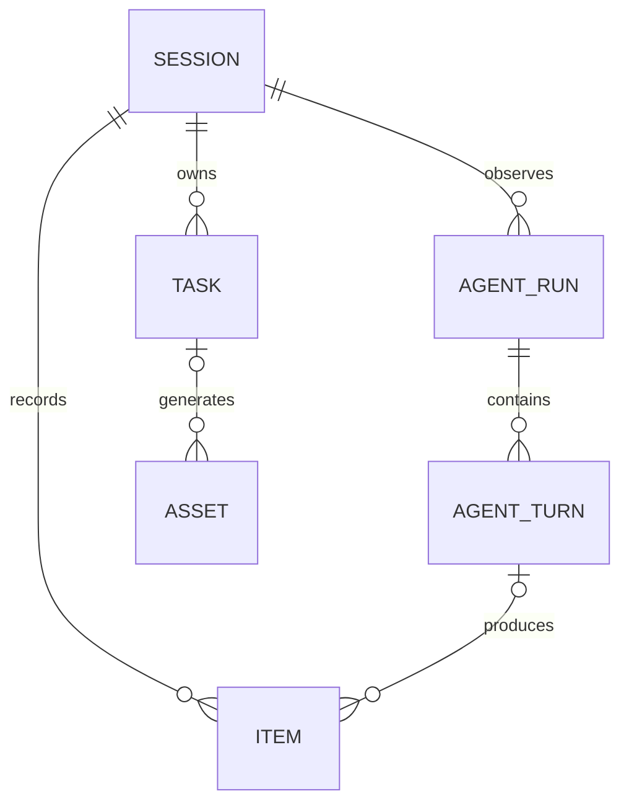

# Session、Run、Turn 与 Item 存储结构设计

原始方案日期：2026-10-09

修订设计日期：2026-10-12

状态：2026-10-12 已加入 Java backend 与 Python agent 实现。新建库使用独立的表结构基线，历史迁移文件仍保留；没有重置现有数据库。启用步骤与验证限制见[当前 v2 契约](../../api-contract-v2.md)及两个项目的 README。

本文件对应[英文设计文档](2026-10-09-session-run-turn-item-storage-design.md)，表名、字段名、协议标识及执行规则保持一致。

## 1. 设计依据与存储归属

本方案遵循[修订后的表结构设计前审查](2026-10-09-session-run-turn-item-design-audit.md)。Session 管理整段对话；输入独立存在；Run 和 Turn 组织 Agent 执行及输出。Python 决定执行生命周期，Java 持久化已接收的输入与已观察的执行事实。

Python 创建并结束 Run 和 Turn，生成稳定 ID 及来源排序字段，选择上下文并负责恢复。Run 完成或后继执行不需要 Java 批准。Java 接收 Session 输入，管理 Task 和 Asset，可靠投递输入／控制事件，保存 Python 事实，并提供前端查询视图。Java 的已观察状态允许滞后，不参与执行调度。

Java 数据库目标仍为 MySQL 8.4/InnoDB。Python 保留现有单进程、独占本地 SQLite 存储，并增加持久化的 LangGraph checkpointer。agent 已集成原生 LangGraph StateGraph 与 AsyncSqliteSaver，并在执行边界同步持久化 checkpoint；模型执行仍通过可注入 adapter 接入。系统正确性不依赖 Redis。本版本不包含 Python 分布式接管、分支会话、输入编辑／撤回或 Task 重试。无需保留现有开发历史。

存储方式仍采用关系型身份／状态字段与具名 JSON 内容变体。输入内容只在 `item.payload` 中保留一份业务存储，不增加 `session_input` 表。Inbox、Outbox 和规范事件记录分别承担接收、投递与恢复职责，可以保留其传输快照。Java 与 Python 中已知的业务载荷必须使用显式具名类型。

Java 可以立即持久化并展示乱序事实。完整来源快照独立更新对应实体，来源版本防止旧状态覆盖新状态。缺失文本增量只影响对应 Item 的拼接。系统仍可补齐缺口，但不能让一个全局事件缺口阻塞全部后续展示更新。

## 2. 关系与身份



输入 Item 的 `run_id` 和 `turn_id` 始终为空，包括纳入上下文之后。全部 Agent Item 必须具有这两个字段，包括 assistant 文本、过程说明、推理摘要、工具调用、工具结果和最终回答。分类依据 source 和 kind：TOOL_RESULT 仍是 AGENT Item。不保存 Item role；Python 在模型 adapter 边界构造 provider 专用的角色和调用 / 结果结构。Run、Turn、Item、Session 与所有者身份必须一致。

Java 生成输入 Item ID。Python 生成 Run、Turn 和 Agent Item ID。Java 根据事实登记这些执行身份，不要求执行前通过 HTTP 同步注册。输入纳入上下文和执行进度仅由 Python checkpoint 管理，Java 不要求记录首次消费关联。

停止是 Session 控制，不由调用方指定 Run。Python 完成已经开始的 Turn，结束被停止的 Run，并保留 pending 输入。停止之后收到的新用户输入，会在当前 Turn 完成后触发新的 Run；不覆盖停止意图，也不重新打开旧 Run。Task 终态通知保留已确认的自动唤醒行为。

### 通用字段约定

- `UUID`：`CHAR(36) CHARACTER SET ascii COLLATE ascii_bin`；外键两端定义完全一致。
- `HASH`：`CHAR(64) CHARACTER SET ascii COLLATE ascii_bin`，保存规范化 SHA-256 摘要。
- `TIME`：`DATETIME(6)`，采用 UTC，并明确应用／连接约定。
- 非负 `BIGINT` 计数器从零开始，已分配排序字段从一开始。
- 业务枚举使用有长度限制的 `VARCHAR`，显式检查取值与是否允许为空。
- 来源 error_code 限制为 64 个字符。来源 error_message 与 GenerationError.message 必须符合 TEXT 存储的 65,535 UTF-8 字节上限；超长输入被拒绝并保留原始 envelope，不静默截断。
- 完整 v2 UTF-8 信封预算为 31 MiB；新主题及 Java／Python 客户端采用 32 MiB 记录／请求／分区获取容量，总获取预算为 64 MiB。已有主题须配置相同容量。Java 在受理事务提交前拒绝超长请求；Python 保留超长响应的原回执／意图，在工具执行前阻止物化，不丢弃或重新调用。provider adapter 须遵守完整事实预算，调整时要同步预算／broker／客户端限制。
- `created_at` 和 `updated_at` 是 Java／本地记录时间。Python 执行时间属于独立事实，不能用接收时间代替。
- Java `version BIGINT NOT NULL DEFAULT 1` 是本地并发元数据。Python `source_revision` 是完整来源实体快照的版本，不是 ORM version，也不是排序索引。
- Agent 投影中，source_revision=0 表示只有身份的骨架；未知状态 / 内容保持为空。正版本要求经过校验的完整快照。Run、Turn 和 Item 都没有 source_hash。同版本直接比较原始来源字段。PARTIAL Item 的原始 payload 必须为空数组，因此重建该来源视图进行比较，同时保留其临时片段数组；终态 / 非流式 Item 直接比较保存的完整 payload。已受理输入是完整的，source_revision=0。
- 保留所有者／Session 范围内的业务外键。乱序实体引用携带真实的来源身份／索引，可以先建立只有身份的父级记录。不伪造生命周期状态，也不引入业务级联删除。
- 允许为空的字段组合显式使用 `IS NULL`／`IS NOT NULL` 检查；结果为 unknown 的 CHECK 不能代替必填校验。

### 相互独立的排序与版本字段

| 字段 | 负责方与用途 |
| --- | --- |
| `agent_run.run_index` | Python；Session 内稳定的 Run 顺序 |
| `agent_turn.turn_index` | Python；Run 内稳定的 Turn 顺序 |
| `item.item_index` | Python；Turn 内稳定的 Agent Item 顺序；输入为空 |
| `item.sequence_no` | Java；Session 内不可变的首次登记位置，用于分页和时间线分段边界；不是 Python 执行顺序 |
| `item.input_sequence_no` | Java；连续输入顺序与只读补齐游标；Agent 输出为空 |
| `run_event.sequence_no` | Python；Session 内跨 Run 的规范执行事件顺序，用于缺口／重放，不是全局展示屏障 |
| `source_revision` | Python；每个 Run、Turn 或 Agent Item 独立的完整快照版本 |
| `command.ordinal` | Python 本地 Inbox；输入与控制首次持久化接纳的顺序，包括停止／唤醒先后关系 |
| `session_event.sequence_no` | Java；前端 SSE 重放顺序 |
| Kafka partition/offset | 消息代理；物理接收坐标 |

默认的 Session 时间线按 Java Item 登记位置交错展示独立输入与 Agent 输出。来自同一个 Run 的相邻 Agent 条目形成一个展示分段；USER/SYSTEM 输入或其他 Run 会将分段隔开。如果 M2 在 R1 期间到达，M2 之后新登记的 R1 输出展示在 M2 之后，形成另一个 R1 分段。更新已有流式 Item 时，保留该 Item 的原始位置。分段是推导出的展示状态，不新增分段表，也不建立输入到 Run/Turn 的消费关联。

分段内部按 `turn_index` 和 `item_index` 排序；Run 元数据按 `run_index` 排序。迟到数据可以在按登记位置推导出的分段内部重排输出，但不能将输出移到独立输入边界的另一侧。骨架登记的位置在内容可用后仍保持不变。API 暴露这两个排序范围，不声称存在统一的 Python／Java 因果时钟，也不推断 Turn 消费了哪条输入。缺失实体可以留下来源索引缺口。SSE 游标仍按 Java 通知发布顺序推进，独立于来源顺序。

输入内容按 `input_sequence_no` 升序进入模型上下文，冻结下一批输入之前先补齐已知缺口。独立的 Inbox `ordinal` 决定控制与唤醒先后：补齐的输入保留既有接纳 ordinal，首次接纳时才获得新 ordinal，不会追溯修改停止事件的效果。这样既保留输入顺序，也不让 Java 决定执行边界。

### 完整数据库清单与审阅边界

本对照清单覆盖重构前全部 Java／Python 应用表，包括保留与移除的表，描述仓库声明而非运行中数据库。历史 V1 创建十二张 Java 表，V2 增加五个版本列。当前实现的新建库基线同样有十二张表，以 item／agent_turn 替换 message／run_input。第 12 节保留完整的旧声明供对照，并链接当前实现。

| 重构前 Java 表 | 目标处理方式 | 职责 / 目标定义 |
| --- | --- | --- |
| `user` | 保留全部列 | 本地归属；第 5.6 节 |
| `http_request` | 保留全部列；扩展到消息发送 | HTTP 幂等及原始响应；第 5.5 节 |
| `session` | 修订 | 会话身份与 Item 登记；第 3.1 节 |
| `agent_run` | 修订 | Python 生命周期投影；第 3.2 节 |
| `message` | 替换为 item | 统一输入 / 输出记录；第 3.4 节；当前结构见第 12 节 |
| `run_input` | 移除 | 旧 Java 输入认领关联；当前结构见第 12 节 |
| `run_event` | 修订排序 / 路由 | Session 范围的不可变执行日志；第 5.1 节 |
| `task` | 修订 | Session 拥有的生成业务状态；第 4.1 节 |
| `asset` | 保留列；加强字段结构检查 | 持久化的上传 / 生成对象；第 4.2 节 |
| `outbox_event` | 保留全部列 | Java 可靠发布；第 5.2 节 |
| `inbox_event` | 保留全部列 | 持久化技术回执 / 冲突处理；第 5.3 节 |
| `session_event` | 保留全部列；修订分配方式 | 前端 SSE 通知 / 重放；第 5.4 节 |
| 当前无对应表 | 新增 agent_turn | Python Turn 投影；第 3.3 节 |

| 重构前 Python Agent 表 | 目标处理方式 | 职责 / 目标定义 |
| --- | --- | --- |
| `command` | 修订 | 逻辑 Session 输入 / 控制 Inbox；第 7.1 节 |
| `receipt` | 修订 | 物理 Kafka 回执；第 7.2 节 |
| `run` | 简化 | 本地稳定 Run 登记；第 7.3 节 |
| `event` | 修订排序 / 路由 | 规范 Session 执行事实；第 7.4 节 |
| `publication` | 修订 | 有序发布与显式重放；第 7.5 节 |
| 当前无对应表 | 新增 session_event_counter | 规范 Session 事件分配；第 7.4 节 |
| 当前无对应表 | 新增 execution_receipt | 外部模型 / 工具结果核实；第 7.6 节 |

重构前 Agent 有五张应用表，当前 AgentStore 实现有七张。第 12 节保留完整的旧内联 schema。SQLite 的 sqlite_sequence 与 MySQL 的 flyway_schema_history 仍属于框架／数据库元数据。原生 LangGraph checkpoints/writes 已集成为独立的框架存储，职责见第 7.7 节；由 saver 初始化，不复制到 Lux DDL 中。

另外两个 Lux 模块当前未声明应用数据库表：lux-python-utils 是工具模块脚手架，lux-python-model-connector 是连接器脚手架。后者在其 model-connector 设计中另有仅用于设计的 generation_execution 和 outbox_event 方案；这些名称属于它的独立存储，不指向 Java 的 outbox_event。本次存储修订不创建这些表。模块源码 / 设计链接见第 12 节。

本方案只提出已确认的简化及此前获准的表结构调整。列出现有表不代表授权改变其业务行为。Item 保留独立的 source_revision；Session 事件排序不替代它。移除 Item 的 source_hash、input_schema_version、input_occurred_at 和 last_included_delta_sequence_no。原始输入元数据保留在原始 Outbox envelope 中，临时流进度由下文严格的片段数组结构推导。

## 3. Java 会话表

Java 保存 Session 输入，并投影 Python 的执行事实。Python 创建 Run/Turn 身份和索引，决定执行与取消；在 Java 尚未观察到前一个 Run 的终态事实时，Python 就可以开始下一个 Run。Java 不批准完成、不分配执行槽位、不调度 Run，也不把输入绑定到消费它的 Turn。

### 3.1 `session`

| 字段 | 类型 / 是否允许为空 | 含义 |
| --- | --- | --- |
| `id` | UUID，PK | 会话标识 |
| `user_id` | UUID，非空 | 资源所有者 |
| `title` | `VARCHAR(255)`，非空 | 展示标题 |
| `next_item_seq` | `BIGINT`，非空，默认 0 | 最近分配的 Java Item 登记位置；替换当前的 next_message_seq |
| `version`, `created_at`, `updated_at` | 公共字段 | 本地变更协调与时间戳 |

约束 / 索引：

- `UNIQUE(user_id, id)`；所有者外键指向 `user`。
- 列表查询索引 `(user_id, created_at, id)`。
- `next_item_seq` 为非负数。Item 登记使用 Session 变更事务。SSE 序号分配使用 Session 行锁和现有 `session_event` 记录，具体规则见第 5 节；Session 不保存 SSE 计数器。
- 移除 `next_event_seq`、`active_run_id` 及其外键、`accepted_input_seq`、`incorporated_input_seq`、`pending_wake`、`queue_paused`、`next_message_seq` 和 `task_update_seq`。不以另一个执行槽位或输入消费水位替代它们。

已观察到的最高 `agent_run.run_index` 标识最近观察到的 Run。其状态可能未知或过时；这不表示 Java 知道 Python 当前的执行状态。

### 3.2 `agent_run`

| 字段 | 类型 / 是否允许为空 | 含义 |
| --- | --- | --- |
| `id` | UUID，PK | Python 创建的稳定 Run 标识 |
| `user_id`, `session_id` | UUID，非空 | 所有者与会话 |
| `run_index` | `BIGINT`，非空 | Python 分配的 Session 内 Run 索引，从 1 开始 |
| `source_revision` | `BIGINT`，非空，默认 0 | Python 的完整 Run 快照版本；0 表示身份骨架 |
| `status` | `VARCHAR(24)`，可为空 | Python 生命周期状态；观察到完整快照之前为空 |
| `started_at` | TIME，可为空 | Python 报告的执行开始时间 |
| `finished_at` | TIME，可为空 | Python 报告的终态时间 |
| `final_item_id` | UUID，可为空 | Python 选定的最终 assistant Item，如有 |
| `error_code` | `VARCHAR(64)`，可为空 | 具名的失败分类 |
| `error_message` | `TEXT`，可为空 | 诊断详情 |
| `last_seen_at` | TIME，非空 | Java 最近接收有效 Run 身份 / 快照观测的时间；不是执行决策 |
| `version`, `created_at`, `updated_at` | 公共字段 | Java 行并发协调与本地登记时间戳 |

状态：`RUNNING`、`COMPLETED`、`FAILED`、`CANCELLED`。

| 状态 | 含义 |
| --- | --- |
| `RUNNING` | Python 已创建 Run，但尚未将其结束；包括准备、Turn 执行、停止处理和恢复阻塞 |
| `COMPLETED` | Python 已正常结束 Run，并选定其最终 assistant Item |
| `FAILED` | Python 已确认执行无法继续，并以失败结束 Run |
| `CANCELLED` | Python 已按照 Session 停止规则结束 Run |

约束 / 索引：

- `UNIQUE(user_id, id)`、`UNIQUE(user_id, session_id, id)` 和 `UNIQUE(session_id, run_index)`；指向 Session 的复合外键。
- Session 展示索引 `(session_id, run_index)`；观测扫描索引 `(last_seen_at)`。
- `run_index > 0`；`source_revision >= 0`。
- 版本为 0 时，`status`、生命周期时间、最终 Item 和失败字段均为空。骨架仅记录真实的身份 / 排序事实及本地接收元数据。
- 版本为正数时，已声明的状态必须有值。当且仅当状态为 `COMPLETED`、`FAILED` 或 `CANCELLED` 时，`finished_at` 有值。
- 完整的 `COMPLETED` 快照要求 `final_item_id` 有值。取消或失败的 Run 可以没有最终回答。
- Python 选定 `final_item_id`，并在 Run 完成快照中携带完整的 `final_item: AgentItemIdentity` 引用。Java 验证所有者、执行归属及可用时的被引用内容，然后保存该引用；绝不根据当前最后收到的 Item 推导它。
- 一旦终态 Run 快照确定了最终 Item 的选择，该可空选择在所有后续版本中都不可变。身份骨架可以补全，选定 Item 的内容也可以稍后到达；这两种情况都不允许改选另一个最终 Item。
- 最终 Item 的外键 `(user_id, session_id, id, final_item_id)` 指向 `item(user_id, session_id, run_id, id)`，在 Item 表创建后添加。完整的最终 Item 身份可以先创建版本为 0 的 Item 骨架。当其快照可用时，验证 AGENT source、MESSAGE kind 及完成状态；缺少该内容不会阻止应用 Run 快照。
- 移除 `active_session_guard` 及其非终态唯一约束。移除 Java 的必需输入边界、上下文边界、取消截止边界、关闭边界和关闭决策字段。

Python 拥有生命周期的决定权。RUNNING 表示尚未结束，不表示当前一定有模型调用正在进行。准备、停止意图、等待输入和恢复阻塞是 Python checkpoint 中明确的阶段／控制效果，而不是额外的 Run 状态。新 Run 的首份完整快照是 RUNNING；身份骨架的状态保持为空，不编造生命周期状态。超时、进程重启或缺少事实都不能证明 FAILED 或其他终态。更高版本的快照不能逆转已经观察到的终态。由于事实乱序到达，Java 可以暂时展示多个观察到的 RUNNING Run；Java 不使用这种观测来允许或阻止执行。

### 3.3 `agent_turn`

| 字段 | 类型 / 是否允许为空 | 含义 |
| --- | --- | --- |
| `id` | UUID，PK | Python 创建的稳定 Turn 标识 |
| `user_id`, `session_id`, `run_id` | UUID，非空 | 所有者、会话与来源 Run |
| `turn_index` | `BIGINT`，非空 | Python 分配的 Run 内索引，从 1 开始 |
| `source_revision` | `BIGINT`，非空，默认 0 | Python 的完整 Turn 快照版本；0 表示身份骨架 |
| `status` | `VARCHAR(24)`，可为空 | `PREPARED`、`RUNNING`、`INTERRUPTED`、`COMPLETED`、`FAILED`、`CANCELLED`；骨架为空 |
| `started_at` | TIME，可为空 | Python 报告的模型调用开始时间 |
| `finished_at` | TIME，可为空 | Python 报告的 Turn 完成、失败或开始前取消时间 |
| `error_code`, `error_message` | 类型与 Run 相同，可为空 | 失败 / 核对详情 |
| `version`, `created_at`, `updated_at` | 公共字段 | Java 行并发协调与本地登记时间戳 |

约束 / 索引：

- `UNIQUE(run_id, turn_index)` 和 `UNIQUE(user_id, session_id, run_id, id)`；指向 Run 的复合外键。
- `turn_index > 0`；`source_revision >= 0`。
- 版本为 0 时，`status`、生命周期时间和失败字段均为空。父 Run 本身也可以是依据真实 RunIdentity 创建的版本为 0 的骨架。
- 版本为正数时，已声明的状态必须有值。当且仅当状态为 `COMPLETED`、`FAILED` 或 `CANCELLED` 时，`finished_at` 有值。
- `CANCELLED` 只适用于调用开始之前（`started_at IS NULL`）。Python 在停止 Run 之前，正常完成已经开始的 Turn，或报告其失败。
- 移除 `active_run_guard` 及其未完成 Turn 唯一约束。Java 不保存 Turn 输入消费边界或首次消费绑定。

一个 Turn 包含一次模型调用、所有对应工具及后处理。其完整快照独立于父 Run 的快照版本。父 Run 已进入终态，不会阻止 Java 接受其某个 Turn 之前缺失的快照或更新版本的快照。

### 3.4 `item`

| 字段 | 类型 / 是否允许为空 | 含义 |
| --- | --- | --- |
| `id` | UUID，PK | 稳定的输入 / 输出标识 |
| `user_id`, `session_id` | UUID，非空 | 所有者与会话 |
| `sequence_no` | `BIGINT`，非空 | 不可变的 Java 首次登记位置；用于分页和时间线分段边界，不代表 Python 执行顺序 |
| `source` | `VARCHAR(16)`，非空 | `USER`、`AGENT` 或 `SYSTEM`；USER/SYSTEM 为 Session 输入，AGENT 为执行输出 |
| `kind` | `VARCHAR(32)`，可为空 | `MESSAGE`、`REASONING_SUMMARY`、`TOOL_CALL`、`TOOL_RESULT`、`TASK_EVENT`；Agent 骨架的类型可以未知 |
| `run_id`, `turn_id` | UUID，可为空 | 来源执行；每个 AGENT Item 两者都必须有值，每个输入 Item 两者始终为空 |
| `item_index` | `BIGINT`，可为空 | Python 分配的 Turn 内 Item 索引，从 1 开始；仅 AGENT Item 必须有值 |
| `source_revision` | `BIGINT`，非空，默认 0 | Python 的完整 Agent Item 快照版本；骨架及 Java 拥有的输入均为 0 |
| `input_sequence_no` | `BIGINT`，可为空 | Session 内连续的输入位置；仅用于输入 Item |
| `status` | `VARCHAR(16)`，可为空 | `PARTIAL`、`COMPLETED`、`INTERRUPTED`；只有 Agent 骨架可以为空 |
| `call_id` | `VARCHAR(255)`，可为空，区分大小写 | TOOL_CALL 及其 TOOL_RESULT 共用的原始模型协议调用标识 |
| `tool_name` | `VARCHAR(255)`，可为空 | 仅用于 TOOL_CALL 的工具名称 |
| `task_id` | UUID，可为空 | 仅用于 TASK_EVENT 的终态 Task 标识 |
| `payload` | JSON，可为空 | 具名内容变体；输入及正版本 Agent 快照必须有值，身份骨架为空 |
| `completed_at` | TIME，可为空 | 内容完成时间；输入使用 Java 受理时间，Agent 输出使用 Python 快照事实 |
| `version`, `created_at`, `updated_at` | 公共字段 | Java 行并发协调、登记与投影时间戳 |

约束 / 索引：

- `UNIQUE(session_id, sequence_no)`、`UNIQUE(user_id, id)`、`UNIQUE(user_id, session_id, id)`、`UNIQUE(user_id, session_id, run_id, id)` 和 `UNIQUE(user_id, session_id, run_id, turn_id, id)`，用于外键引用目标。
- `UNIQUE(turn_id, item_index)` 保留 Python 的 Item 顺序。输入的这两列均为空。来源索引用于展示分段内部的 Agent 子条目排序；`sequence_no` 提供 Java 登记顺序、分段边界和稳定分页。
- `UNIQUE(turn_id, kind, call_id)` 允许每个实际调用具有一条 TOOL_CALL 和一条 TOOL_RESULT。两种类型均要求非空且非空字符串的 call ID；其他类型保持为空。调用身份比较与唯一键均区分大小写。HTTP 输入请求的唯一性由 http_request 保证，不属于 Item。
- `UNIQUE(session_id, input_sequence_no)` 支持输入恢复分页。每个不可变输入恰好具有一个 InputAccepted 事件，其事件 ID 等于 Item 主键；无需额外的输入事件身份列或唯一键。
- `UNIQUE(user_id, task_id)` 确保每个 Task 只有一条终态通知。历史工具结果 payload 内的 Task ID 不填入该列。
- 指向 Session 的外键；Agent 来源执行的复合外键 `(user_id, session_id, run_id, turn_id)` 指向 `agent_turn(user_id, session_id, run_id, id)`。
- 在相同的所有者／Session／Run／Turn 内，通过完全相同的 call ID 将 TOOL_RESULT 与实际 TOOL_CALL 关联。不设置结果到调用 Item 的外键。即使调用尚未到达，也持久化并展示其他条件均有效的结果；调用到达时，以及重启／同步修复时，通过查询保留的 Item 校验配对。尚未解析的关联不能依赖内存标记。仅凭 call ID 不能编造调用 Item 的身份或骨架。配对调用可用时，从中派生工具名称。
- Task 外键 `(user_id, session_id, task_id)` 指向 `task(user_id, session_id, id)`。
- CHECK source 为 USER/AGENT/SYSTEM。已知 kind 为 MESSAGE/REASONING_SUMMARY/TOOL_CALL/TOOL_RESULT/TASK_EVENT 之一；只有 AGENT 身份骨架允许 kind 为空。有效的 source/kind 配对遵循下表。
- sequence_no > 0；source_revision >= 0。AGENT Item 要求 item_index 为正数；input_sequence_no 在有值时为正数。
- 移除 role、message_phase、call_item_id 及其自引用外键、client_request_id、request_hash、input_event_id、input_event_hash、Item 的 operation_id、source_hash、input_schema_version、input_occurred_at、last_included_delta_sequence_no、producer_run_id、producer_turn_id、全部 consumed_* 字段及 incorporated_at。Item 上唯一的 Run/Turn 关系是它的来源执行。不得将移除的哈希、输入元数据或流计数器移入 Item.payload。

输入 / 输出按 source 和 kind 分类。source 枚举恰好为 USER/AGENT/SYSTEM，Item、已受理输入内容及 Agent 快照都没有 role。TOOL_RESULT 仍是 Run/Turn 非空的 AGENT 输出。USER 和 SYSTEM 输入的两个执行字段永久为空。source 不可变；输入不能升级为 Agent 输出，用户 prompt 也不能升级为系统指令。Agent 骨架可以补入此前未知的 kind，但已经确定的 kind 不能在更高版本中改变。只有 Python 构造适当的模型协议角色 / 变体。

由 Python 明确给出的 Run final_item_id 选定该 Run 的最终 assistant 回答。Item 不再单独将消息标记为 COMMENTARY 或 FINAL。在观察到该 Run 事实之前，Java 无法确定选中的最终回答，也绝不根据消息到达顺序推断回答。移除 phase 不会推迟 assistant 消息的流式展示。

版本为 0 时，AGENT 骨架必须具备真实身份、所有者 / Session、Run/Turn 及 Item 索引。其 status、payload 和 completed_at 为空；未知子类型字段可以保持为空。骨架是尚未解析的引用，不是编造的消息或生命周期事实。其 input_sequence_no 为空。在完整快照到达之前，跳过依赖未知子类型的检查。

Agent 版本为正数时，kind、status 和 payload 必须有值。完整输入及正版本 Agent 快照遵循以下字段结构：

| 类型 / 来源 | 必须满足的字段结构 / 具名 payload |
| --- | --- |
| MESSAGE / USER | OrderedContent；input_sequence_no 有值；Run/Turn/index、call 和 task 字段为空；COMPLETED |
| MESSAGE / SYSTEM | OrderedContent；input_sequence_no 有值；Run/Turn/index、call 和 task 字段为空；COMPLETED |
| MESSAGE / AGENT | OrderedContent；Run/Turn/index 有值；input_sequence_no、call 和 task 字段为空 |
| REASONING_SUMMARY / AGENT | OrderedContent；Run/Turn/index 有值；input_sequence_no、call 和 task 字段为空 |
| TOOL_CALL / AGENT | ToolCallContent 具名参数变体；Run/Turn/index、call ID 和 tool name 有值；input_sequence_no 和 task 字段为空；COMPLETED |
| TOOL_RESULT / AGENT | ToolResultContent 具名结果变体；Run/Turn/index 及原始 call ID 有值；tool name、input_sequence_no 和 task 字段为空；COMPLETED |
| TASK_EVENT / SYSTEM | 仅包含 task_id 的 TaskEventContent；task ID 和 input_sequence_no 有值；Run/Turn/index 和 call 字段为空；COMPLETED |

每个 USER/SYSTEM 输入具有 input_sequence_no、完整非空内容及 source_revision=0。其 InputAccepted.event_id 等于其 id；原始事件元数据只保留在其 Outbox envelope 中。每个 AGENT Item 的 input_sequence_no 为空。对于已知内容，completed_at 当且仅当状态为 COMPLETED 时有值。只有 AGENT MESSAGE 和 REASONING_SUMMARY 支持文本增量；工具调用 / 结果没有流计数器或覆盖字段。

对于当前每次只提交一个 Task 的 submit_generation 工具，operation_id 等于原始 TOOL_CALL Item.id。Python 在任何提交请求之前持久化该 Item 身份及其执行绑定，并在恢复或不确定结果核实时复用。Item 和 AgentItemSnapshot 不携带单独的 operation_id 字段；Task、execution_receipt 及具名提交请求保留各自的 operation_id 字段，使用相同的 UUID 值。Java 不要求调用 Item 已经到达，也不为 Task 增加 Item 外键。一次调用提交多个 Task 或多个独立副作用不在本契约范围内。模型 call_id 仍是单独的协议关联身份。

#### 快照与流式投影规则

Run、Turn 和 Agent Item 的版本是相互独立、由 Python 拥有的计数器。Python 在暴露变更后的来源状态之前持久化其版本；重投递 / 恢复不递增未变化的快照。只有经过字段结构 / 生命周期校验后，更高版本才替换来源投影字段。同版本直接比较原始来源字段：内容相同则幂等，内容不同则属于协议冲突。没有实体保存来源快照哈希。旧快照保留在日志中，不覆盖更新投影；不可变身份 / 索引 / 归属在任何版本发生不一致都属于冲突。已经观察到的终态不能返回非终态，也不能变成另一种终态结果。

对于 Item，比较真实身份 / 父级索引、source、kind、status、payload、completed_at、call_id 和 tool_name，排除 Java sequence/version/时间戳及外层传输元数据。终态及非流式 payload 不可变，因此直接使用已保存的完整 payload。先验证传入的 PARTIAL 来源快照属于 MESSAGE/REASONING_SUMMARY，source_revision=1、blocks=[]，且 completed_at 为空；后续 PARTIAL 版本或非空 PARTIAL 来源快照无效。Java 已追加片段后，为比较该初始版本，重建当前行的原始 AgentItemSnapshot，令 payload.blocks=[]，其余已保存来源字段保持不变。不得把无效的传入非空 payload 规范化为空并接受。同一初始快照保持实际临时数组不变。这种严格结构使比较具有确定性，无需保存哈希或强制查询日志。来源同步快照采用相同规则；Java 临时投影不是 Python 来源快照。

Run 比较范围包括 `RunIdentity`、`status`、`started_at`、`finished_at`、`error_code`、`error_message`，以及可为空的完整 `final_item: AgentItemIdentity`。Turn 比较范围包括完整 `TurnIdentity`、`status`、`started_at`、`finished_at`、`error_code` 和 `error_message`。身份引用递归比较真实 ID 和来源索引，不比较被引用实体后来更新的状态、内容或版本。排除 Java `last_seen_at`、`version`、`created_at`、`updated_at`，外层投递的 `event_id`、`event_seq`、`occurred_at`，以及 Inbox/SSE 元数据。在每个版本都校验外层所有者／Session 及不可变身份／索引。不需要 Run/Turn 快照哈希。

MESSAGE 和 REASONING_SUMMARY 共用 OrderedContent，即由 TextBlock 和 AssetReferenceBlock 组成的有序数组。两种 kind 都可以引用属于该所有者的上传或生成 Asset。块没有 id 或独立排序字段；数组顺序即展示顺序。Asset 引用保留真实 asset_id，并校验归属及存在性。推理摘要只包含可对外展示的摘要内容，不包含模型私有推理。

调用之前，Python 将候选 Item 绑定写入 checkpoint；只有实际观察到的 Item 才能发布初始快照。有序 emitter 在该 Item 的首个文本增量之前提交并发布唯一的初始 PARTIAL AgentItemSnapshot，其 source 为 AGENT、source_revision=1、OrderedContent.blocks=[]。未使用的候选项不发布、不参与同步，也不展示。空数组是必需条件，不是可选示例。PARTIAL 期间，每个连续的 ItemTextDelta 恰好在临时数组尾部追加一个 TextBlock。持久化记录和前端状态都不能合并、移除、重新排序或插入其他块，不能增加 Asset 块，也不能应用另一份完整 PARTIAL payload。渲染可以在视觉上连接这些块，同时保留已保存的边界。增量不改变 source_revision；临时 payload 变化时，Java 递增本地 version。

因此，PARTIAL Item 已持久化的 blocks.length 恰好等于连续已应用的 stream_seq N。推导下一个序号为 N+1，不额外保存计数器。序号不大于 N 的事件已被表示；大于 N+1 的事件保留在规范日志中，直到缺口补齐。N+1 可用后，在现有 Item/Session 变更事务中追加它及后续新形成连续序列的缓存片段，同时保存相应 SSE 记录和 Inbox 应用标记。绝不依据收到的最高序号推断进度。重启时从同一持久化数组推导 N，并处理保留的日志片段；无需仅存在于内存的游标或额外表。原始初始快照确立 kind/路由；身份骨架不能编造内容。重复初始快照不能重置已经扩展的数组。

每个新应用的连续增量，在同一个 Java 事务中提交临时 Item payload 和携带 ItemTextDelta 的 Session SSE 记录。前端执行相同的有序尾部追加，不等待模型、Turn 或 Run 完成，并从 PARTIAL 数组长度推导 N。重复增量不重复追加或通知；因缺口而缓存的增量在可应用时发布。完整保留片段文本，包括空格及换行。这条路径只流式传输文本；Asset 及最终分段来自完整终态 payload。Item 的 PARTIAL 状态标识临时表示；不为块 / payload 增加 partial 标志、哈希或流计数器。

前端首次加载或刷新时，Java PARTIAL 投影携带已持久化的临时块；其长度用于推导 N。在相同 source_revision 下，刷新不能以较短的旧前缀覆盖较新的本地前缀。只接受更长且匹配的前缀；更高增量先缓存，直到其前缀已知；为分歧前缀记录诊断。Python 来源同步的初始 PARTIAL 快照始终为空，它只是幂等的来源观测，不是清空已渲染文本的指令。更高版本的终态替换优先于任何在途 PARTIAL 刷新。SSE 重放结合常规 Session 游标及该 Item 内前缀规则。

#### 完整模型响应与最终 payload 替换

模型正常完成响应后，Python 排空全部片段写入，并在 execution_receipt 中持久化完整原始响应及其稳定 Item 绑定。随后将最终的每 Item 快照及稳定 ModelResponseCompleted 出站意图写入 checkpoint，再通过规范 event/Outbox 事务可靠地物化该事件。它携带原始 model_execution_id、Turn 身份及按 item_index 排序的全部模型输出 Item 完整快照。每份快照包含原始 Item 身份、AGENT source、kind、最终 payload、COMPLETED 状态 / 时间及递增后的 source_revision；不携带快照哈希或已包含增量的边界。之后产生的工具结果仍是独立 Item / 事实。完成不创建额外展示 Item，不改变 Turn/Run 状态，也不选择 Run.final_item_id。

即使增量缺失，Java 仍将事件写入日志。它在变更前校验公共响应 / Turn 归属及每个 Item 绑定，再按版本及原始来源内容规则应用各快照。整体替换每个新接受 Item 的临时 payload，保存 COMPLETED，并在同一投影事务中追加携带完整快照的 ItemContentReplaced。不将最终响应文本追加到片段数组。全部可应用成员 / SSE 一起提交；旧版本或同版本且内容相同的成员跳过。真实身份 / 内容冲突会拒绝集合投影并保留诊断。真实父级身份建立缺失骨架，无需等待更早生命周期事件。无需新增响应表或每 Item 日志事件。

前端更新或插入同一个 Item，并原子替换 payload、status 和 source_revision，不新增第二条回答。同版本 / 同内容属于幂等；旧版本不能替换更新的 Item。终态快照之后，全部迟到增量保留在日志中，但无论 stream_seq 为何都不能改变最终内容。前端同样在 SSE 重放期间忽略每个终态后增量及旧刷新 / 替换。完整最终 payload 通过整体替换修复缺失片段。终态数组可以具有任何有效的文本 / Asset 分段；其长度绝不解释为流位置。

响应可以已经产生完整消息、可对外展示的摘要及 TOOL_CALL Item，而其工具和后处理仍待执行。ModelResponseCompleted 确立完整模型输出，不代表 Turn 或 Run 完成。Python 仅在各自边界发布其生命周期快照；Run.final_item_id 仍明确选择整个 Run 的最终回答。

| 单个 Item 的事件 | 可见 OrderedContent.blocks | 来源版本 / 状态 |
| --- | --- | --- |
| 初始快照 | 空数组；推导 N=0 | 1 / PARTIAL |
| 增量 1：Hello | TextBlock("Hello")；推导 N=1 | 1 / PARTIAL |
| 增量 2：空格加 world | TextBlock("Hello"), TextBlock(" world")；推导 N=2 | 1 / PARTIAL |
| 完整响应快照 | TextBlock("Hello world"), AssetReferenceBlock(A1)，按最终数组顺序；没有流位置 | 2 / COMPLETED |
| 重复完成或任何迟到增量 | 相同最终数组 | 2 / COMPLETED |

REASONING_SUMMARY Item 采用相同规则。A1 引用已经持久化的上传 / 生成 Asset。最终块可以合并片段，也可以包含从未出现在临时流式数组中的 Asset 引用。

完整 COMPLETED 或 INTERRUPTED 快照越过任何增量缺口替换临时内容，并封口该 Item。非空或较新的替换 PARTIAL 快照不在本流式契约范围内。迟到增量保留在日志中，但不再追加到终态内容。已完成调用的参数 / 结果不可变；已知 call ID、tool name 及原始绑定不能改变。提交 operation 身份仍由原始调用 Item ID 派生。父 Run/Turn 的终态不抑制独立有效的迟到 Item 快照或缺失内容。

外部结果仍待核实时，对应 Item 保持 PARTIAL。其 Run 保持 RUNNING，并在 checkpoint 中保存恢复阻塞阶段；其 Turn 可以是 INTERRUPTED。只有确认原响应无法再完成该 Item 后，才发布终态 Item INTERRUPTED；UNKNOWN 本身不能证明这一终态条件。

对于父对象缺失的引用，可以在投影事务内根据完整 RunIdentity/TurnIdentity/AgentItemIdentity 创建版本为 0 的骨架。如果缺少身份或必需的排序信息，只保留该实体待处理并请求同步；不影响其他投影继续更新。骨架登记时只分配一次 `sequence_no`，后续快照复用同一个 Item。UI 可以展示未知的父状态或尚未解析的引用，但不能编造骨架内容 / 状态。

### 3.5 `item` 中的输入受理与重放

item 中的输入记录构成有序业务输入日志。业务输入内容保存在 item.payload；原始传输元数据保存在已有的 outbox_event.envelope 中，不放在 Item 列中。不增加 session_input、run_input、claim 表、首次消费绑定或 Java 上下文纳入水位。

在 Session 输入受理事务中，首先取得所有输入/SSE 写入方共用的 Session 行锁。使用当前读／锁定读读取该 Session 输入索引中的最新位置，例如限定输入位置非空的 `ORDER BY input_sequence_no DESC LIMIT 1 FOR UPDATE`，再分配其后继序号；空输入日志从 1 开始。不能根据未锁定的最大值或较早快照中的最大值分配。在同一个事务中分配 Java Item/SSE 位置、保存不可变内容及事件身份，并追加原始 InputAccepted Outbox 快照。请求幂等性防止重复分配。Task 终态通知使用同一输入管线；首次 Task 终态转换与唯一的 TASK_EVENT/input/Outbox/SSE 记录一起提交。两种操作均不创建或选择 Run。

HTTP 消息发送使用现有 http_request 表和幂等组件。在所有者范围内，将前端 client_request_id 映射为 http_request.request_id。请求摘要覆盖操作／路由、目标 Session 及原始具名请求内容。HTTP 回执、已受理输入 Item、Outbox、SSE 及保存的 InputAcceptanceResponse 在同一个本地事务中提交。相同内容的重试返回原始响应，不再分配新的 Item、输入位置、事件或 SSE 记录；同一键对应不同范围／内容属于冲突。响应不选择或报告由 Java 创建的 Run。Item 既不保存请求键，也不保存请求摘要。

输入序号、身份 / 类型字段及内容在受理后不可变。原始 Outbox envelope 同样不可变；只有技术投递状态变化。即使 Python 已使用输入，输入 Item 的 Run/Turn 字段仍为空。Python checkpoint/Inbox 状态记录消费，并决定输入归入同一个 Run 的后续 Turn，还是需要新的 Run。Java 永远不把该消费事实回填到输入 Item。

受理时只构造一次 InputAccepted，使 event_id 等于 Item.id，并携带原始协议 schema_version/occurred_at、所有者 / Session / Item 身份、位置及已受理输入变体。在同一个事务中保存输入 Item 及完整原始 envelope。Kafka 重投递、HTTP 重试及补齐复用该 envelope 和身份。排除 Java 可变 version/updated_at 及执行 / 调度状态。Item 不保存输入事件 ID / 哈希、协议版本或原始事件时间。wire envelope 保留 schema_version/occurred_at 作为传输字段；移除其重复 Item 列不代表从 Kafka 契约中删除它们。技术层 Inbox 检查比较原始 envelope / 内容或其规范 event_hash。同一身份对应不同原始内容仍属于冲突。不得重新生成事件元数据、升级 schema_version，或将最新前端 Item DTO 序列化为重放事件。一个输入对应一个事件的身份规则不适用于可更新 Agent Item，其快照与增量保留独立事件 ID。

每条 InputAccepted Outbox 行在 Session 输入历史保留期间都必须保留，包括 delivered_at 已设置之后。补齐按 input_sequence_no 选择输入 Item，在相同所有者 / Session 范围内连接 outbox_event.event_id = item.id，并返回保存的原始类型化 envelope。校验它与不可变输入 Item 一致。Outbox 证据缺失或冲突属于补齐完整性错误，不授权合成替代事件。本基线不清理这些输入 Outbox 行；任何未来清理都须在删除前保留等价的原始 envelope。Outbox 仍是传输证据，不是第二张权威业务输入表。

HTTP 输入补齐接受 after_input_sequence_no、固定的 through_input_sequence_no 及有上限的 limit，按 Item 输入升序返回保留的原始 Outbox envelope。从 Item 索引取得补齐高水位，不新增 Session 已接收 / 已消费计数器。排除输出 Item、校验归属，补齐时既不分配 Run，也不改变消费。保留 envelope 原始协议版本对应的解码器 / 规范化规则。

## 4. Java Task 和 Asset 表

### 4.1 `task`

| 字段 | 类型 / 是否允许为空 | 含义 |
| --- | --- | --- |
| `id` | UUID，PK | 业务生成标识 |
| `user_id`, `session_id` | UUID，非空 | 仅包含所有者与会话归属 |
| `operation_id` | UUID，非空 | 调用方提交身份；对于 submit_generation，等于原始 TOOL_CALL Item.id |
| `file_type` | `VARCHAR(16)`，非空 | IMAGE/VIDEO 媒体分类；不是 MIME 类型或文件扩展名 |
| `payload` | JSON，非空 | 不可变的具名生成请求变体（`ConnectorRequest`） |
| `status` | `VARCHAR(24)`，非空 | CREATED/SUBMITTED/RUNNING/IMPORTING/SUCCEEDED/FAILED |
| `provider_event_seq` | `BIGINT`，非空，默认 0 | 已接受的 connector 生命周期进度 |
| `result_sources` | JSON，可为空 | 用于导入完整 connector 输出的有序 `ResultSourceManifest`；受理后固定不变 |
| `error_stage` | `VARCHAR(16)`，可为空 | FAILED 时为 GENERATION/IMPORT |
| `error_code` | `VARCHAR(64)`，可为空 | 失败分类 |
| `error_message` | `TEXT`，可为空 | 诊断详情 |
| `finished_at` | TIME，可为空 | 不可变的终态转换时间 |
| `version`, `created_at`, `updated_at` | 公共字段 | 并发协调与快照 |

约束 / 索引：

- `UNIQUE(user_id, id)`、`UNIQUE(user_id, session_id, id)` 和 `UNIQUE(user_id, operation_id)`。
- 指向 Session 的复合外键；索引 `(user_id, session_id, created_at, id)`。
- 未完成生成任务扫描索引 `(status, updated_at, id)`；中断的结果导入通过尚未提交的 Kafka 记录恢复，不设置导入扫描索引或租约。
- 当且仅当 `finished_at` 有值时，状态为终态；FAILED 要求 `error_stage` 有值；SUCCEEDED 不保留失败字段。
- 移除 `origin_run_id`、`tool_call_id`、它们的外键 / 唯一键、`request_hash`、`provider_task_id`、`last_seen_at`、`last_reconcile_at`、`import_lease_until`、`import_attempts`，以及用于重试的 `next_import_at`。

Task 的 file_type/payload 映射到现有具名提交参数及 connector wire 字段 kind/request。这是目标存储字段改名，不会静默修改当前 v1 工具或 connector 协议字段。provider Task ID、提交回执、轮询及不确定 provider 结果的核实属于 model connector。Java 保存自身 Task 身份，并通过 provider_event_seq 接受 connector 观测；该序号表示 connector 的每业务 Task 序号，不是原生 provider 计数器。Java Task 及新业务事件契约不要求 provider ID。

ResultSourceManifest 是内部导入交接，不是最终 Asset 列表：每条有序 ResultSource 包含 url、filename 和 media_type。connector 提供完整、持久化 / 可恢复的输出清单。Java 在导入前保存该清单，并将每个数组位置用作 Asset.source_index。崩溃后，清单标识全部预期输出，已验证的 Asset 元数据 / 字节则标识哪些输出已落地。已受理清单保持不可变；内容相同的重复清单属于幂等处理，来源 / 顺序变化属于协议冲突。查询暴露已验证 Asset 引用，不暴露来源 URL。本目标保留 result_sources；若移除其 Task 列，需要在技术 Inbox 中明确保留等价清单及恢复查询方式。

现有只读 connector 状态 / 重放补齐，可以按 status 及 updated_at 检查结果产生前的 CREATED/SUBMITTED/RUNNING Task。不处理 IMPORTING Task，也不恢复结果下载。Task 不具有独立的最近观测或最近核对时钟。并发或重复观测通过稳定事件身份及 connector 序号去重；查询时机 / 节流属于 worker。查询 / 重放绝不再次提交生成，没有业务变更的重放不必更新 updated_at。

导入 worker 可以恢复被中断且结果尚未确认的导入操作，并复用已验证的现有 Asset。一旦记录生成 / 导入失败，Task 就结束；不允许 FAILED 到 IMPORTING 的状态转换、重新提交业务操作或重试关联。Outbox 重投递与状态核对保留原始 operation ID，不构成再次发起 provider 生成的授权。

接收 connector 结果事件的 Java worker 在确认 Kafka 消费之前完成下载 / 导入。不预先指定导入器，不设置 Task 导入租约列，也不轮询 Inbox 恢复结果导入。Kafka 重投递通过同一处理入口恢复中断工作；第 4.3 节定义处理及提交边界。

Task 不需要终态通知指针。`item.task_id` 的唯一性与 Task 终态事务共同保证通知不变量，无需创建 Task 到 Item 的依赖。

调用方的 operation 身份与 Java 创建的 Task 身份仍然不同。对于已存在的所有者 / operation，使用定义好的强类型 / JSON 值相等规则，直接比较不可变的 session_id、file_type 及完整原始 payload；值相同则返回原始 Task，值变化则属于冲突。比较时排除后续 Task 状态、connector 进度、导入结果、version 及时间戳。不需要 Task 请求哈希；HTTP 和 execution receipt 摘要保留独立范围。首次提交并发时依靠 UNIQUE(user_id, operation_id)；唯一键竞争后比较已胜出的原始 Task，不创建另一份提交意图。复用调用 Item UUID 作为 operation 值，不会创建 Task 到 Item 的外键，也不会使 Agent 事实成为 Task 受理的前提。Asset 上传操作保留其现有的独立调用方身份。

### 4.2 `asset`

保留现有字段及其类型；该表没有 ORM version 或 updated_at 列。

| 字段 | 类型 / 是否允许为空 | 含义 |
| --- | --- | --- |
| `id` | UUID，PK | 持久化 Asset 身份 |
| `user_id` | UUID，非空 | 资源所有者 |
| `task_id` | UUID，可为空 | 生成该资源的 Task；上传资源为空 |
| `source_index` | `INT`，可为空 | Task 内稳定的结果来源位置，从零开始 |
| `operation_id` | UUID，可为空 | 现有调用方上传身份；不是生成调用身份 |
| `filename` | `VARCHAR(255)`，非空 | 原始或声明的文件名 |
| `media_type` | `VARCHAR(128)`，非空 | 已验证的媒体类型 |
| `size_bytes` | `BIGINT`，非空 | 已验证的存储字节数 |
| `sha256` | `CHAR(64) CHARACTER SET ascii`，非空 | 已存储字节的摘要；保留现有列声明 |
| `created_at` | TIME，非空，默认当前时间 | Java 持久化时间 |

保留所有者 / Task 外键、`UNIQUE(user_id, id)`、`UNIQUE(user_id, operation_id)` 和 `UNIQUE(task_id, source_index)`。添加显式的字段结构检查：生成的 Asset 必须具有 Task / source index，不具有上传 operation ID；上传的 Asset 必须具有上传 operation ID，不具有 Task / source index。大小和来源索引不能为负数。

Asset 只表示经过验证的持久化对象。失败的 Task 保留已经有效的部分 Asset。Task 状态表达失败；部分 Asset 不会使 Task 成为 SUCCEEDED。现有存储对象 key 的推导仍由 Asset store 负责；不新增 Run / Turn / Item 关联。

### 4.3 事件触发的结果导入

接收结果的 Java worker 在确认 Kafka 记录之前，完成结果导入及持久化业务结果。恢复使用 Kafka 尚未提交的 offset 及重投递，不使用单独的 Task/Inbox 导入扫描器或 MySQL 具名锁。Inbox 仍作为接收、去重及诊断证据。可能接收重投递的 worker 共享 Java 数据库和 Asset 字节存储。

1. 使用相同的 generation consumer group 及 owner/Task 分区键。关闭 Kafka auto-commit，在每个已分配分区内串行处理记录；不同分区可以并发推进。初始实现使用有上限的同步记录处理。不将下载派发到后台后，在完成之前返回成功。
2. 校验并将原始事件身份 / 内容保存到 Inbox，不确认 Kafka。内容相同的 RECEIVED 事件继续处理；仅有重复事件身份不能证明已完成。兼容的 APPLIED 事件，或有意持久化的 REJECTED 诊断，可以完成消费，不重复业务效果。
3. 校验 Task/所有者/Session、connector 进度及完整受理清单。在短事务中保存不可变清单及 IMPORTING 状态，并发出适用的前端失效通知，同时 Inbox 保持 RECEIVED。已受理事件重投递时，匹配的清单允许继续 IMPORTING，即使其 connector 序号已记录。兼容的终态 Task 完成其待处理 Inbox 标记，不下载、不重新打开 Task，也不再次发布终态通知。
4. 在数据库事务及数据库重试回调之外下载。复用确定性的 Task/source_index Asset 身份，校验现有字节 / 元数据，并在短事务中保存新验证的元数据。以不可变方式发布完整生成对象：原子创建不存在的最终对象，或校验 / 复用已有对象；冲突字节绝不覆盖它。发布之前使用每次尝试各自的临时文件 / 对象。崩溃或 rebalance 后可能重复下载；仅凭稳定 ID 和 SQL 唯一约束，不能保护已保存对象的字节。
5. 全部预期 Asset 都已持久化验证后，在持有 Session 行锁的同一个事务中，一起提交 Task SUCCEEDED、唯一的 SYSTEM/TASK_EVENT 输入、前端通知、Outbox 意图及该 Inbox APPLIED。已确认导入失败则提交 FAILED 及 IMPORT 详情，采用相同通知 / APPLIED 边界，保留有效的部分 Asset。使用 Task version/status 条件及现有唯一约束，使竞争完成不能重新打开终态 Task 或发布第二条通知。下载期间不持续占用数据库连接或事务。
6. 只有该事务提交后，listener 才能确认消费。每个分区只提交已完成的连续前缀，绝不越过尚未完成的记录，也不在工作尚未完成时提交到最新拉取位置。数据库已提交但 offset 提交失败时，重投递复用已记录结果。技术故障或检查未完成必须传递到 Kafka 的受控重投递路径，不进行确认；仅记录 Inbox 重试元数据并正常返回是不够的。已确认的业务 FAILED 结果属于已完成处理，在持久化后确认，不触发 Task 重试。
7. 确认前崩溃，记录仍可交给另一个消费者。重投递重新校验原始 envelope，并从已受理清单 / 已验证 Asset 继续，包括 Task 已为 IMPORTING 且其序号已保存的情况。通用 Java Inbox drain 排除生成回调，因此不能在 Kafka 消费之外启动第二次导入。现有 Java Agent 事实及 Python 输入 / 控制 Inbox 恢复边界保持独立。

将一批 poll 记录的总处理时间（包括全部下载、校验及数据库工作）限制在 max.poll.interval.ms 以内，并保留余量；选择有上限的批次大小。消费者 heartbeat 本身不消除这项 poll 要求。分区撤销或技术中断时，停止后续工作，不将执行权丢失归类为 Task 失败。rebalance 不保证旧下载器已经停止，因此仍需要不可变对象、Task 状态 / 版本条件及通知唯一性。不要求 MySQL Session 锁，也不在 I/O 期间预留连接。参见 [Kafka 消费者契约](https://kafka.apache.org/41/javadoc/org/apache/kafka/clients/consumer/KafkaConsumer.html)。

Kafka 保留期必须覆盖预期恢复窗口。如果所需记录已经不可获得，应诊断并明确补齐 / 重放原始 connector 结果，不静默跳过尚未处理的 offset。这条路径提供可恢复的幂等处理；Kafka offset、MySQL 事务及对象发布仍是独立提交。不改变 Python 的单一决策者 / checkpoint 边界。

在选择 Kafka 完成路径之前先对故障分类。本设计不重试已确认的 Task 导入失败；技术中断尝试的恢复仍属于同一次操作。

| 观察结果 | 持久化结果 / offset 规则 |
| --- | --- |
| 有效结果回调的来源 GET 返回非成功 HTTP 状态、连接/读取超时，或内容为空、截断、超出大小限制、无效 | 确认 IMPORT 失败，保留有效的部分 Asset，提交 FAILED/通知/APPLIED 后再确认；HTTP 5xx 不引入 Task 重试 |
| 对象发布确定失败，且不可能存在已完成对象 | 使用相同终态事务确认 IMPORT 失败；绝不覆盖已有对象 |
| 数据库工作尚未提交、进程/控制执行被中断，或消费者执行权丢失 | 不作 Task 终态决定，不确认；受控重投递继续同一事件并复用稳定 Asset |
| 对象发布结果不确定 | 决定之前核验原始确定性对象及其元数据；恢复尚未确定时，该记录保持未确认 |
| 所有者/身份无效、终态观察不兼容，或事件内容冲突 | 保存 REJECTED 诊断，不改变原始 Task；仅在该诊断提交后确认 |
| 只读 connector 查询超时或找不到执行 | 诊断观察失败；它不是 GenerationFailureOutcome，不能制造 Task 终态转换 |

## 5. Java 投递、重放与 HTTP 幂等

复用现有表名，同时调整执行日志的排序范围：

| 表 | 保留的契约 / 调整 |
| --- | --- |
| `run_event` | `id` 为事件 ID。保存所有者 / Session、Python 分配的 Session 范围 `sequence_no`、事件类型、原始时间、规范 `event_hash` 及不可变的类型化 envelope / 内容。`(session_id, sequence_no)` 及事件 ID 唯一。保留可为空的 `run_id` 及其查询索引，但不要求接收事实时具有 Run 外键。保留所有者 / Session 外键。日志保存所有有效接收的执行事实与增量，包括乱序事实及实体尚未投影的事实；重复投递复用已有逻辑事件。 |
| `outbox_event` | 保留现有身份、所有者 / Session、topic/key、规范类型化 envelope、技术投递次数 / 退避、投递时间、错误及创建时间。事件 ID 唯一；按分区顺序发送。输入与控制使用不同的具名 envelope 变体；二者均不要求 Run 外键。 |
| `inbox_event` | 保留 `(source, event_id)` 身份、摘要、原始 / 冲突 envelope、RECEIVED/APPLIED/REJECTED、技术处理次数 / 退避及时间戳。适用时，执行事实投影与 APPLIED 处于同一个 Java 事务。生成结果事件在 Asset 导入期间保持 RECEIVED；按第 4.3 节，在确认 Kafka 之前提交终态结果及 APPLIED。通用 Inbox 恢复排除生成回调；无关缺口不阻止信息完备的事实。 |
| `session_event` | 独立的 SSE 通知／重放记录，具有所有者／Session 外键、正数 `sequence_no` 和唯一约束 `(session_id, sequence_no)`。具名 SessionItemNotification 封装 Item 投影/增量/替换及其 Java 登记位置；Run/Turn/Task 失效通知载荷保持独立。在持有 Session 行锁的同一个插入事务中分配序号；不保存 `session.next_event_seq` 字段。Java 的 SSE 游标反映通知顺序，独立于 Python 来源事件序号及实体快照版本。 |
| `http_request` | 保留 `(user_id, request_id)` 摘要及保存的类型化响应，现在也作为消息发送唯一的 HTTP 幂等机制。将前端 client_request_id 映射为 request_id；摘要包括操作／路由、目标 Session 及请求内容。回执和原始响应与输入 Item/Outbox/SSE 一起提交；相同内容的重试返回该响应，拒绝同一身份对应不同内容的复用。Item 不重复保存请求键／摘要字段。保存的输入／控制受理响应不证明 Python 已执行该请求。 |
| `user` | 保留当前本地资源归属模型；不重新设计身份认证。 |

每个 Java SSE 写入方都先在变更事务中获取同一个 Session 行锁，读取该 Session 最近已提交的 SSE 序号，再插入下一条 `session_event` 后提交。日志为空时从一开始。按序号倒序读取索引中的最高记录时，必须使用当前读／锁定读，例如 `ORDER BY sequence_no DESC LIMIT 1 FOR UPDATE`，而不是读取较早的事务快照。同一事务中的多条通知取得连续位置。唯一约束仍作为最后防线；未加锁的最大值查询不能作为分配器。业务变更与对应 SSE 记录一起提交。参见 [MySQL locking reads](https://dev.mysql.com/doc/refman/8.4/en/innodb-locking-reads.html)。

本方案保留 SSE 记录，同一个 Session 内绝不重置或复用序号。未来的裁剪策略必须保留最高已分配位置，并定义重放边界；删除尾部或清空日志不能隐式地从头分配。Java SSE 分配与 Python 为规范执行事实保留的 `session_event_counter` 相互独立。

Python 只有在原子追加规范日志记录及 Outbox publication 时，才为跨 Run 的 Session 执行分配一个 `event_seq`。重投递 / 重放保留原始事件 ID、Session 序号、发生时间及内容摘要。checkpoint 意图与实体版本不预留传输序号。

对于 ObservedTextFragment，同一个追加事务还分配 Item 内的 `stream_seq`，并物化 ItemTextDelta。原始观测意图不包含这两个已分配序号。

Java 立即持久化有效事实，并投影任何信息完备的实体快照，不等待全局连续接收。旧快照及乱序增量仍保留在日志中。父身份骨架保留业务归属外键；身份不足时只推迟相关实体。格式错误或冲突记录保留在 Inbox 冲突 / 拒绝处理路径中，不会静默替换已有日志事件。

Run/Turn/Item 来源索引决定执行顺序及每个时间线分段内部的子条目顺序。Java Item 登记位置决定分段边界，即使更早的来源实体之后才被发现，该位置仍保持稳定；SSE 顺序独立保持稳定。Python Session 事件序号的缺口用于触发重放 / 同步，不是全局投影屏障，也不是执行已完成的证据。

Session 范围的重放 / 同步提供固定的规范事件高水位、范围分页及具名的当前 Run/Turn/Agent Item 快照。序号中间缺口，以及相对于该高水位缺失的尾部，都触发补齐。当历史事件永久不可用时，完整快照可以恢复当前投影内容；不得编造缺失的日志事件，也不得推断生命周期完成。首版不删除输入历史或中间重放事件。后续清理必须具有明确保留策略。

### 5.1 `run_event`

保留名称，但将旧的每 Run 日志替换为 Session 范围的不可变执行事实日志。规范 payload 是完整的具名 ExecutionFact envelope，不是可变的前端 Item DTO。

| 字段 | 类型 / 是否允许为空 | 含义 |
| --- | --- | --- |
| `id` | UUID，PK | 原始 Python 事件 ID；每份快照 / 增量都有各自的 ID |
| `user_id`, `session_id` | UUID，非空 | 已验证的所有者及 Session 路由 |
| `run_id` | UUID，可为空 | 来源 Run 查询字段；不要求父级外键 |
| `item_id` | UUID，可为空 | 单个 Item 快照 / 增量的来源查询字段；多 Item 响应事件为空；不设置投影外键 |
| `sequence_no` | `BIGINT`，非空 | 原始 Python Session 范围 event_seq |
| `stream_seq` | `BIGINT`，可为空 | 仅用于文本增量的原始 Item 内序号 |
| `event_type` | `VARCHAR(64)`，非空 | 具名执行事实变体 |
| `occurred_at` | TIME，非空 | 原始 Python 事实时间 |
| `event_hash` | HASH，非空 | 规范完整 ExecutionFact 摘要 |
| `payload` | JSON，非空 | 不可变的原始类型化 ExecutionFact envelope |
| `created_at` | TIME，非空，默认当前时间 | Java 日志插入时间 |

- 保留所有者 / Session 外键；移除旧的必需 Run 外键。投影缺失不能阻止持久化日志插入。
- 将 UNIQUE(run_id, sequence_no) 替换为 UNIQUE(session_id, sequence_no)。主键对事件身份去重；UNIQUE(item_id, stream_seq) 检测片段位置的冲突复用。
- 建立索引 (user_id, session_id, sequence_no)、(run_id, sequence_no) 和 (item_id, stream_seq)。单个 Item 快照 / 增量携带 item_id；stream_seq 仅在 ItemTextDelta 中有值且为正数。ModelResponseCompleted 的顶层 item_id/stream_seq 始终为空，完整 Item 快照保存在 payload.body.items 内；run_id 来自其公共 Turn 身份。补齐 / 当前快照提取读取这些嵌套成员，不仅依赖单 Item 索引。其他变体将无关查询字段留空。
- 依据保存的原始 envelope 校验全部已索引的路由 / 序号 / 类型 / 时间字段。同一事件 ID 或 Session / 片段位置对应不同内容属于冲突，不进行替换。这份不可变日志没有 Java ORM version。

### 5.2 `outbox_event`

保留全部当前列及 V2 version 字段。这是可靠发布状态，不是另一张业务输入表。

| 字段 | 类型 / 是否允许为空 | 含义 |
| --- | --- | --- |
| `id` | `BIGINT`，PK，自增 | 本地发布选择键 |
| `event_id` | UUID，非空 | 逻辑事件身份；InputAccepted 复用其输入 Item.id |
| `user_id`, `session_id` | UUID，非空 | 已验证的路由与归属 |
| `topic` | `VARCHAR(128)`，非空 | Kafka 目标 topic |
| `partition_key` | `VARCHAR(128)`，非空 | Agent 输入/控制使用 Session 键；生成投递使用所有者/Task 键 |
| `envelope` | JSON，非空 | 原始具名不可变 wire envelope |
| `attempts` | `INT`，非空，默认 0 | 技术发布尝试次数 |
| `next_attempt_at` | TIME，非空，默认当前时间 | 发布退避边界 |
| `delivered_at` | TIME，可为空 | Kafka 确认时间 |
| `last_error` | `VARCHAR(1000)`，可为空 | 最近发布诊断 |
| `created_at` | TIME，非空，默认当前时间 | 本地插入时间 |
| `version` | `BIGINT`，非空，默认 1 | V2 增加的 Java 并发元数据 |

- 保留 UNIQUE(event_id)、所有者 / Session 外键，以及索引 (delivered_at, next_attempt_at, id) 和 (topic, partition_key, delivered_at, id)。
- 在同一个事务中持久化业务变更与 Outbox 行。按分区顺序发送待处理行；重投递保留事件 ID 和原始 envelope。投递尝试不是 Task 重试。
- 已投递的 InputAccepted 行在相应输入历史保留期间继续保留。输入补齐按 event_id 等于 Item.id 读取原始 envelope；投递确认不代表这些行可以丢弃。
- 现有表没有 event_hash 列；不得将其归档 envelope 与 Inbox / 日志摘要字段混淆。该表没有 updated_at 列。

### 5.3 `inbox_event`

保留现有技术回执 / 冲突 schema，包括专为不可信 envelope 保留、不设外键的 user_id 表示形式。

| 字段 | 类型 / 是否允许为空 | 含义 |
| --- | --- | --- |
| `source` | `VARCHAR(128)`，PK 组成字段 | 事件来源 / 去重命名空间 |
| `event_id` | UUID，PK 组成字段 | 原始逻辑事件身份 |
| `user_id` | `VARCHAR(128)`，非空 | 归档的入口所有者标识；可以描述被拒绝的输入 |
| `event_hash` | `CHAR(64) CHARACTER SET ascii`，非空 | 原始规范 envelope 摘要 |
| `envelope` | JSON，非空 | 原始接收的 envelope |
| `conflict_envelope` | JSON，可为空 | 同一身份的冲突复用 |
| `status` | `VARCHAR(16)`，非空，默认 RECEIVED | RECEIVED/APPLIED/REJECTED |
| `error_message` | `VARCHAR(1000)`，可为空 | 拒绝 / 应用诊断 |
| `attempts` | `INT`，非空，默认 0 | 技术处理尝试次数 |
| `next_attempt_at` | TIME，非空，默认当前时间 | 处理退避边界 |
| `received_at` | TIME，非空，默认当前时间 | 持久化入口接收时间 |
| `processed_at` | TIME，可为空 | 完成应用 / 拒绝的时间 |
| `version` | `BIGINT`，非空，默认 1 | V2 增加的 Java 并发元数据 |

- 保留主键 (source, event_id)、索引 (status, next_attempt_at, received_at) 及状态 CHECK。该表没有 Session 列或业务归属外键；在业务投影之前进行校验。
- 执行事实投影与 APPLIED 一起提交。对于生成结果，初步清单 / IMPORTING 接纳可以先提交，而 Inbox 保持 RECEIVED，不确认 Kafka；导入完成或已确认失败按第 4.3 节，在确认之前提交终态结果及 APPLIED。生成回调重投递继续处理 RECEIVED 记录；通用 Inbox 轮询不处理该来源。有意拒绝的格式错误 / 冲突消息，在确认之前必须持久化诊断。其他 Agent 事实的 Inbox 接收 / 恢复规则保持独立，无关缺口不阻止有效且信息完备的投影。

### 5.4 `session_event`

保留全部当前列；分配方式按上文调整。

| 字段 | 类型 / 是否允许为空 | 含义 |
| --- | --- | --- |
| `user_id` | UUID，非空 | Session 所有者 |
| `session_id` | UUID，PK 组成字段 | 前端会话 |
| `sequence_no` | `BIGINT`，PK 组成字段 | 正数的 Java SSE 通知 / 重放游标 |
| `event_type` | `VARCHAR(64)`，非空 | 具名前端通知变体 |
| `payload` | JSON，非空 | 具名 SessionItemNotification 或 Run/Turn/Task 失效通知 |
| `created_at` | TIME，非空，默认当前时间 | 通知持久化时间 |

- 保留主键 (session_id, sequence_no)、所有者 / Session 外键及索引 (user_id, session_id, sequence_no)。这份不可变通知日志没有 ORM version 或 updated_at 列。
- Session 行锁使分配串行化；插入与业务变更处于同一个事务。Python event_seq 不是这个游标。保留记录 / 高水位位置，使重启或重放不能复用游标。

### 5.5 `http_request`

保留全部现有列及 V2 version 字段。将现有组件扩展到消息发送；Item 不再保留额外的请求键 / 摘要列。

| 字段 | 类型 / 是否允许为空 | 含义 |
| --- | --- | --- |
| `user_id` | UUID，PK 组成字段 | 请求所有者 / 去重范围 |
| `request_id` | UUID，PK 组成字段 | 调用方请求键；消息发送使用前端 client_request_id |
| `request_hash` | `CHAR(64) CHARACTER SET ascii`，非空 | 规范化操作 / 路由、目标及类型化请求的摘要 |
| `response` | JSON，可为空 | 保存的原始类型化 HTTP 响应；事务执行期间暂时为空 |
| `created_at` | TIME，非空，默认当前时间 | 本地请求接收时间 |
| `version` | `BIGINT`，非空，默认 1 | V2 增加的 Java 并发元数据 |

- 保留主键 (user_id, request_id) 及指向 user 的所有者外键。没有 Session 外键或 updated_at 列；适用时，类型化请求摘要包含目标 Session。
- 成功受理在同一事务中提交回执、原始响应及相关业务 / Outbox / SSE 变更。同一所有者 / 键对应不同操作、目标或内容属于冲突。回执不能证明 Python 已执行或 provider 已完成。

### 5.6 `user`

保留当前完整的归属表；本方案不增加身份认证行为。

| 字段 | 类型 / 是否允许为空 | 含义 |
| --- | --- | --- |
| `id` | UUID，PK | 本地所有者身份 |
| `display_name` | `VARCHAR(128)`，非空 | 展示名称 |
| `created_at` | TIME，非空，默认当前时间 | 本地创建时间 |
| `updated_at` | TIME，非空，默认当前时间，更新时使用当前时间 | 最近本地修改时间 |
| `version` | `BIGINT`，非空，默认 1 | V2 增加的 Java 并发元数据 |

主键是当前唯一的唯一键。具有业务归属的行保留现有所有者引用；传输 Inbox 行不新增所有者外键。

## 6. 具名 JSON 契约

JSON 列保存具名模型，不使用匿名业务字典。已知身份、排序、生命周期、快照及输入字段均显式定义。业务处理之前解码本组件拥有的字段。输入、控制、执行事实与生成生命周期消息使用不同的具名 envelope 变体。

| 类型 | 字段 / 归属 |
| --- | --- |
| `RunIdentity` | `id`、`run_index`；所有者 / Session 来自外层已验证 envelope |
| `TurnIdentity` | `id`、`turn_index`、`run: RunIdentity` |
| `AgentItemIdentity` | `id`、`item_index`、`turn: TurnIdentity` |
| `TextBlock` | `type="text"`、`text: str`；没有 id 或排序字段 |
| `AssetReferenceBlock` | `type="asset"`、`asset_id: UUID`；上传 / 生成 Asset 引用，没有块 id 或排序字段 |
| `OrderedContent` | `blocks: list[TextBlock \| AssetReferenceBlock]`；MESSAGE/REASONING_SUMMARY 共用的 payload，数组顺序即展示顺序 |
| `ToolCallContent` | 根据 Item 的 tool_name 选择具名 SubmitGenerationCallContent 或 GetTaskCallContent；不使用无类型参数 |
| `SubmitGenerationCallContent` | `arguments: SubmitGenerationArguments`；tool_name 为 submit_generation |
| `GetTaskCallContent` | `arguments: GetTaskArguments`；tool_name 为 get_task |
| `SubmitGenerationArguments` | `kind: IMAGE \| VIDEO`、`request: ConnectorRequest`；所有者 / Session / operation 身份由执行环节注入，不由模型选择 |
| `ConnectorRequest` | 所选 connector / 工具 adapter 的具名请求 schema 中的原始生成参数，加上用于归属校验的强类型 asset_ids 投影；Java 只归档 / 转发 provider 拥有的字段 |
| `GetTaskArguments` | `task_id: UUID`；读取同一 Session 拥有的 Task |
| `ToolResultContent` | 具名 TaskSubmissionReceipt、TaskQuerySnapshot 或 ToolError；payload 判别字段标识结果变体 |
| `TaskSubmissionReceipt` | `type="task_submission_receipt"`、`task_id: UUID`、`accepted: true`；不可变的 Lux 受理，不表示 provider 完成 |
| `TaskQuerySnapshot` | `type="task_query_snapshot"`、`task_id: UUID`、`version: int`、`status: TaskStatus`、`assets: list[TaskAssetReference]` 及可为空的 `failure: TaskFailure`；该次调用的不可变观察结果 |
| `TaskStatus` | CREATED/SUBMITTED/RUNNING/IMPORTING/SUCCEEDED/FAILED；现有 Task 生命周期枚举 |
| `TaskAssetReference` | `asset_id: UUID`、`source_index: int`；稳定且有序的生成结果引用 |
| `TaskFailure` | `stage: GENERATION \| IMPORT`、可为空的 `code: str`、可为空的 `message: str`；已确认的 Task 失败详情，不编造诊断信息 |
| `ToolError` | `type="tool_error"`、`code: str`、`message: str`；不可变的调用失败结果，保留原始调用配对 |
| `TaskEventContent` | 仅包含 `task_id`；不包含状态、Asset 或原调用 ID |
| `AcceptedInputItem` | `id`、`sequence_no`、`input_sequence_no`、`kind`、`source: USER \| SYSTEM` 及 `content: OrderedContent \| TaskEventContent`；没有 role 或 Run/Turn |
| `InputAcceptanceResponse` | `item: AcceptedInputItem`；原始类型化 HTTP 受理响应，不包含由 Java 选定的 Run/Turn 身份 |
| `InputAccepted` | 原始 `schema_version`、`event_id = item.id`、`occurred_at`、`user_id`、`session_id` 及 `item: AcceptedInputItem`；不包含 Java Item 版本 / 更新元数据及执行状态 |
| `StopSession` | `schema_version`、稳定的 `event_id`、`occurred_at`、`user_id`、`session_id`；不包含 Run/Turn ID 或 Java 输入取消截止边界 |
| `ContinueSession` | `schema_version`、稳定的 `event_id`、`occurred_at`、`user_id`、`session_id`；不包含 Run/Turn ID 或 Java 输入消费边界 |
| `QuerySessionExecution` | `schema_version`、稳定的 `event_id`、`occurred_at`、`user_id`、`session_id` 及有上限的 `limit`；查询来源执行高水位及具名的当前快照 |
| `ReplaySessionEvents` | `schema_version`、稳定的 `event_id`、`occurred_at`、`user_id`、`session_id`、`after_event_seq`、固定的 `through_event_seq` 及有上限的 `limit`；在请求范围内重发原规范事实，不分配新的规范事件序号 |
| `RunSnapshot` | `run: RunIdentity`、正数 `source_revision`、已声明状态、可为空的 `started_at`、`finished_at`、`final_item: AgentItemIdentity`、`error_code`、`error_message`；是完整来源状态，不是部分生命周期补丁 |
| `TurnSnapshot` | `turn: TurnIdentity`、正数 `source_revision`、已声明状态、可为空的 `started_at`、`finished_at`、`error_code`、`error_message`；不包含 Java 输入消费绑定 |
| `AgentItemSnapshot` | `item: AgentItemIdentity`、`source: AGENT`、正数 `source_revision`、`kind`、状态、类型化 `payload: OrderedContent \| ToolCallContent \| ToolResultContent`，以及可为空的 `completed_at`、`call_id` 和 `tool_name`；没有 role、来源哈希、流边界或单独的 operation 字段。PARTIAL 只允许必需的初始空 payload |
| `ModelResponseCompleted` | `model_execution_id: str`、`turn: TurnIdentity`、`items: list[AgentItemSnapshot]`；完整终态 MESSAGE/REASONING_SUMMARY/TOOL_CALL 快照，保留原始身份 / 版本 / payload，不含流边界 |
| `ObservedTextFragment` | 内部观测意图，包含原始 `schema_version`、稳定的 `event_id`、`occurred_at`、`user_id`、`session_id`、`item: AgentItemIdentity` 及 `text`；规范追加之前不包含块身份 / 索引、stream_seq 或 event_seq |
| `ItemTextDelta` | `item: AgentItemIdentity`、正数的 Item 内 `stream_seq`、`text: str`；一个片段对应一个临时 TextBlock，依据 PARTIAL 数组推导的前缀去重；source_revision 不变 |
| `ItemContentReplaced` | `snapshot: AgentItemSnapshot`；通过 SSE 替换同一 Item 的全部终态 payload / 状态 / 版本，不含增量边界字段 |
| `ItemProjection` | `id`、`user_id`、`session_id`、`sequence_no`、`source`，可空的 `kind`、`run_id`、`turn_id`、`item_index`、`input_sequence_no`、`status`、`call_id`、`tool_name`、`task_id`，类型化 `payload: OrderedContent \| ToolCallContent \| ToolResultContent \| TaskEventContent \| null`、`source_revision`，可空的 `completed_at`，以及 `version`、`created_at`、`updated_at`；Java 视图，包括累积的 PARTIAL 文本块 |
| `RunProjection` | `id`、`user_id`、`session_id`、`run_index`、`source_revision`，可空的 `status`、`started_at`、`finished_at`、`final_item_id`、`error_code`、`error_message`，以及非空的 `last_seen_at`、`version`、`created_at`、`updated_at`；Java 视图可以是身份骨架 |
| `TurnProjection` | `id`、`user_id`、`session_id`、`run_id`、`turn_index`、`source_revision`，可空的 `status`、`started_at`、`finished_at`、`error_code`、`error_message`，以及 `version`、`created_at`、`updated_at`；Java 视图可以是身份骨架 |
| `SessionProjectionPage` | `items: list[ItemProjection]`、被引用的 `runs: list[RunProjection]`、`turns: list[TurnProjection]`，可空的 `next_before_sequence_no`，以及 `last_event_sequence_no`；一个所有者/Session 快照，独立于 Python 来源同步 |
| `SessionItemNotification` | `item_id`、不可变的 Java `item_sequence_no`，以及类型化 `body: ItemProjection \| ItemTextDelta \| ItemContentReplaced`；仅供前端使用的封装，位于 Session SSE 游标之内 |
| `ExecutionFact` | 原始 `schema_version`、`event_id`、`occurred_at`、`user_id`、`session_id`、Session 范围的 `event_seq`，以及具名消息体 `RunSnapshot \| TurnSnapshot \| AgentItemSnapshot \| ModelResponseCompleted \| ItemTextDelta` |
| `SessionExecutionSync` | 所有者 / Session、固定的执行高水位、升序规范事实页及具名的当前实体快照；重放保留原始事实身份 |
| `GenerationSubmit` | 版本 / 事件 ID / 时间 / 所有者 / Session / Task、operation ID、生成类型及具名请求；不要求 Run/Turn/call 身份 |
| `TaskStatusQuery` | 原所有者 / Session / Task 身份及最近观察到的 connector 序号；只读核对同一个 Task |
| `GenerationEvent` | `schema_version`、稳定的 `event_id`、原始 `occurred_at`、`user_id`、`session_id`、`task_id`、每 Task 的正数 `sequence_no`、`connector_status: ConnectorExecutionStatus`，可空的 `outcome: GenerationSuccessOutcome \| GenerationFailureOutcome`；provider 回执身份仍由 connector 拥有 |
| `ConnectorExecutionStatus` | ACCEPTED/RUNNING/SUCCEEDED/FAILED；connector 执行生命周期，区别于 Java TaskStatus |
| `GenerationSuccessOutcome` | `status="SUCCEEDED"`、非空且按序排列的 `sources: list[ResultSource]`；完整的已受理输出清单 |
| `GenerationFailureOutcome` | `status="FAILED"`、`error: GenerationError`；已确认的 connector 失败，不是只读观察失败 |
| `GenerationError` | 非空字符串 `code: str`、`stage: VALIDATION \| PROVIDER \| RESULT_PRESERVATION`、`message: str`，可空的 `provider_diagnostic: ProviderErrorDiagnostic`；connector 拥有的分类错误 |
| `ProviderErrorDiagnostic` | 非空字符串 `provider_id: str`，可空的 `provider_code: str`、`provider_message: str`；归档的 connector 诊断，不属于 Java Task 列 |
| `ResultSourceManifest` | 按序排列的 `ResultSource` 记录，包含 `url`、`filename`、`media_type`；数组位置为稳定来源索引。provider URL 保持内部使用，直到内容导入为已验证的 Asset |

前端投影是独立于 AgentItemSnapshot 的契约：ItemProjection 可以包含已持久化的非空 PARTIAL 片段数组，而 Python 初始 PARTIAL 来源快照必须为空。在一个只读 REPEATABLE READ 一致性快照中读取当前页的 Item、它们引用的 Run/Turn 投影，以及 Session 的最高 SSE 位置；空日志返回 last_event_sequence_no=0。这些读取全部是同一快照上的非锁定一致性读，区别于序号分配所使用的当前读／锁定读。如果先读取旧 Item，再读取较新的 SSE 最大值，就会跳过两次读取之间提交的变化。初始化 SSE 时，严格从该页的 last_event_sequence_no 之后开始。后续分页/刷新不能根据页面水位推进已有订阅游标；只有已消费的 SSE 才推进该游标。按第 3.4 节的来源版本和匹配前缀规则合并刷新的 Item。分页使用不可变的 Java 登记位置，时间线分段遵循第 2 节。SessionItemNotification 携带该位置，以便立即插入/更新；其身份/位置必须与 Java 行及内部消息体一致。该封装不向 Python 来源事实或模型上下文加入 Java 字段。参见 [MySQL 一致性读](https://dev.mysql.com/doc/refman/8.4/en/innodb-consistent-read.html)。

GenerationEvent 使用新一代协议。ACCEPTED/RUNNING 要求 outcome 为空；SUCCEEDED/FAILED 要求匹配的具名 outcome 判别字段。sequence_no 映射为 Task.provider_event_seq，重复投递保留原始事件及完整 outcome。Java 将已确认 GenerationError 的 code/message 复制到 Task 失败记录，error_stage=GENERATION；code 必须符合声明的 VARCHAR(64) 契约。更细的 connector stage/provider 诊断保留在原始 Inbox envelope 中。

| connector 观察 | Java Task 投影 |
| --- | --- |
| ACCEPTED | SUBMITTED：connector 已持久化受理请求，不表明 provider 已确认 |
| RUNNING | RUNNING：包括 provider 提交/核对以及 connector 输出保存 |
| SUCCEEDED 且具有完整 GenerationSuccessOutcome | 使用固定 result_sources 进入 IMPORTING；仅当 Java 核验全部持久化 Asset 后才进入 SUCCEEDED |
| FAILED 且具有 GenerationFailureOutcome | 进入 FAILED，保存 GENERATION 详情及唯一的终态 Session 输入 |

现有 v1 TASK_SUBMITTED 表示 provider 已确认，其含义不能复用于 connector ACCEPTED。不同协议代际隔离这些语义；本文档不就地修改当前 v1 adapter。connector 拥有的输出保存及错误规则参见 [model-connector 设计](../../../../lux-python-model-connector/docs/superpowers/specs/2026-10-10-model-connector-design.md)。

完整实体快照携带 Python 拥有的事实，并使用 source_revision 及直接来源字段比较。对于 PARTIAL Item，按第 3.4 节重建初始空来源 payload；不将传入初始内容与累积临时块比较。最终数组顺序参与完整 payload 相等性判断。Item 或来源快照状态都不再具有 source_hash。技术 intent_hash 和 ExecutionFact.event_hash 仍校验不可变事件身份 / 内容；后者覆盖完整 ModelResponseCompleted 集合。它们是传输检查，不是替代的 Item 字段。

ModelResponseCompleted 包含来自同一个 model_execution_id 的不同真实 Item ID / 索引，全部位于它声明的 Turn，source 均为 AGENT。每个成员都是 COMPLETED 的 MESSAGE、REASONING_SUMMARY 或 TOOL_CALL，并具有完成时间、source_revision 及完整 payload。不携带增量边界，不包含 TOOL_RESULT、TASK_EVENT、未使用的流式候选项或 Turn/Run 终态决定。恢复 / 重放保留原始事件身份及最终快照。同一个 model_execution_id/Turn 不能改变最终成员身份 / 内容；日志仍作为证据，无需新增响应表。当前状态同步可以按相同字段结构 / 版本规则分别暴露已观察到的成员快照，不产生新事实或版本；绝不暴露未使用的准备候选项。

工具名称选择具体参数变体，结果类型选择具体结果变体。SubmitGenerationArguments 不包含调用方生成的 operation 或执行归属字段；执行 adapter 注入原始 TOOL_CALL Item.id 作为 operation_id，并携带已验证的所有者 / Session。ConnectorRequest 是用于 provider 参数的明确具名归档 / 转发边界：工具 / connector 所解释的已知字段被解码为该 adapter 声明的具名 schema，Java 则投影强类型 Asset 引用用于归属检查。本存储设计不虚构 provider 专用生成参数。成功提交返回 accepted=true 的 TaskSubmissionReceipt；调用失败返回 ToolError，不返回虚假的生成完成结果。GetTaskArguments 为实际调用产生新的 TaskQuerySnapshot；查询错误不改变 Task 状态。这两种工具结果保持不可变，完成后不能相互替换。

Python 的 provider adapter 根据已验证的 source/kind 及原始执行绑定构造协议角色 / 变体，不允许客户端提供角色覆盖。SYSTEM 来源仅由可信的运行时 / 业务输入处理设置。框架 / provider 角色可以按其协议要求保留在原始响应及 checkpoint 消息中；它们不是 Item 存储字段。

| 已存储的 source / kind | Python 模型 adapter 投影 |
| --- | --- |
| USER / MESSAGE | 使用规范化有序内容的 user 消息 |
| SYSTEM / MESSAGE | 可信的固定系统指令，采用 provider 支持的 system/developer 指令变体 |
| SYSTEM / TASK_EVENT | 仅包含 task_id 的固定 developer/runtime 通知 |
| AGENT / MESSAGE | 来自真实模型响应的 assistant 消息 |
| AGENT / REASONING_SUMMARY | provider 对外展示的推理摘要，或 adapter 支持的 assistant 摘要表示 |
| AGENT / TOOL_CALL | 真实的 assistant function-call 结构，保留原始 call_id 和强类型参数 |
| AGENT / TOOL_RESULT | 匹配的 tool/function-call 输出，保留原始 call_id 和强类型结果 |

规范事件物化先根据 `intent_hash` 验证原始意图的身份 / 内容，再分配适用的 Item 流序号与传输序号。重复意图复用之前已分配的序号，重建原始 envelope。ObservedTextFragment 既不包含 `stream_seq`，也不包含 `event_seq`，所以不能把它的摘要直接与完整传输事件的 `event_hash` 比较。该区分不增加 Java 业务列。

所有身份引用均携带真实、不可变的身份及排序字段。Run 快照中的最终 Item 引用必须属于该 Run。应用可以为这类引用创建真实身份骨架，但不能编造其状态、类型或内容。当被引用快照到达时，验证最终 assistant 消息。工具结果则在相同的所有者／Session／Run／Turn 内，通过原始 call ID 与实际调用关联；调用内容缺失时，保留可恢复的未解析关联，而不是编造 Item 引用。Java 能展示尚未配对的结果，不表示 Python 可以向模型 provider 发送尚未配对的工具结果：Python 根据 checkpoint 中真实的调用／结果绑定构造上下文。身份／引用冲突仍是协议错误；它们不允许把实体移到另一个 Run/Turn。

每次模型请求之前，包括失败后后继 Run 的请求，都要验证已纳入上下文的模型响应中，每个工具调用都恰好具有一个匹配且已确认的结果或 ToolError，并使用原始 call_id。复用已确认结果。对于已证明从未调用的 call，已确认的 runtime 决定可以生成 ToolError(code=TOOL_NOT_EXECUTED) 来解释执行中止，并在下一次模型请求之前使用原始调用/结果绑定持久化；不能将其描述为 provider 失败。IN_FLIGHT/UNKNOWN 结果不能被该错误替代，仍阻止不安全的推进。该请求关卡同时覆盖不完整的 assistant 调用批次和未配对工具输出，独立于 Java 投影是否完整。

StopSession 与 ContinueSession 是控制记录，不是 Item 内容。Java 验证所有者 / Session、记录幂等的可靠投递并报告请求受理。Python 的 Session driver 根据自身持久化状态排序并应用控制，发布由此产生的生命周期快照。移除 RunCompletionProposed、RunContinue、RunClose 及 Java 关闭 / 确认握手。

QuerySessionExecution 与 ReplaySessionEvents 也属于具名控制请求，不是 Item。它们通过既定的控制投递 / 读取路径进行观测与补齐，不由 Java 调度执行。查询返回来源高水位及具名快照；重放保留每个原始事实的身份、序号、时间与摘要。

Task 查询返回 TaskQuerySnapshot，包含一致的 Task ID / 版本 / 状态 / 失败 / Asset 引用观察结果。failure 当且仅当 FAILED 时有值，stage 等于 Task.error_stage；code/message 保留 Task 原始的可空值。其类型判别字段属于 Item payload；submit 工具的不可变业务回执仍为 `{task_id, accepted}`。之后 Task 失败不会改变该回执。TaskEventContent.task_id 必须等于 Item 的 task_id。InputAccepted 的所有者 / Session / Item 身份及内容必须与不可变的已接收 Item 一致。SYSTEM + TASK_EVENT 仍是独立输入，payload 恰好为 task_id；其模型 adapter 表示为上文定义的固定 developer 通知。

生成回调验证原 Task/所有者/Session、规范事件身份 / 摘要、递增的每 Task connector 序号，以及已有的不可变受理结果清单。只有 model connector 验证并持久化原生 provider 回执身份；Java 不要求或比较它。connector 成功并提供完整结果清单后，Task 进入 IMPORTING，并按第 4.3 节由接收 worker 开始导入；只有经过验证且已持久化的 Asset 才允许进入 SUCCEEDED。Kafka 重投递从已受理序号 / 清单继续处理尚未完成的 RECEIVED 事件。生成进度及已确认生成失败同样在确认之前提交业务效果及 Inbox 应用；它们不启动下载。迟到进度不能覆盖终态，也不能再次发送终态输入。

后台 Task 失败本身不会使 Run 失败。已处理的工具错误是一份不可变的 TOOL_RESULT，并保留原始调用配对。之后的 Task 终态通知是 Session 输入，不是 submit 调用的第二份输出。工具专用 schema 由已声明的 Python 工具 adapter 拥有；framework/provider 拥有的不透明内容只能在具名外层类型内归档。不增加 generation_result 子类型。

## 7. Python 持久化存储

Python 是每个 Session 唯一的执行决策者。它创建和结束 Run、Turn，生成它们的 ID 和 Agent 输出 Item ID，冻结输入批次，应用 Session 控制，并决定执行何时继续或停止。Java 持久化已接纳的输入 Item，并投影 Python 事实；Python 不等待 Java 批准 Run、Turn、正常完成、停止或后继执行的创建。

保留现有独占管理的本地 SQLite 存储，并增加持久化的原生 LangGraph checkpointer。checkpointer 是模型上下文和执行状态的权威来源。AgentStore 提供持久化接纳、执行回执、事件分配和投递。Python 不维护另一份前端 Item 时间线。本方案采用单进程基线，现有操作系统进程锁覆盖 AgentStore 和 checkpointer 的整个生命周期；不提供分布式接管，也不允许同一个 Session 有多个决策者并发执行。

SQLite 中的身份标识、枚举值、哈希值和序列化后的具名信封使用 TEXT；计数器和布尔值使用带检查约束的 INTEGER。新记录的时间戳使用标准化 UTC TEXT；publication.next_attempt 保留现有 REAL Unix 秒数表示，用于发送器退避。原始 Kafka key/value 字节使用 BLOB。除非明确描述为可空，否则字段均为必填。已知业务结构使用具名类型和经过校验的变体表示，不使用匿名字典。以下定义当前 v2 字段契约；AgentStore 初始化新的 v2 存储，并拒绝不兼容的旧 schema。第 12 节单独保留重构前五表声明。

### 7.1 逻辑 `command` Inbox

保留 ordinal、事件身份及 envelope；将当前 state 列替换为 application_state。入口输入和 Session 控制信封不携带 Run 或 Turn 分配。不新增输入消费 Run/Turn 列。

| 字段 | 类型 / 是否允许为空 | 含义 |
| --- | --- | --- |
| `ordinal` | INTEGER，PK，AUTOINCREMENT | 首次持久化逻辑接纳位置 |
| `event_id` | TEXT，非空，唯一 | 原始输入 / 控制事件；InputAccepted 时等于 item_id |
| `envelope` | TEXT，非空 | 原始具名规范输入 / 控制 envelope |
| `schema_version` | INTEGER，非空 | 原始协议解码 / 规范化版本 |
| `event_type` | TEXT，非空 | 具名输入 / 控制变体 |
| `user_id`, `session_id` | TEXT，非空 | 已验证的归属及 Session 路由 |
| `item_id` | TEXT，可为空 | 不可变输入 Item 身份；控制为空 |
| `input_sequence_no` | INTEGER，可为空 | 原始 Java 输入位置；控制为空 |
| `event_hash` | TEXT，非空 | 原始规范 envelope 摘要 |
| `received_at` | TEXT，非空 | 首次持久化逻辑接收时间 |
| `application_state` | TEXT，非空，默认 RECEIVED | RECEIVED/APPLIED/REJECTED |
| `applied_checkpoint_id` | TEXT，可为空 | 不透明的 checkpoint 应用引用；不设置框架外键 |
| `error` | TEXT，可为空 | 拒绝 / 应用诊断 |

- 输入的 `(session_id, input_sequence_no)` 和 `item_id` 分别唯一。控制命令将这些列留空。
- 按 Session/应用状态/ordinal 为待处理命令建立索引，按 Session/输入序号为输入建立索引。
- `command.ordinal` 记录在 Python 首次成功持久化接纳逻辑事件的顺序。stop/input/continue 的先后使用该 Session 内的原始 ordinal，而不使用 Java 时间、Java 投影或不同 Kafka topic 的 offset。HTTP 补齐的输入使用相同的逻辑接纳路径。
- 重复事件 ID 必须与原始规范化身份和内容一致。它们保留原始 ordinal，不创建第二条命令，也不产生另一次停止或唤醒效果。
- INPUT APPLIED 表示已纳入 checkpoint 的模型上下文。仅被保留、尚待处理的输入仍为 RECEIVED。该标记不证明模型/工具执行成功，也不会在 Java 中将输入 Item 分配给 Run 或 Turn。
- Control APPLIED 表示声明的效果和处理身份已被持久化写入 checkpoint。效果完全位于 AgentStore 内的重放命令在执行该效果的同一个事务中标记 APPLIED。
- 冲突的身份/哈希复用被拒绝，同时保留最初接纳的内容。HTTP 冲突需要持久化诊断记录，不能为此构造 Kafka receipt。
- 为每个已接纳 envelope 版本保留解码 / 规范化规则。输入补齐读取 Java 保留的原始 Outbox InputAccepted envelope；原始元数据及不可变 Item 内容得以保留，无需 Item 元数据列。最新前端 DTO 或 Java 可变 version 不能代替该事件。

### 7.2 物理 Kafka `receipt`

保留当前物理回执字段；新增接收时间和可为空的逻辑事件 ID。

| 字段 | 类型 / 是否允许为空 | 含义 |
| --- | --- | --- |
| `topic` | TEXT，PK 组成字段 | 原始 Kafka topic |
| `partition`, `offset` | INTEGER，PK 组成字段 | 消息代理的物理坐标 |
| `key`, `value` | BLOB，可为空 | 原始消息代理字节，包括格式错误的输入 |
| `state` | TEXT，非空 | ACCEPTED/DUPLICATE/REJECTED |
| `error` | TEXT，可为空 | 入口诊断 |
| `received_at` | TEXT，非空 | 持久化物理接收时间 |
| `event_id` | TEXT，可为空 | 可解码时保存的逻辑身份 |

主键为 (topic, partition, offset)。归档格式错误的回执不要求业务父级或 checkpoint 外键。

Receipt 对消息代理的物理投递去重；Inbox 对逻辑事件去重。Kafka 接收在 ACK 之前通过同一个 SQLite 事务提交两份记录。消费者仅接纳命令并通知 driver；不并发更新正在执行的 graph 的 checkpoint 状态。HTTP 输入补齐创建逻辑 Inbox 记录，不创建物理 Kafka receipt。

### 7.3 本地 `run` 身份登记

保留 Run ID、所属身份和 Session ID，并增加创建时间，作为供执行回执引用的小型持久化身份登记表。移除当前的 start_envelope、status、cancel_requested、last_sequence 及 active_session 索引。在插入依赖该登记的回执之前，依据最初的 checkpoint 幂等修复登记。它不包含 Java RunStart 命令、Run 事件计数器、独立权威的调度状态，或第二份模型/上下文存储。

| 字段 | 类型 / 是否允许为空 | 含义 |
| --- | --- | --- |
| `run_id` | TEXT，PK | 原始 Python checkpoint 中的 Run 身份 |
| `user_id`, `session_id` | TEXT，非空 | 原始归属及 Session |
| `created_at` | TEXT，非空 | 本地身份登记时间 |

保留不可变的所有者 / Session 身份校验及用于登记查询的索引 (user_id, session_id, run_id)。不保留非终态调度唯一约束。

Run 状态、活跃执行归属、`run_index`、`turn_index`、`item_index` 和源快照 revision 属于 checkpoint 状态。重建登记或为登记建立索引不能创建 Run、递增执行索引或选择生命周期转换。恢复时复用已经持久化到 checkpoint 的稳定 ID。

### 7.4 Session 事件计数器与规范化 `event`

使用小型技术表 `session_event_counter`，包含所属身份/Session 身份和 `last_event_seq INTEGER`，初始为零，每个 Session 唯一。该计数器仅分配传输/重放位置；它不是执行状态，也不是 checkpoint 输入水位。

| session_event_counter 字段 | 类型 / 是否允许为空 | 含义 |
| --- | --- | --- |
| `session_id` | TEXT，PK | 规范事件分配范围 |
| `user_id` | TEXT，非空 | 不可变 Session 所有者 |
| `last_event_seq` | INTEGER，非空，默认 0 | 已提交规范 Session 事件的最高位置 |

校验 last_event_seq 非负，且 Session 不能更换所有者。

规范化事件字段包括本地 `log_ordinal INTEGER PRIMARY KEY AUTOINCREMENT`、唯一事件 ID、所属身份/Session ID、根据具名事实变体决定是否可空的 Run/Turn/Item 目标、事件类型、Session `event_seq`、可空的 `stream_seq INTEGER`、原始发生时间、`intent_hash`、`event_hash`，以及最终的强类型传输信封。stream_seq 仅在 ItemTextDelta 时为正整数，其他事实中为空。校验索引身份/序号列与具名信封声明的路由和流式序号一致。使用 `UNIQUE(session_id, event_seq)`，并为 Session 重放和 Item 片段重建建立索引。Agent 输出事实要求真实 Run/Turn 路由。ModelResponseCompleted 索引其公共 Run/Turn，将 item_id/stream_seq 留空，并将全部完整快照保留在 envelope.body.items 中。Item 快照查询 / 同步也必须提取这些嵌套成员；片段索引仍只覆盖 ItemTextDelta。

| event 字段 | 类型 / 是否允许为空 | 含义 |
| --- | --- | --- |
| `log_ordinal` | INTEGER，PK，AUTOINCREMENT | 本地日志选择键 |
| `event_id` | TEXT，非空，唯一 | 原始逻辑执行事实身份 |
| `user_id`, `session_id` | TEXT，非空 | 已验证的来源路由 |
| `run_id`, `turn_id`, `item_id` | TEXT，是否可空取决于变体 | 原始真实执行目标 |
| `event_type` | TEXT，非空 | 具名执行事实变体 |
| `event_seq` | INTEGER，非空 | 正数的 Session 范围规范事件位置 |
| `stream_seq` | INTEGER，可为空 | ItemTextDelta 的正数 Item 内片段位置 |
| `occurred_at` | TEXT，非空 | 原始来源发生时间 |
| `intent_hash` | TEXT，非空 | 序号分配之前的原始意图摘要 |
| `event_hash` | TEXT，非空 | 已提交完整 wire envelope 摘要 |
| `envelope` | TEXT，非空 | 原始具名 ExecutionFact wire envelope |

将旧的每 Run 序号和唯一键替换为 UNIQUE(session_id, event_seq)；新增 UNIQUE(item_id, stream_seq)、Session 重放索引 (session_id, event_seq) 及片段索引 (item_id, stream_seq)。Publication 引用稳定的 event_id，不引用本地 ordinal。事件不要求已有原生 checkpoint 行或独立投影的 Turn / Item 行。

一次追加事务检查稳定事件身份和规范化内容、递增 Session 计数器、插入规范化事件，并插入其 publication 行。重复项在内容校验后返回原始 event_seq。该计数器在跨 Run 边界时仍提供连续的已提交 Session 事件序号。本地 AUTOINCREMENT log_ordinal 仅是选择键。

checkpoint 出站意图包含稳定事件 ID、发生时间、真实路由身份和完整的具名内容；不预留 event_seq。checkpoint 意图和直接记录的流式片段共用同一个追加事务。Run 转换和 checkpoint 提交都不独立分配 Session 事件序号。Run 结束后，已提交终态事实的重放仍然执行身份检查。

每个流式 Item 具有独立的 `stream_seq`，表示已持久化观察片段的位置，从一开始。追加事务依据已提交片段日志取得该 Item 的下一个流式位置，并对片段事件约束 `UNIQUE(item_id, stream_seq)`。重复片段身份复用原始 stream_seq 和 event_seq。这些位置与 Item 排序、快照 revision 和 Session event_seq 分开。

流式入口使用 ObservedTextFragment，包含原始 schema_version/event_id/occurred_at/user_id/session_id、Item 身份及文本。不包含块 ID / 索引、stream_seq 或 event_seq。规范追加校验原始意图、分配两个位置，并构造 ItemTextDelta/ExecutionFact。保留空格 / 换行，每个片段对应一个临时 TextBlock。快照 / ModelResponseCompleted 意图包含完整来源 payload，不含流边界。完成意图为响应分配一个 Session event_seq，不分配新 stream_seq。

实体 source_revision 属于 checkpoint 中的完整快照，并针对每个 Run、Turn 和 Item 独立增长。实时片段不推进它。Item 具有一份空的初始 PARTIAL 快照及后续完整终态快照；不发布中间完整 PARTIAL 替换。终态快照通过完整 payload 封口 Item，因此无需增量截止点即可取代缺失 / 迟到片段。Event_seq 用于日志 / 重放完整性，不作为 Java 应用有效快照的门槛。

技术哈希范围仍彼此独立：intent_hash 覆盖分配器分配序号之前的原始具名意图，包括 schema/event/time/owner/routing/body；event_hash 覆盖已提交的不可变 ExecutionFact，包含已分配 event_seq 及适用的增量 stream_seq。不计算或保存任何实体 source_hash。保留各版本的规范化规则，将重复意图校验与已分配信封校验分开。实体幂等性使用版本及直接原始来源比较，不使用这些传输哈希。

### 7.5 `publication` Outbox

保留 publication ID、事件外键、Session 分区键、已投递状态、尝试次数和下次尝试时间；新增 `dispatch_generation INTEGER NOT NULL DEFAULT 1`、可空的确认时间，以及可空的最近错误。每个事件只有一行常规 publication（`UNIQUE(event_id)`）。单个有序发送器为每个分区键选择最早的尚未确认 Session 事件。

| 字段 | 类型 / 是否允许为空 | 含义 |
| --- | --- | --- |
| `id` | INTEGER，PK，AUTOINCREMENT | 本地发布选择键 |
| `event_id` | TEXT，非空，唯一 | 指向规范 event(event_id) 的外键 |
| `partition_key` | TEXT，非空 | 稳定的 Session Kafka 排序键 |
| `delivered` | INTEGER，非空，默认 0 | 表示当前投递是否确认的布尔状态 |
| `attempts` | INTEGER，非空，默认 0 | 技术发送尝试次数 |
| `next_attempt` | REAL，非空，默认 0 | 发送器退避时间，使用 Unix 秒数 |
| `dispatch_generation` | INTEGER，非空，默认 1 | 当前常规 / 重放投递代次 |
| `acknowledged_at` | TEXT，可为空 | 当前代次的确认时间 |
| `last_error` | TEXT，可为空 | 当前技术发布诊断 |

保留 pending_publication(delivered, partition_key, id)、事件外键及新增的事件身份唯一约束。检查 delivered 为 0/1、attempts 非负且 dispatch_generation 为正数。

物化已经提交的 checkpoint 意图不会重置已确认的 publication。显式 Session 重放查询按 event_seq 顺序将原始规范化事件重新入队，不改变其 ID/内容，也不分配新序号。重新入队在同一个 SQLite 事务内递增 dispatch_generation、设置待发送状态，并将其逻辑 Inbox 命令标记为 APPLIED；只有 RECEIVED 状态的重放命令执行该效果。普通物化绝不递增代次。

一次发送捕获 dispatch_generation。确认、失败和退避更新以捕获的代次为条件，防止较早的在途发送清除或延迟较新的重放请求。后续选择遵循最早的尚未确认 Session 事件；重放请求不会构造新的生命周期事实。

本地事件日志提供已提交的 Session 高水位，以及给定 event_seq 之后的重放。Java 可以发现内部缺口或缺失尾部，并请求原始事件。但是，其接收/投影路径仍可以按照 source_revision 立即应用乱序到达的完整快照，使用真实路由引用建立身份骨架。日志补齐和执行决策相互独立。

### 7.6 `execution_receipt`

这份小型执行日志衔接外部请求与 checkpoint 提交。它不是另一份消息/上下文存储。

字段包括 `execution_id TEXT PRIMARY KEY`、类型 MODEL/TOOL、所属身份/Session/Run/Turn ID、可空的调用 Item ID、可空的副作用 `operation_id`、规范化请求哈希值和具名请求快照、PREPARED/IN_FLIGHT/CONFIRMED/FAILED/UNKNOWN 状态、可空且不可变的具名响应/回执、创建/更新时间，以及可空的确认时间。

| 字段 | 类型 / 是否允许为空 | 含义 |
| --- | --- | --- |
| `execution_id` | TEXT，PK | 稳定的外部调用身份 |
| `kind` | TEXT，非空 | MODEL/TOOL |
| `user_id`, `session_id`, `run_id`, `turn_id` | TEXT，非空 | 原始执行归属 / 路由 |
| `tool_call_item_id` | TEXT，可为空 | TOOL 的原始 TOOL_CALL 身份；不是 Java Item 自引用外键 |
| `operation_id` | TEXT，可为空 | Task 提交身份，submit_generation 时等于 tool_call_item_id |
| `request_hash` | TEXT，非空 | 原始规范调用请求摘要 |
| `request_snapshot` | TEXT，非空 | 原始具名模型 / 工具请求 |
| `state` | TEXT，非空 | PREPARED/IN_FLIGHT/CONFIRMED/FAILED/UNKNOWN |
| `response_snapshot` | TEXT，可为空 | 不可变的具名已确认响应 / 错误及绑定 |
| `created_at`, `updated_at` | TEXT，非空 | 本地回执生命周期时间 |
| `confirmed_at` | TEXT，可为空 | 原始已确认响应 / 错误时间 |

使用按 kind 限定的部分唯一索引，确保 MODEL turn_id 唯一及 TOOL tool_call_item_id 唯一，并确保非空 operation_id 在所有者范围内唯一。记录依赖登记的回执之前，校验原始 Run 登记身份；原生 checkpoint ID 和 Java 投影行不是外键目标。

- 约束每个 Turn 只有一次 MODEL 执行，每个调用 Item 只有一次 TOOL 执行。非空的 operation ID 在所属身份内唯一。
- MODEL 没有调用 Item 或 Task 提交 operation ID；TOOL 必须具有 checkpoint 中记录的稳定调用 Item。对于 submit_generation，operation_id 等于该原始调用 Item ID；不提交业务操作的工具将其留空。保留原始供应商 call ID 和已声明的调用/结果绑定。在请求投递、重启及 UNKNOWN 核实期间保持该等式；恢复不能分配替代调用 Item 或 operation ID。
- 在调用之前持久化 PREPARED 身份/请求，在发出外部请求之前持久化 IN_FLIGHT。在纳入 checkpoint 状态或发布完整工具结果之前，持久化最初观察到的响应/错误。
- CONFIRMED/FAILED 保留完整、不可变的观察响应/错误结果和确认时间。恢复复用该结果，包括只读 get_task 调用的原始快照，而不是为同一个已完成调用获取不同结果。
- 已确认的模型 response_snapshot 保留完整原始 provider 响应、稳定的响应到 Item 身份 / 顺序，以及片段写入排空后的最终规范化 payload；无需保存每个 Item 的增量截止点。从持久化日志恢复已发布 Item 身份，不分配替代身份。后续 sync checkpoint 在工具执行 / 发布之前保留最终 Item、原始工具绑定 / 上下文，以及稳定 ModelResponseCompleted 意图。回执持久化后崩溃，可以不调用另一个模型就重建该 checkpoint。计划中的调用 / operation 身份在工具执行前写入 checkpoint。
- checkpoint 失败前已确认的模型响应或工具结果，可以在恢复时纳入上下文，而不重复外部调用。计划中尚未启动的工具仍属于已经开始的 Turn，包括已经有待处理停止请求的情况。
- 中断后没有已确认结果的 IN_FLIGHT 在核实之前属于 UNKNOWN。UNKNOWN 绝不授权自动发出新的模型请求、供应商生成请求或创建新的 Task。核实使用原始执行/操作身份；重试投递或取回已经受理的回执不是新的 Task 尝试。
- Task 提交的受理回执保持不可变。后续 Task 完成是单独的 Session task_event 输入，后续真正发起的 get_task 调用以自己的调用身份获取自己的观察结果。

### 7.7 原生 LangGraph 持久化与强类型状态

首次本地实现使用持久化的原生 `AsyncSqliteSaver`。它拥有自己的 checkpoint/writes 表；不要复制它们的布局，也不要创建指向框架内部结构的业务外键。将 checkpoint ID 视为不透明引用。在实现时选择并验证兼容的包版本；本设计不声称未经测试的版本兼容 Python 3.14。

使用 `thread_id=session_id`，并验证存储的所属身份。只有一个 Session driver 推进该 thread。checkpoint 是跨 Run 的模型上下文和执行状态的权威来源。Kafka 消费者持久化 Inbox 记录，不对正在执行的 graph 调用 aupdate_state。框架的 AIMessage/ToolMessage 对象与展示 Item 不必一一对应；具名的执行/调用绑定保留这一区别。

| 状态类型 | 明确定义的字段 |
| --- | --- |
| `SessionAgentState` | 状态版本、所属身份、Session ID、`messages: list[BaseMessage]`、待处理的强类型输入、输入进度、最后一个 Run 索引、活跃 Run/Turn、保留的实体快照/revision、Session 控制状态、待发送的强类型出站事实 |
| `CheckpointInputProgress` | checkpoint 中保留的连续输入序号、已纳入消息的连续输入序号、选定的接纳截点，以及覆盖该截点内全部已知 pending 输入的固定 through_input_sequence_no |
| `RunExecutionState` | 稳定 Run ID/索引、四状态生命周期、明确的执行阶段（包括准备／等待输入／停止处理／需要核实）、原始触发身份/ordinal、最后一个 Turn 索引、保留的执行引用 |
| `TurnExecutionState` | 稳定 Turn ID/索引、状态/阶段、冻结输入的身份和边界、模型执行 ID、最后一个 Item 索引、流式 Item 候选项、已声明的工具执行引用 |
| `StreamItemCandidate` | `model_execution_id`、`item: AgentItemIdentity`、`initial_snapshot: AgentItemSnapshot`、稳定的 `start_event_id`；已写入 checkpoint 的可能流式 Item 绑定，尚不是出站事实或公开投影 |
| `EntitySnapshotState` | 具名身份 / 路由、独立 source_revision、完整具名来源快照；Item PARTIAL 来源 payload 始终为初始空数组，不含哈希或增量边界 |
| `SessionControlState` | 已处理控制 ID/效果、最近已应用的 stop ordinal、可空的待处理唤醒身份/ordinal、仅在 Python 内保留的已确定执行引用 |
| `StopEffect` | 原始事件 ID/ordinal、处理结果、可空的内部确定 Run/Turn 身份、完成状态 |
| `PendingInput` | 原始输入 Item ID（也即其 InputAccepted 事件 ID）、input_sequence_no、原始接纳 ordinal、具名不可变内容 |
| `OutboundFactIntent` | 稳定事件 ID/时间、真实执行/路由引用、具名完整快照或其他完整事实内容；不预留 event_seq |

Session run_index、Run turn_index 和 Turn item_index 单调递增，并与稳定生成的 ID 一起保存，然后才能暴露这些身份或将其用于执行。它们是排序键，不是传输序号，也不是原生 LangGraph super-step 编号。快照 revision 针对每个实体独立增长；恢复的事实保留原始 ID、revision 和内容。

调用之前，每个计划中的流式 Item 都将其稳定 ID / 索引 / 路由、初始 PARTIAL 来源快照及稳定的 start event ID，以 StreamItemCandidate 形式写入 checkpoint。该快照声明 AGENT source、MESSAGE/REASONING_SUMMARY kind、source_revision=1 及空 OrderedContent.blocks，不含哈希或流边界。候选项不是待发送的出站事实：只有首次实际观察到输出时，有序 emitter 才能在首个片段之前物化其初始快照。未使用的候选项绝不进入规范化事件日志、Java Item 表、来源同步或完成集合；预留的 Item 索引因此可能存在缺口。已观察到的空 Item 不必可见。候选项覆盖所选 adapter 支持的实时输出槽位；未计划形态保持缓冲，直到完整原始响应已经保存且绑定已写入 checkpoint，再作为完整输出发布。adapter 的选择/校验必须确定其流式 Item 能力，不能承诺任意未计划输出都能实时流式发布。回调不能分配另一个业务计数器或编辑活跃 graph 状态。仅包含 TOOL_CALL 输出的响应不留下虚构的 PARTIAL 消息。正常响应完成保留每个已暴露身份；真实的非流式输出在发布前取得稳定绑定，可以直接发布完整终态快照。

准备和生命周期决策在明确的 graph 持久化边界使用 `durability="sync"`。LangGraph 文档说明 sync 在下一步开始之前写完 checkpoint，完整 checkpoint 的边界是 super-step。因此，在进入模型步骤之前，先在一个已经完成的准备步骤中准备输入/身份；在同一个 node 内修改本地状态后立即调用模型不具备这个保证。这保护 checkpoint 的推进，不提供与 AgentStore 的原子事务，也不保证外部调用恰好执行一次。参见 [LangGraph checkpointers](https://docs.langchain.com/oss/python/langgraph/checkpointers#durability-modes)。

Run 状态为 RUNNING/COMPLETED/FAILED/CANCELLED。RUNNING 只表明 Run 尚未结束；Session driver 必须结合 checkpoint 阶段、已处理控制、Turn 状态和执行回执，决定下一个合法动作。不能仅凭 RUNNING 就调用模型或创建竞争执行的 Run。Turn 状态仍为 PREPARED/RUNNING/INTERRUPTED/COMPLETED/FAILED/CANCELLED。PREPARED 证明身份/输入上下文已持久化，不证明已经调用模型。Turn 可以在调用模型之前进入 CANCELLED；一旦开始，停止请求会让它先完成模型、对应工具和后处理，再取消 Run，但已确认的未处理执行失败要求 FAILED 时除外。Graph 的准备/持久化节点不创建额外的逻辑 Turn。

## 8. 原子性、Session driver、停止与流式输出

### 8.1 本地事务与可恢复的交接

| 操作 | 本地原子效果 | 恢复/下一步操作 |
| --- | --- | --- |
| Java 接纳用户输入 | http_request 键／摘要及保存的 InputAcceptanceResponse、不可变输入 Item/事件元数据和 input_sequence_no、输入 Outbox、SSE | 相同请求返回原始结果；不分配 Run/Turn，也不调度 |
| Java 记录 Session stop/continue | 稳定 Session 控制身份/信封和 Outbox | 重试同一个事件；Java 不选择 Run ID 或取消输入边界 |
| Java 提交 Task | Task 操作身份/请求和生成 Outbox | 返回不可变的已受理 task_id 回执 |
| Java 接纳 connector 结果用于导入 | 原始 Inbox 接收记录，随后在短事务中保存 Task manifest/IMPORTING 及适用的 SSE；结果 Inbox 保持 RECEIVED，Kafka offset 尚未提交 | 接收 worker 在事务外下载；Kafka 重投递从已受理清单及不可变 Asset 继续，不使用 Inbox 导入扫描器或具名锁 |
| Java 记录 Task 首次进入终态 | Task 状态、唯一 task_event 输入 Item 和 input_sequence_no、输入 Outbox、SSE；适用时包含结果导入 Inbox APPLIED | 只有该事务提交后才确认回调 offset；重放幂等，不能创建第二条通知；Java 不唤醒或创建 Run |
| Java 应用 Python 事实 | Inbox 接纳/应用、归档的规范化事实、依据 source_revision 建立身份骨架/完整投影、SSE | 即使 event_seq 有缺口或投递顺序不同，也应用有效的较新快照；归档缺口单独补齐 |
| Java 追加 SSE 通知 | Session 行锁、当前读取得 Session 最近 SSE 序号，以及与业务变更一起连续插入通知 | 并发写入方不能分配同一个位置；回滚和重放不会重置已有游标 |
| Python 接收 Kafka 输入/控制 | 逻辑 Inbox 和物理 receipt | 提交后 ACK；重复逻辑身份保留原始 ordinal/效果 |
| Python 保留或纳入输入 | 一个包含 pending 输入/上下文、输入进度、执行 ID、冻结边界、计数器和事实的 checkpoint | checkpoint 之后修复 Inbox APPLIED；绝不再次追加同一条输入消息 |
| Python 应用 Session stop/continue | 一个包含已处理身份、已确定内部效果和唤醒/停止顺序的 checkpoint | 修复 control APPLIED；重复 stop 不能重新绑定到后续 Run |
| Python 准备执行 | 一个包含稳定 Run/Turn 绑定、流式 Item 候选项、模型/工具执行身份和实际准备事实的 checkpoint | 调用之前修复本地登记并物化实际准备事实；候选 Item 的开始等待首次观察 |
| Python 追加出站事件 | Session 事件计数器、规范化事件和 Outbox publication | 重复事件 ID 在内容校验后返回原始 event_seq |
| Python 转移 checkpoint 事实 | 先提交 AgentStore 物化事务；后续 checkpoint 移除该具体意图 | 未移除意图以幂等方式物化；后续 checkpoint 继承所有尚未转移的事实 |
| Python 显式重放事件 | 代次感知的 publication 重新入队和重放命令 APPLIED | 重试不能为同一条已应用命令递增两次代次 |
| Python 发出外部动作 | 执行日志在动作之前/之后提交；随后纳入 checkpoint | 复用原始已确认/失败结果；核实 UNKNOWN，不盲目重复 |

原生 checkpoint 提交和 AgentStore 事务仍然分离。仅将它们放入同一个数据库不会使其成为一个事务。Kafka ACK、Java 数据库、模型、工具和对象存储仍分别构成独立边界。稳定身份和可恢复交接在不使用分布式事务的情况下提供一致性。

输入纳入上下文的 checkpoint 成功后，将相应 Inbox 输入标记 APPLIED。如果第二次提交失败或进程停止，driver 读取权威 checkpoint，识别稳定消息 ID 和已纳入边界，并在继续之前修复标记。待处理输入被保留，不会被错误标记为已纳入上下文。Java 输入 Item 不接收 consumed Run/Turn 元数据。

checkpoint 事实保留稳定 ID 和完整内容，直到确认其 AgentStore 事件/Outbox 事务已经提交。只有此后 Session driver 才可以在后续 checkpoint 中移除这些具体意图。恢复扫描保留意图，幂等物化，并在取消、终态 checkpoint 和后继 Run 之间保留所有尚未转移的事实。发布器不并发更新 checkpoint 状态。初始保留策略不删除原始输入、回执或重放事件。

### 8.2 Session driver 与输入边界

driver 按顺序处理每个 Session 首次接纳命令的 ordinal。在模型/工具步骤期间接纳的命令保留在持久化 Inbox；新输入不会打断 Turn 或修改其冻结上下文。在边界处，driver 应用已接收的控制和唤醒效果、保留新接纳的强类型输入，并选择准备另一个 Turn 或结束 Run。

输入上下文本身按 input_sequence_no 升序组织。先选择持久化的接纳截点，再为下一次模型步骤冻结所有符合条件的连续输入；不跳过已知缺口。through_input_sequence_no 固定为已纳入进度与该截点内全部已知 pending 输入序号的最大值，包括停止后保留的积压输入。它不只是最后一条唤醒消息的序号，也不是 Java 持续变化的当前头部。已纳入的输入不再次追加。

当所需范围缺失时，使用 after_input_sequence_no、固定的 through_input_sequence_no 和 limit 读取 Java 的不可变输入 Item。例如，停止之前保留的 pending 输入 5，加上随后作为唤醒接纳的输入 2，要求补齐到 5，包括缺失输入 3–4；选择 2 会遗漏已知积压。结果保留原始 event ID、input_sequence_no、Item 身份和 payload，并进入共用的逻辑 Inbox 接纳路径。已有接纳保留其 ordinal；新补齐的缺口取得首次 ordinal，不追溯改变 stop 的效果。补齐填满选定序号范围，不将范围扩展到新到达的更高输入；它们保持 pending，等待后续边界。调用尚未开始的 Turn 之前，处理新收到的控制。使用升序 keyset 分页、校验所属身份/内容，只有所需连续范围已经齐全才结束补齐。HTTP 补齐不创建 Kafka receipt。该协议不需要 Java 的 accepted/incorporated Session 水位或输入消费绑定。

用于保留队列状态、保存控制、修复标记或物化事实的 graph 步骤不计为 Turn。一个逻辑 Turn 仍是一次模型调用、该响应产生的全部工具调用和后处理。并行工具构成该 Turn 的一个逻辑批次；它们不是一个数据库事务。

### 8.3 Session 停止、后续唤醒与正常完成

stop 命令仅携带 Session 身份和稳定 event_id，以及常规 owner/version/type 元数据。Java 不指定 Run、Turn 或取消输入边界。按序执行的 Session driver 应用该命令时，Python 一次性确定其效果，并将原始 ordinal 和内部确定的执行引用写入 checkpoint。首次到达的迟到 stop 作用于当时存在的执行；已处理 stop 的重放不作用于后续 Run。

对于已经开始的 Turn，在 Python 中持久化停止请求的控制效果及停止处理阶段，保持 Run 状态 RUNNING，让该 Turn 的模型、对应工具和后处理完成。通常将 Run 结束为 CANCELLED。如果已确认的未处理执行失败导致 Turn 无法完成，则记录 Turn/Run FAILED，并完成同一个 stop 效果；已处理的 ToolError 或后台 Task 失败本身不使 Run 失败。任何其他尚未确定的 IN_FLIGHT/UNKNOWN 结果都优先于该终态决定：保留已确认失败，保持 Run RUNNING 且恢复受阻，在记录 FAILED 或创建后继之前核实原始操作。不在该 Run 内启动后继 Turn。PREPARED 但尚未调用模型的 Turn 直接取消，不调用模型。如果没有已开始的 Turn，停止不会创建一个 Turn。空闲 Session 的 stop 记录控制效果，不创建空 Run 或 Turn。

已经纳入上下文的输入保留在那里，包括在模型调用之前停止时已经准备好的输入。尚未纳入的输入保留 pending。停止处理绝不删除 pending 输入、移除有效的既有上下文，或将已经纳入的输入移回队列。

原始 command.ordinal 定义 stop/wake 的顺序。最近一次已应用 stop 之后新接纳的用户输入、task_event 或显式 continue 会记录待处理唤醒。该 stop 之前已经接纳的输入仍是有效积压，但不独立重启执行。另一个更晚的 stop 抑制此前记录的唤醒，但不丢弃其输入。重复接纳绝不记录另一次唤醒。Java 更早接纳、但在 stop 之后才首次被 Python 持久化接纳的输入，遵循 Python 接收顺序。

当 stop 之后的唤醒仍然有效时，先持久化旧 Run 已确认的终态及事实：通常为 CANCELLED，已确认的未处理执行失败则为 FAILED。然后以新的稳定 ID/索引创建全新 Run，在准备其 Turn 之前将身份写入 checkpoint。它按 input_sequence_no 顺序消费符合条件的 pending 输入，并保留 Session 的既有上下文。在后继调用模型之前，先前已纳入的工具调用批次必须通过第 6 节的模型请求配对关卡，包括为已证明未执行的调用保存已确认错误。新输入不覆盖 stop，也不复活旧 Run。UNKNOWN 仍阻止该转换。终态事实先物化，然后才分配/发送后继事实；Python 不等待 Java 接收它们。Task 终态通知使用相同的自动唤醒规则。

stop 效果完成后，可以清除其活跃标志，但已处理控制身份/效果仍保持可恢复。在推进到该效果之后的执行之前，修复原始 Inbox APPLIED 标记。重启或重复 stop 投递不能将该事件重新解释为指向后继 Run 的新请求。

正常完成也由 Python 在 Turn 边界决定。driver 扫描持久化 Inbox、选择冻结的决策边界，并将继续执行或 Run 终态事实写入 checkpoint。不存在完成提议/Java 批准/CLOSE 握手。由于 Inbox 接纳与 checkpoint 提交是分开的，driver 在提交终态决定之后，以及启动/空闲调度时重新扫描持久化 Inbox；通知信号仅是优化。超过所选边界的输入启动新 Run。因此，已经由 Java 保存、但尚未被 Python 接收的输入，可以合理地属于后继 Run。

控制接收与控制应用是两个不同阶段。Receipt 表示持久化接纳，不表示执行已经停止。不承诺消息代理延迟或停止完成时间的明确上界。如果执行的外部结果尚未确定，将恢复阻塞阶段写入 checkpoint，并保持 Run 状态 RUNNING；Turn 可以保持 INTERRUPTED，直到核实。stop 或新唤醒不授权竞争执行或盲目重新提交外部动作。UNKNOWN 不是已确认的失败，本身不会将 Run 结束为 FAILED。确认的失败保留上下文和 pending 输入；旧积压本身不盲目重启它。

### 8.4 流式输出与外部调用的恢复屏障

1. 使用 sync durability 保存执行准备：冻结模型上下文、稳定 Run/Turn 路由、流式 Item 候选绑定/初始快照/start event ID、计数器/revision 和实际准备事实。修复 Inbox 纳入标记和本地身份登记，然后在调用模型之前物化实际 Run/Turn 准备事实。不能提前发布候选 Item 的开始。
2. 首次实际观察到 Item 时，通过有序 emitter 在首个片段之前物化已写入 checkpoint 的初始快照。发布之前，通过共用的规范化事件/Outbox 事务持久化每个观察到的 Item 开始/文本 delta。未使用的候选项保持私有，可以留下索引缺口。delta 在本地取得 Item stream_seq 和 Session event_seq；它不依赖模型 node 的完成 checkpoint，也不更新活跃 graph 状态。
3. ItemTextDelta 包含原始 Run/Turn/Item 路由、stream_seq 和文本，不包含块 ID / 索引。它证明已观察到输出，不证明模型上下文或 Turn 完成。在初始完整快照之后，Java / 前端向临时内容数组尾部追加连续的部分文本块。先到达的增量被归档，直到真实完整 Item 快照提供 kind/payload；身份骨架不能展示它。最终完整快照也可以直接越过缺口替换临时内容。
4. 排空流式回调及规范写入，再在 execution_receipt 中持久化完整原始响应及稳定 Item 绑定 / 最终 payload，不保存增量截止点。以 sync checkpoint 保存模型上下文、最终快照、原始工具绑定 / 后续阶段，以及稳定 ModelResponseCompleted 意图。在工具执行之前物化它；恢复复用相同的响应 / Item 身份。
5. ModelResponseCompleted 携带完整终态 Item 快照，包含 source_revision 及最终 payload，不含哈希或增量边界。Java 替换 payload，并一起提交 ItemContentReplaced SSE。同版本且内容相同的快照不产生操作；旧版本不能覆盖，终态 Item 忽略全部迟到增量。最终排空后不能为这些 Item 再发出片段。这只完成模型输出；工具 / 后处理及独立 Turn/Run 决定随后继续。
6. 在工具执行之前，将真实调用/operation 身份写入 checkpoint。恢复时复用已有 execution receipt。在 Turn 终态快照之前完成全部对应工具调用和后处理；创建后继 Run 之前持久化 Run 终态状态/事实。
7. 恢复读取当前 checkpoint / 意图、已确认 / 失败回执及片段日志。已保存的完整响应或完成 checkpoint 使同一个 Item 完成；缺少 Outbox 事件不能证明中断。对于 UNKNOWN，保留 PARTIAL，并从日志重建连续片段；Java 从持久化临时数组推导已应用进度。保持 Run RUNNING / 恢复阻塞，必要时保持 Turn INTERRUPTED。不将片段作为模型上下文，也不盲目再次调用。只有确认不存在仍可纳入的原始响应后，才发布终态 Item.INTERRUPTED；该完整 payload 封口 Item，无需截止点，终态结果绝不逆转。

## 9. 代表性记录与恢复场景

| 场景 | 必须得到的持久化结果 |
| --- | --- |
| 空闲 Session 收到 M1 | Java 保存 M1 的 input_sequence_no，Run/Turn 为空，将原始事件元数据保留在 Outbox 中。Python 只接纳一次，创建 R1/run_index 1，将 T1/turn_index 1/上下文写入 checkpoint，并发布真实事实。Java 可以依据这些引用建立真实身份骨架。 |
| M2 引导执行中的 T1 | M2 立即持久化，但不打断或改变 T1。在边界处，Python 为 R1 中的 T2 冻结所有符合条件的连续输入。M2 的 Java Item 仍仅表示输入，Run/Turn 为空。M2 之后新登记的 R1 输出展示在后续 R1 分段；较早 Item 的更新保持原位。 |
| 正常完成与 M3 并发 | Python 的持久化边界决定 M3 进入 R1 的另一个 Turn，还是启动 R2。终态之后/启动时的 Inbox 重扫避免输入丢失在分离的 Inbox/checkpoint 事务之间。Java 投影延迟不改变决定。 |
| T1 期间到达 stop S，且更早已有 pending M2 | 持久化 S 首次接纳的 ordinal。T1 完成；R1 进入 CANCELLED。M2 根据已有状态保留为有效上下文/pending 数据，但不独立启动新 Run。 |
| 准备好的 T1 调用模型之前到达 stop S | T1 进入 CANCELLED，不调用模型。已经纳入的 M1 仍是有效 Session 上下文，不移回 pending。停止不创建替代 Turn。 |
| 空闲 Session 收到 stop S | 记录 S 已处理的效果。不会仅为保存 stop 而创建空 Run、Turn、模型调用或展示 Item。 |
| T1 期间先收到 S，后收到新 M3 | 按原始 ordinal 持久化 S 和随后 M3 的唤醒。完成 T1，将 R1 CANCELLED 写入 checkpoint，再创建具有新 run_index 的 R2，并根据符合条件的 pending 输入准备其 Turn。R1 绝不复活。 |
| S 和 M3 之后发生已确认的未处理 T1 失败 | 持久化 T1/R1 FAILED 和 S 已完成的效果，保留上下文/pending 输入。物化 R1 终态事实后，让保留的 stop 后唤醒创建 R2。UNKNOWN 不能采用这条路径。 |
| 致命错误使模型工具批次中的部分调用尚未启动 | 保留已确认结果；仅为已证明从未调用的 call 保存 TOOL_NOT_EXECUTED 错误，使用其原始 call_id/绑定。后继模型请求之前，验证完整配对上下文。UNKNOWN 不能被编造结果替代。 |
| 一个并行调用已确认致命失败，另一个为 UNKNOWN | 保留已确认失败，但保持 R1 RUNNING 且恢复受阻。在终态失败、完成 stop 或启动后继 Run 之前，核实未知的原始调用。 |
| S，然后 M3，然后第二次 stop S2 | S2 根据接收顺序抑制 M3 的待处理唤醒。M3 仍被保留。不会仅因该已抑制唤醒而启动后继。 |
| R2 存在后再次投递 S | 原始 event_id 保留原始 ordinal/已处理效果。重复项既不停止 R2，也不创建另一唤醒。不同的首次 stop 应用于当时存在的执行。 |
| stop S 之后 Task X 进入终态 | Java 创建一条只包含 X 的 ID 的 task_event 输入。在 S 之后首次被 Python 接纳时，它记录与新用户消息相同的自动唤醒。旧 Turn 停止后，新 Run 可以用真正的新 call ID 调用 get_task。 |
| Java 在 S 之前保存 M1，但 Python 首次接收 M1 在 S 之后 | Python 接收顺序控制唤醒。M1 仍是同一个不可变输入 Item，并可以触发后继 Run；Java 时间不将它追溯绑定到旧 Run。 |
| 接纳输入 N 时缺少 N-1 | 保留触发和 pending 输入；从 Java Item 范围 API 取得原始缺失输入，并幂等接纳。模型冻结不跳过缺口，也不创建重复输入上下文。 |
| pending 输入 5 先于 stop，输入 2 随后唤醒 | 根据全部已知 pending 输入将补齐上界固定为 5，恢复缺失的 3–4，并保留原始接纳效果。不能按唤醒序号 2 截断下一批，也不能追逐持续增长的 Java 输入头部。 |
| 输入纳入 checkpoint 成功，但 Inbox APPLIED 提交失败 | 恢复识别 checkpoint 的稳定消息/进度，修复 APPLIED，不再次追加。Java 输入 Item 不接收消费绑定。 |
| 已有完整模型回执，但完成 checkpoint 失败 | 复用原始响应和持久化 Item/流式绑定，纳入上下文，并继续相同执行阶段，不发起另一个模型请求。 |
| 工具结果已观察到，但其 checkpoint 失败 | 复用原始受理回执或读取快照。get_task 恢复不将已完成调用的结果替换为更新的 Task 快照。 |
| 重启后模型或工具结果为 UNKNOWN | 保留因恢复受阻的执行和 pending 输入；Run 保持 RUNNING，Turn 可以是 INTERRUPTED，尚未确定结果的流式 Item 保持 PARTIAL。核实原始身份；不启动竞争执行、新 Task 或自动发起新的生成。已确认响应完成同一个 Item；Item.INTERRUPTED 要求确认已不存在仍可纳入的原始响应。 |
| 终态 checkpoint 已存在，但事实尚未物化 | 恢复同一个待发事实，并在后继事实之前物化一次。不需要 Java 关闭决定。 |
| Event/Outbox 提交成功，但尚未移除意图 | checkpoint 中剩余意图返回原始规范化 event_seq，不产生另一个 publication generation。后续 checkpoint 清理仅移除该已提交意图。 |
| Item 完成快照先于缺失 delta 到达 | Java 立即应用更新的 source_revision 和全部终态 payload。忽略后续全部片段；日志补齐可以独立继续。 |
| 完整响应包含摘要、消息及工具调用 | ModelResponseCompleted 携带三份完整的原始 Item 快照。Java 与其 SSE 记录一起，原子替换 / 追加这些相同 Item。工具执行及 Turn/Run 完成仍是后续独立步骤。 |
| 模型响应只包含工具调用 | 未使用且已写入 checkpoint 的消息/摘要候选项不产生规范化开始事件、Java Item 或完成成员。发布实际调用绑定；预留的候选索引可以保持未使用。 |
| 完整响应先于初始快照 / 增量后缀到达 | 真实身份按需建立骨架；立即应用最终 payload / 版本 / 状态。较旧初始快照及全部终态后增量不能改变它。 |
| Java 在应用两个文本增量后重启 | 持久化 PARTIAL blocks.length=2 推导 N=2；保留的日志片段从 3 继续。无需流进度列，也不重复追加重放内容。 |
| 两个增量之后重投递初始快照 | 校验初始 blocks=[] 并比较原始来源视图；保留临时的两个块，不产生另一条通知。 |
| 前端刷新返回较旧 PARTIAL 前缀 | 保留较长且匹配的本地前缀；旧刷新不能回退已消费的 SSE 增量。终态替换优先于全部 PARTIAL 刷新。 |
| 前端初始化期间提交增量 | 投影行和 last_event_sequence_no 使用同一一致性快照，因此增量要么已反映在页面中，要么从该游标之后重放。后续页面请求绝不跳跃推进活跃 SSE 游标。 |
| 崩溃后重放响应完成事件 | 恢复原始 model_execution_id、事件 ID 及每 Item 快照。同版本且内容相同的成员不产生第二次替换或展示 Item；为响应集合记录绑定冲突诊断。 |
| 较新 Run/Turn 快照先于较旧生命周期事实到达 | Java 建立真实身份/路由骨架，并应用较高 source_revision，不调度执行。较低 revision 不能将投影回退。 |
| 显式重放与旧发布器确认并发 | 重新入队与 command APPLIED 同事务推进 dispatch_generation。旧代次的成功/失败不能清除或延迟新待发送记录。ID/内容/event_seq 保持不变。 |

## 10. 替换内容与实施边界

- 将 `message` 替换为 `item`；移除每个 Run 只有一条 assistant 消息的唯一约束与预建 assistant 容器。
- 移除 `run_input`，不增加 `session_input`。Java 输入仅保留 Session 归属、不可变内容／顺序／事件元数据及 HTTP 幂等。
- 移除 Java 的 Run 创建／调度、完成批准、关闭／继续握手、活跃执行槽、输入认领、首次消费关联与执行唤醒调度。
- 移除 Session 的 `next_event_seq`、`active_run_id`、`accepted_input_seq`、`incorporated_input_seq`、`pending_wake`、`queue_paused`、`next_message_seq` 和 `task_update_seq`。在持有 Session 行锁时，根据保留的 `session_event` 记录分配 SSE 位置。移除拟议的 Item `consumed_run_id`、`consumed_turn_id` 与 `incorporated_at`。保留 Python checkpoint 中的输入进度。
- 移除 Run/Turn/Item source_hash；保留 source_revision 及直接原始来源比较。重建 PARTIAL Item 必需的空来源 payload，不清空临时片段。保留 Python 明确作出的 final_item_id；Run 具有四个生命周期状态，内部阶段位于 checkpoint。Turn/Item 状态集合不变。
- 移除 Item 的 `message_phase`、`call_item_id` 及其自引用外键。通过 Run 选定的 Item 识别最终回答，并在实际 Turn 内按原始 call ID 关联每个工具结果。保留可更新的流式 Item 投影，在执行完成之前通过 SSE 发送已应用的文本增量。
- 保留 Item source 为 USER/AGENT/SYSTEM，从 Item / 输入 / Agent 快照契约移除 role。Python 根据已验证的来源 / kind 及原始执行绑定构造模型角色。TASK_EVENT 仍是仅包含 task_id 的 SYSTEM 输入。
- MESSAGE 和 REASONING_SUMMARY 使用共用的 OrderedContent，允许文本及上传 / 生成 Asset 引用。移除 block.id 及块顺序 / 索引字段；数组顺序控制展示。文本增量仅用 Item / 流序号标识，在尾部追加临时文本块。
- 持久化完整原始模型响应，并发布携带原始每 Item 最终快照的 ModelResponseCompleted。整体替换临时 payload，发送类型化 ItemContentReplaced SSE；响应完成不结束 Turn/Run。工具参数及提交 / 查询 / 错误结果保留在不同具名变体中。
- 将计划流式绑定作为私有候选项写入 checkpoint，只为实际观察到的 Item 发布开始，将未使用候选项排除在来源同步/完成之外。保留同一个响应的实际身份，允许未使用的排序索引留下缺口。
- 从同一一致性快照提供 Java 投影页及其 SSE 水位。具名 SessionItemNotification 包含不可变的 Java Item 位置。独立 Session 输入将 Run 展示分段，确保引导输入之后新登记的输出展示在该输入之后。
- 使用 http_request 处理消息发送幂等；移除 Item client_request_id/request_hash/input_event_hash/input_schema_version/input_occurred_at。InputAccepted.event_id 仍为 Item.id；原始版本 / 时间 / 内容保留在 Outbox.envelope 中，补齐读取该 envelope。输入历史保留期间，投递确认不授权删除它。
- 从 Item、来源快照、checkpoint 实体快照及 SSE 替换中移除 last_included_delta_sequence_no。严格依据 PARTIAL blocks.length 推导临时前缀；增量事件保留 stream_seq。不用隐藏在 payload 中的字段或新进度表替代移除的列。
- 移除 Item 的 input_event_id 和 operation_id。InputAccepted 使用不可变输入 Item.id 作为 event_id；submit_generation 在提交 / 回执 / Task 层使用原始 TOOL_CALL Item.id 作为 operation_id。Agent 输出的每份快照和每个片段仍使用不同的事件 ID；HTTP 请求 ID 和模型 call ID 仍具有独立范围。
- 将 `producer_run_id`／`producer_turn_id` 替换为确认后的 Item `run_id`／`turn_id`。Agent 输出要求两者都有值，输入要求两者永远为空。
- 增加 Python 创建的 Run／Turn／Item 来源索引、独立快照版本、仅有身份的投影及严格的片段数组进度推导。移除 Java Run/Turn 非终态唯一约束；执行独占由 Python 保证。
- 将指向 Run 的取消控制替换为 Session 停止。Java 返回控制受理；Python 应用停止、完成当前 Turn，并报告实际效果。后续新触发开启新 Run，同一个停止事件的重复投递不会变成新命令。
- 将规范执行重放从 Run 范围改为 Session 范围。允许立即持久化／展示可应用的乱序快照，同时保留缺口诊断与只读重放／快照修复。
- 从表结构、校验及生成信封中移除 Task 对 Run／call 的依赖；通过直接比较不可变提交字段保留 operation 幂等。将 Task kind/request 改为 file_type/payload，移除其 request_hash/provider_task_id/last_seen_at/last_reconcile_at，保留已受理的不可变导入清单。现有具名工具及 connector kind/request 字段在存储边界映射。
- 固定新一代 connector 事件为 ACCEPTED/RUNNING/SUCCEEDED/FAILED，并使用具名终态结果。ACCEPTED 映射为 Java SUBMITTED，表示 connector 已持久化受理，区别于旧 v1 的 provider 确认。Java 导入仍是独立的完成边界，明确区分业务失败与技术恢复。
- 移除 Task import_lease_until、固定导入器调度、生成回调 Inbox 轮询及 MySQL 具名锁执行权。接收 worker 在确认 offset 之前导入，使用短事务及不可变生成对象发布。结果 Inbox APPLIED 属于导入终态事务；Kafka 重投递恢复未完成工作，包括已受理序号的重放。其他 Inbox 恢复路径保持独立。
- 用一条终态 task-ID 输入替换 TASK_UPDATED 结果修改。进度可以刷新前端 Task 状态，但不进入模型上下文。保留生成／导入失败终态及不重试 Task 的规则。
- 协调启用新协议代际。启用前停止旧 worker，隔离旧 topic／offset／本地存储；重置开发记录不会清除消息代理积压。

本次请求只修订设计文档与表结构方案。可执行 DDL、迁移、依赖安装、HTTP／API 实现及 Java／Python 运行时重构属于后续工作。本次文档编辑不授权 DROP／重置、启动外部服务或调用供应商。无需保留历史数据，但实际执行前仍须定义具体重置过程。

## 11. 实现时必须验证的行为

- Python 创建稳定的 Run／Turn／Item 身份与索引，恢复原执行环境，并在没有 Java 批准或注册请求的情况下结束／替换 Run。
- 输入 Item 的 `run_id`／`turn_id` 在受理、纳入上下文、停止和恢复中保持为空；全部 Agent Item（包括 TOOL_RESULT 输出）具有一致的 Run／Turn／Session 归属。
- 目标 Item / 输入 / 快照 schema 没有 role。source 恰好为 USER/AGENT/SYSTEM；有效的 source/kind 配对选择类型化 payload 及 adapter 角色。用户提供的数据不能成为可信 SYSTEM 输入，也不能覆盖 provider 角色。
- MESSAGE 和 REASONING_SUMMARY 均保留有序文本 / Asset 块，不包含块 ID / 索引；上传 / 生成引用要求归属一致及持久化的 Asset 身份。
- 重复 HTTP／Kafka／HTTP 补齐身份保留原始内容、序号和本地接纳顺序，不新增重复输入或唤醒。
- HTTP 消息回执与原始 InputAcceptanceResponse 和 Item/Outbox/SSE 一起提交。重复键返回原始响应；Session／路由／内容变化会被拒绝，不依赖 Item 上的请求键／摘要字段。
- 输入补齐将有序输入 Item 与保留的 Outbox 行连接，返回完全相同的原始 envelope / 版本 / 时间 / 内容，不依赖 Item 元数据 / 哈希列。原始证据缺失时记录诊断，不合成事件；技术回执检查仍拒绝冲突内容。
- InputAccepted.event_id 在受理、重复投递及补齐期间等于其不可变输入 Item.id。同一个 Agent Item 的不同快照 / 增量保留各自的事件 ID，不作为重复 Item 丢弃。
- 一次 submit_generation 调用在 HTTP 调用之前，以及 UNKNOWN / 重启恢复之后，都复用原始 TOOL_CALL Item.id 作为 operation_id。相同提交返回同一个 Task；变更内容属于冲突。不要求单独的 Item operation 列或 Task 到 Item 的外键。
- Java 输入写入方锁定 Session，并使用当前读／锁定读读取输入索引，分配唯一连续位置，与 Item/Outbox/SSE 在同一事务提交，包括空日志。移除 Session 执行水位不会破坏固定上界的补齐分页。
- 并发 SSE 写入方锁定 Session，并使用当前读分配唯一且连续的位置，包括首条事件及同一事务内的多条事件。SSE 插入与业务变更一起提交或回滚；保留的记录防止重启或重放后复用游标。
- Python 输入缺口阻止不安全的上下文推进；收到较晚输入不能静默填补缺失的较低输入序号。
- 固定的输入补齐上界覆盖已纳入进度及选定接纳截点内全部已知 pending 输入，包括保留的积压。乱序到达的较低序号唤醒不会缩小该上界；补齐缺口保留已有 ordinal 或取得首次 ordinal，不将范围扩展到新到达的更高输入。
- 自然完成期间或之后到达的持久化 Inbox 输入最终会被扫描，并适当继续或启动新 Run，不依赖内存通知。
- 停止先于未开始 Turn 时不执行模型；停止发生于已开始 Turn 时，工具／后处理完成后再结束 Run。空闲停止不创建空 Run／Turn。
- 停止前的积压保留 pending，不独自重启；停止后的输入或 Task 通知在旧 Turn／Run 完成后触发新 Run，新 Run 只纳入一次保留的 pending 输入。
- 重复／恢复的停止事件复用首次持久化效果，不停止后继 Run。首次投递延迟到另一个 Run 时，对当时 Session 执行生效。
- checkpoint 或 Inbox 标记失败后，停止／唤醒顺序仍保留；后续停止可压住之前尚未执行的唤醒，同时保留全部 pending 内容。
- 停止期间发生已确认的未处理 Turn 失败，仅在全部外部结果已确定后才将旧 Turn/Run 结束为 FAILED，并完成 stop 效果；保留的 stop 后唤醒随后可以创建全新 Run。已处理的 ToolError/Task 失败不自动成为致命错误。混合致命失败/UNKNOWN 的工具批次保留失败，UNKNOWN 阻止终态判断及替换执行。
- 旧 Run／Turn／Item 快照不能覆盖新的来源版本。身份冲突或同版本不同内容被记录为诊断，不静默替换。
- Run/Turn/Item 同版本比较排除本地 / 传输元数据及被引用实体后来更新的可变状态。先验证传入的空 PARTIAL 快照，再仅重建已保存当前 Item 的空原始来源视图用于比较；不清空其临时片段，也不将无效输入规范化后接受。终态 / 非流式 payload 直接比较。来源变化推进持久化版本；重投递不递增。
- Run 恰好具有四个生命周期状态。停止及 UNKNOWN 结果在真正的终态决定之前保持其非终态 RUNNING；checkpoint 阶段防止不安全地继续执行。Turn/Item 的中断语义不变。
- Python 选定的 `final_item_id` 在完成重放和乱序 Item 投递中保持不变。Java 校验并保存该引用，不选择最后收到的输出，也不保存 Item 消息 phase。
- 已经确定的 Item kind 和终态 Run 的最终 Item 选择不能在后续版本中改变；骨架可以补入此前未知字段，内容可以独立迟到。
- TOOL_CALL 和 TOOL_RESULT 使用完全相同的原始 call ID，并在每个 Turn／kind 内采用区分大小写的唯一约束。先于调用到达的结果保持持久化；调用到达、重启及同步修复时重新校验配对，不编造调用 Item 骨架，也不设置结果到调用 Item 的外键。
- R2 可以先于 R1 的完成通知被投影。R1 缺失事件不阻塞 R2 展示；Java 不将临时的多个非终态投影解释为可并发执行。
- 仅有身份的父级／最终回答记录保留真实来源 ID 与索引，明确未完整同步，并在不伪造状态／内容的前提下满足所有者／Session 关联。仅凭结果的 call ID 不制造 Item 身份。
- 已投影为终态的 Run 仍接收迟到 Item；独立实体版本防止 Run 状态压住其输出更新。
- 初始流式来源快照具有 source_revision=1 和 blocks=[]；不允许非空 / 较新 PARTIAL 来源替换。PARTIAL 期间，每个增量恰好增加一个文本块，不合并 / 删除 / 增加 Asset。持久化数组长度在重启及缓存处理期间推导连续已应用前缀和下一个可用序号。
- 调用之前将候选绑定/start event ID 写入 checkpoint，不发布它们。首次实际观察发生在初始快照/首个增量之前；未使用候选项不创建公开 Item 或完成成员，包括仅包含工具的响应。恢复保留已观察绑定，不创建虚构输出。
- 已应用的文本增量为每个片段追加一个临时 TextBlock，并在执行完成之前与 SSE 一起提交。身份 / 去重使用 item_id 加 stream_seq；在新序号重复相同文本是有效的，包括空格 / 换行。服务端和前端都不修改已寻址的块，也不编造块 ID。
- PARTIAL 前端加载在相同 source_revision 下保留最长且匹配的前缀；发生竞争的旧刷新不能抹去较新已消费增量。来源同步的空初始快照不重置已有内容的临时投影。
- Java Item/Run/Turn 投影页与 last_event_sequence_no 共用一个只读一致性快照。并发提交的增量要么在页面中，要么可供 SSE 重放，不会被较新但无关的水位跳过。活跃 SSE 游标只根据已消费通知推进；封装验证每个 Item 的稳定 Java 位置。
- M2 在 R1 期间到达时分隔时间线分段。M2 之后新登记的 R1 输出仍位于 M2 之后，即使其来源索引更早；已有流式 Item 在原始位置更新。不新增 UI 分段表，也不推断输入消费关系。
- 完整响应先持久化，再发布 ModelResponseCompleted。成员快照携带最终 payload/status/source_revision，不含来源哈希或增量截止点；校验后，可应用集合 / SSE 一起提交。冲突不能产生部分投影。
- 终态 payload 整体替换临时数组，包括最终 Asset / 分段。重复完成、旧 PARTIAL / 替换 SSE，以及每个终态后增量，都不能改变最终内容，即使最终输出先于片段到达。终态块数量不具有流位置含义。
- 一个响应可以完成多个 MESSAGE/REASONING_SUMMARY/TOOL_CALL Item，而其 Turn 仍为 RUNNING，工具 / 后处理继续执行。它不能结束 Run，也不能隐式选择 final_item_id。
- 规范响应事件将单 Item 日志查询列留空；查询 / 恢复提取嵌套成员身份 / 版本 / 完整 payload，不使用快照哈希或覆盖字段。
- 工具 schema 区分 SubmitGenerationArguments/GetTaskArguments 及 TaskSubmissionReceipt/TaskQuerySnapshot/ToolError。查询结果保持该调用原始且一致的观察；Task 终态通知是仅包含 task_id 的新 SYSTEM/TASK_EVENT 输入。
- 来源事件重放与完整快照核对可以发现中间／尾部缺口。永久不可获得的来源数据保持可见的不完整状态，不停止其他展示。
- 规范 Session 事件分配与 Outbox 插入处于同一个本地事务。checkpoint 意图转移可恢复任一侧先提交的情况，在 Run 替换中保持事件身份／顺序。
- 显式重放与发送中的确认／失败竞争时，旧回调不能清除新的 dispatch generation；重放恢复不会重复递增代际。
- 完成 checkpoint／已确认回执可以恢复已完成执行，即使最终事件尚未发布。未知外部结果按原执行／operation ID 核实，不盲目重做。
- 每次模型请求都验证先前全部已纳入的工具调用批次，包括致命失败/新 Run 之后。复用原始已确认结果；为已证明未执行的调用保存持久化绑定的 TOOL_NOT_EXECUTED 错误；UNKNOWN 不能被编造错误替代，也不能被新的唤醒绕过。
- Task 提交重放比较原始所有者 / operation / Session / file_type / payload，不依赖 Task 请求哈希，包括首次并发提交。provider 身份仍属于 connector；Task 扫描及只读核对使用现有状态 / 更新时间字段。完整受理结果清单在中断导入恢复期间保留全部预期来源及稳定 Asset 索引。
- GenerationEvent 验证 connector_status/outcome 一致及准确的具名结果/错误结构。connector ACCEPTED 映射为 SUBMITTED，不声称 provider 已确认；connector SUCCEEDED 不能在 Asset 核验之前使 Java 进入 SUCCEEDED。细分错误阶段/诊断保留在 Inbox 中，终态 Task 保存 code/message 及 GENERATION 分类。
- 生成回调在每个已分配分区内串行处理，并关闭 auto-commit。持久化处理完成之前不推进 offset，也不越过尚未完成记录。临时故障及检查未完成时，listener 不返回成功；已确认业务失败先持久化再确认。通用 Inbox drain 排除生成回调，不增加导入轮询、Task 租约或具名锁。其他 Inbox 恢复规则保持原样。
- 接纳等待、下载、Asset 元数据、最终数据库提交及 offset 提交期间的崩溃，都通过 Kafka 重投递恢复。内容相同的 RECEIVED 事件及已保存 connector 序号不能使未完成导入被跳过；已完成结果以幂等方式确认，不新增下载 / 通知。重复或旧消费者发布对象时不能覆盖生成字节；竞争终态提交使用 Task version/status 及通知唯一性。验证 poll / 批次时间上限、rebalance 中断及记录不可获得时的诊断；技术执行权丢失不使 Task 失败。
- 有效来源下载的 HTTP/超时/内容失败使导入一次性进入终态，提交 IMPORT 详情/通知/APPLIED 后确认。数据库/控制中断及不确定对象发布恢复原始操作，不确认，也不盲目进入 FAILED；无效/冲突回调提交拒绝诊断，不改变 Task。
- 生成／导入失败进入终态，保留已验证的部分 Asset，发送一条 task-ID 通知，不能重试或关联重试 Task。

实现验证包含 Java 单元／HTTP 装配／共享协议测试，以及 Python 原生 checkpoint／重启、控制、回执、流式与故障恢复测试。Docker 当前卡在隔离容器启动处，真实 MySQL 约束／并发、Kafka 与 S3 集成仍未验证。没有调用模型／供应商，也没有重置现有数据。验证命令和边界见两个项目的 README 与实施计划。

## 12. 完整重构前 schema 与当前实现

以下代码块保留实施前已经审阅的旧声明，不是当前 v2 schema，也不是已经检查的运行中数据库。历史 Java 迁移文件保持不变。第 3–7 节定义已实现的目标，第 12.4 节链接完整当前声明。下文旧 Run 状态、Session 计数器、消息请求字段、Task 执行引用及输入认领只属于历史基线。
### 12.1 Java 应用表：V1 加 V2

历史 V1 声明十二张重构前应用表，包括 message 和 run_input。V2 为 user、agent_run、http_request、inbox_event 和 outbox_event 增加 version，不新增表。这两个源码块共同包含完整的现有字段、默认值、键、检查约束及索引；全部十二张表使用 InnoDB。ORM 配置为 schema 校验，不额外生成表。

来源：[V1 业务 schema](/Users/xuwenjie/lux-java-backend/src/main/resources/db/migration/V1__business_schema.sql)、[V2 Hibernate 版本列](/Users/xuwenjie/lux-java-backend/src/main/resources/db/migration/V2__hibernate_versions.sql)及 [Hibernate 配置](/Users/xuwenjie/lux-java-backend/src/main/resources/application.yml)。

```sql
CREATE TABLE `user` (
    id CHAR(36) CHARACTER SET ascii COLLATE ascii_bin PRIMARY KEY,
    display_name VARCHAR(128) NOT NULL,
    created_at DATETIME(6) NOT NULL DEFAULT CURRENT_TIMESTAMP(6),
    updated_at DATETIME(6) NOT NULL DEFAULT CURRENT_TIMESTAMP(6) ON UPDATE CURRENT_TIMESTAMP(6)
) ENGINE=InnoDB;

CREATE TABLE http_request (
    user_id CHAR(36) CHARACTER SET ascii COLLATE ascii_bin NOT NULL,
    request_id CHAR(36) CHARACTER SET ascii COLLATE ascii_bin NOT NULL,
    request_hash CHAR(64) CHARACTER SET ascii NOT NULL,
    response JSON NULL,
    created_at DATETIME(6) NOT NULL DEFAULT CURRENT_TIMESTAMP(6),
    PRIMARY KEY (user_id, request_id),
    FOREIGN KEY (user_id) REFERENCES `user` (id)
) ENGINE=InnoDB;

CREATE TABLE `session` (
    id CHAR(36) CHARACTER SET ascii COLLATE ascii_bin PRIMARY KEY,
    user_id CHAR(36) CHARACTER SET ascii COLLATE ascii_bin NOT NULL,
    title VARCHAR(255) NOT NULL,
    queue_paused BOOLEAN NOT NULL DEFAULT FALSE,
    active_run_id CHAR(36) CHARACTER SET ascii COLLATE ascii_bin NULL,
    next_message_seq BIGINT NOT NULL DEFAULT 0,
    next_event_seq BIGINT NOT NULL DEFAULT 0,
    task_update_seq BIGINT NOT NULL DEFAULT 0,
    version BIGINT NOT NULL DEFAULT 1,
    created_at DATETIME(6) NOT NULL DEFAULT CURRENT_TIMESTAMP(6),
    updated_at DATETIME(6) NOT NULL DEFAULT CURRENT_TIMESTAMP(6) ON UPDATE CURRENT_TIMESTAMP(6),
    UNIQUE KEY session_owner (user_id, id),
    KEY session_listing (user_id, created_at, id),
    FOREIGN KEY (user_id) REFERENCES `user` (id)
) ENGINE=InnoDB;

CREATE TABLE agent_run (
    id CHAR(36) CHARACTER SET ascii COLLATE ascii_bin PRIMARY KEY,
    user_id CHAR(36) CHARACTER SET ascii COLLATE ascii_bin NOT NULL,
    session_id CHAR(36) CHARACTER SET ascii COLLATE ascii_bin NOT NULL,
    status VARCHAR(24) NOT NULL,
    last_event_seq BIGINT NOT NULL DEFAULT 0,
    last_seen_at DATETIME(6) NOT NULL DEFAULT CURRENT_TIMESTAMP(6),
    last_reconcile_at DATETIME(6) NULL,
    error_message TEXT NULL,
    created_at DATETIME(6) NOT NULL DEFAULT CURRENT_TIMESTAMP(6),
    finished_at DATETIME(6) NULL,
    UNIQUE KEY run_owner (user_id, id),
    UNIQUE KEY run_session (user_id, session_id, id),
    KEY run_recovery (status, last_seen_at),
    FOREIGN KEY (user_id, session_id) REFERENCES `session` (user_id, id),
    CHECK (status IN ('PENDING','RUNNING','WAITING','CANCELLING','COMPLETED','FAILED','CANCELLED'))
) ENGINE=InnoDB;

ALTER TABLE `session` ADD CONSTRAINT session_active_run
    FOREIGN KEY (user_id, id, active_run_id) REFERENCES agent_run (user_id, session_id, id);

CREATE TABLE message (
    id CHAR(36) CHARACTER SET ascii COLLATE ascii_bin PRIMARY KEY,
    user_id CHAR(36) CHARACTER SET ascii COLLATE ascii_bin NOT NULL,
    session_id CHAR(36) CHARACTER SET ascii COLLATE ascii_bin NOT NULL,
    sequence_no BIGINT NOT NULL,
    role VARCHAR(16) NOT NULL,
    queue_status VARCHAR(16) NULL,
    run_id CHAR(36) CHARACTER SET ascii COLLATE ascii_bin NULL,
    client_request_id CHAR(36) CHARACTER SET ascii COLLATE ascii_bin NULL,
    request_hash CHAR(64) CHARACTER SET ascii NOT NULL,
    content JSON NOT NULL,
    version BIGINT NOT NULL DEFAULT 1,
    created_at DATETIME(6) NOT NULL DEFAULT CURRENT_TIMESTAMP(6),
    updated_at DATETIME(6) NOT NULL DEFAULT CURRENT_TIMESTAMP(6) ON UPDATE CURRENT_TIMESTAMP(6),
    UNIQUE KEY message_owner (user_id, id),
    UNIQUE KEY message_session (user_id, session_id, id),
    UNIQUE KEY message_order (session_id, sequence_no),
    UNIQUE KEY assistant_run (run_id),
    UNIQUE KEY message_request (user_id, client_request_id),
    KEY message_queue (user_id, session_id, queue_status, sequence_no),
    FOREIGN KEY (user_id, session_id) REFERENCES `session` (user_id, id),
    FOREIGN KEY (user_id, session_id, run_id) REFERENCES agent_run (user_id, session_id, id),
    CHECK ((role = 'USER' AND run_id IS NULL AND client_request_id IS NOT NULL
            AND queue_status IN ('QUEUED','CLAIMED','WITHDRAWN'))
        OR (role = 'ASSISTANT' AND run_id IS NOT NULL AND client_request_id IS NULL AND queue_status IS NULL))
) ENGINE=InnoDB;

CREATE TABLE run_input (
    user_id CHAR(36) CHARACTER SET ascii COLLATE ascii_bin NOT NULL,
    session_id CHAR(36) CHARACTER SET ascii COLLATE ascii_bin NOT NULL,
    run_id CHAR(36) CHARACTER SET ascii COLLATE ascii_bin NOT NULL,
    message_id CHAR(36) CHARACTER SET ascii COLLATE ascii_bin NOT NULL,
    position INT NOT NULL,
    PRIMARY KEY (run_id, position),
    UNIQUE KEY input_once (message_id),
    FOREIGN KEY (user_id, session_id, run_id) REFERENCES agent_run (user_id, session_id, id),
    FOREIGN KEY (user_id, session_id, message_id) REFERENCES message (user_id, session_id, id)
) ENGINE=InnoDB;

CREATE TABLE run_event (
    id CHAR(36) CHARACTER SET ascii COLLATE ascii_bin PRIMARY KEY,
    user_id CHAR(36) CHARACTER SET ascii COLLATE ascii_bin NOT NULL,
    run_id CHAR(36) CHARACTER SET ascii COLLATE ascii_bin NOT NULL,
    sequence_no BIGINT NOT NULL,
    event_type VARCHAR(64) NOT NULL,
    payload JSON NOT NULL,
    created_at DATETIME(6) NOT NULL DEFAULT CURRENT_TIMESTAMP(6),
    UNIQUE KEY run_event_order (run_id, sequence_no),
    FOREIGN KEY (user_id, run_id) REFERENCES agent_run (user_id, id)
) ENGINE=InnoDB;

CREATE TABLE task (
    id CHAR(36) CHARACTER SET ascii COLLATE ascii_bin PRIMARY KEY,
    user_id CHAR(36) CHARACTER SET ascii COLLATE ascii_bin NOT NULL,
    session_id CHAR(36) CHARACTER SET ascii COLLATE ascii_bin NOT NULL,
    origin_run_id CHAR(36) CHARACTER SET ascii COLLATE ascii_bin NOT NULL,
    operation_id CHAR(36) CHARACTER SET ascii COLLATE ascii_bin NOT NULL,
    tool_call_id VARCHAR(255) NOT NULL,
    request_hash CHAR(64) CHARACTER SET ascii NOT NULL,
    kind VARCHAR(16) NOT NULL,
    request JSON NOT NULL,
    status VARCHAR(24) NOT NULL,
    version BIGINT NOT NULL DEFAULT 1,
    provider_event_seq BIGINT NOT NULL DEFAULT 0,
    provider_task_id VARCHAR(255) NULL,
    result_sources JSON NULL,
    import_attempts INT NOT NULL DEFAULT 0,
    next_import_at DATETIME(6) NULL,
    last_seen_at DATETIME(6) NOT NULL DEFAULT CURRENT_TIMESTAMP(6),
    last_reconcile_at DATETIME(6) NULL,
    error_message TEXT NULL,
    created_at DATETIME(6) NOT NULL DEFAULT CURRENT_TIMESTAMP(6),
    updated_at DATETIME(6) NOT NULL DEFAULT CURRENT_TIMESTAMP(6) ON UPDATE CURRENT_TIMESTAMP(6),
    UNIQUE KEY task_owner (user_id, id),
    UNIQUE KEY task_operation (user_id, operation_id),
    UNIQUE KEY task_tool (origin_run_id, tool_call_id),
    KEY task_import (status, next_import_at),
    KEY task_session (user_id, session_id, created_at),
    FOREIGN KEY (user_id, session_id, origin_run_id) REFERENCES agent_run (user_id, session_id, id),
    CHECK (kind IN ('IMAGE','VIDEO')),
    CHECK (status IN ('CREATED','SUBMITTED','RUNNING','IMPORTING','SUCCEEDED','FAILED'))
) ENGINE=InnoDB;

CREATE TABLE asset (
    id CHAR(36) CHARACTER SET ascii COLLATE ascii_bin PRIMARY KEY,
    user_id CHAR(36) CHARACTER SET ascii COLLATE ascii_bin NOT NULL,
    task_id CHAR(36) CHARACTER SET ascii COLLATE ascii_bin NULL,
    source_index INT NULL,
    operation_id CHAR(36) CHARACTER SET ascii COLLATE ascii_bin NULL,
    filename VARCHAR(255) NOT NULL,
    media_type VARCHAR(128) NOT NULL,
    size_bytes BIGINT NOT NULL,
    sha256 CHAR(64) CHARACTER SET ascii NOT NULL,
    created_at DATETIME(6) NOT NULL DEFAULT CURRENT_TIMESTAMP(6),
    UNIQUE KEY asset_owner (user_id, id),
    UNIQUE KEY asset_operation (user_id, operation_id),
    UNIQUE KEY asset_source (task_id, source_index),
    FOREIGN KEY (user_id) REFERENCES `user` (id),
    FOREIGN KEY (user_id, task_id) REFERENCES task (user_id, id),
    CHECK (size_bytes >= 0)
) ENGINE=InnoDB;

CREATE TABLE outbox_event (
    id BIGINT PRIMARY KEY AUTO_INCREMENT,
    event_id CHAR(36) CHARACTER SET ascii COLLATE ascii_bin NOT NULL,
    user_id CHAR(36) CHARACTER SET ascii COLLATE ascii_bin NOT NULL,
    session_id CHAR(36) CHARACTER SET ascii COLLATE ascii_bin NOT NULL,
    topic VARCHAR(128) NOT NULL,
    partition_key VARCHAR(128) NOT NULL,
    envelope JSON NOT NULL,
    attempts INT NOT NULL DEFAULT 0,
    next_attempt_at DATETIME(6) NOT NULL DEFAULT CURRENT_TIMESTAMP(6),
    delivered_at DATETIME(6) NULL,
    last_error VARCHAR(1000) NULL,
    created_at DATETIME(6) NOT NULL DEFAULT CURRENT_TIMESTAMP(6),
    UNIQUE KEY outbox_identity (event_id),
    KEY outbox_pending (delivered_at, next_attempt_at, id),
    KEY outbox_partition (topic, partition_key, delivered_at, id),
    FOREIGN KEY (user_id, session_id) REFERENCES `session` (user_id, id)
) ENGINE=InnoDB;

CREATE TABLE inbox_event (
    source VARCHAR(128) NOT NULL,
    event_id CHAR(36) CHARACTER SET ascii COLLATE ascii_bin NOT NULL,
    user_id VARCHAR(128) NOT NULL,
    event_hash CHAR(64) CHARACTER SET ascii NOT NULL,
    envelope JSON NOT NULL,
    conflict_envelope JSON NULL,
    status VARCHAR(16) NOT NULL DEFAULT 'RECEIVED',
    error_message VARCHAR(1000) NULL,
    attempts INT NOT NULL DEFAULT 0,
    next_attempt_at DATETIME(6) NOT NULL DEFAULT CURRENT_TIMESTAMP(6),
    received_at DATETIME(6) NOT NULL DEFAULT CURRENT_TIMESTAMP(6),
    processed_at DATETIME(6) NULL,
    PRIMARY KEY (source, event_id),
    KEY inbox_pending (status, next_attempt_at, received_at),
    CHECK (status IN ('RECEIVED','APPLIED','REJECTED'))
) ENGINE=InnoDB;

CREATE TABLE session_event (
    user_id CHAR(36) CHARACTER SET ascii COLLATE ascii_bin NOT NULL,
    session_id CHAR(36) CHARACTER SET ascii COLLATE ascii_bin NOT NULL,
    sequence_no BIGINT NOT NULL,
    event_type VARCHAR(64) NOT NULL,
    payload JSON NOT NULL,
    created_at DATETIME(6) NOT NULL DEFAULT CURRENT_TIMESTAMP(6),
    PRIMARY KEY (session_id, sequence_no),
    KEY session_event_owner (user_id, session_id, sequence_no),
    FOREIGN KEY (user_id, session_id) REFERENCES `session` (user_id, id)
) ENGINE=InnoDB;
```

```sql
ALTER TABLE `user` ADD COLUMN version BIGINT NOT NULL DEFAULT 1;
ALTER TABLE agent_run ADD COLUMN version BIGINT NOT NULL DEFAULT 1;
ALTER TABLE http_request ADD COLUMN version BIGINT NOT NULL DEFAULT 1;
ALTER TABLE inbox_event ADD COLUMN version BIGINT NOT NULL DEFAULT 1;
ALTER TABLE outbox_event ADD COLUMN version BIGINT NOT NULL DEFAULT 1;
```

### 12.2 Python Agent 应用表：重构前内联 schema

记录的重构前 AgentStore 创建 command、receipt、run、event 和 publication，接受 user_version 为零／一，并初始化版本一。其 run 保存调度与每 Run 事件分配。当前 v2 Store 已将这些职责交给原生 checkpoint 状态与 Session 分配器，并约束每个规范事件只有一条 publication。

来源：设计审阅时记录的重构前声明。[当前 AgentStore](/Users/xuwenjie/lux-python-agent/src/lux_agent/store.py) 已实现七表 v2 schema。

```sql
CREATE TABLE IF NOT EXISTS command (
    ordinal INTEGER PRIMARY KEY AUTOINCREMENT,
    event_id TEXT NOT NULL UNIQUE,
    envelope TEXT NOT NULL,
    state TEXT NOT NULL DEFAULT 'RECEIVED',
    error TEXT
);
CREATE TABLE IF NOT EXISTS receipt (
    topic TEXT NOT NULL,
    partition INTEGER NOT NULL,
    offset INTEGER NOT NULL,
    key BLOB,
    value BLOB,
    state TEXT NOT NULL,
    error TEXT,
    PRIMARY KEY (topic, partition, offset)
);
CREATE TABLE IF NOT EXISTS run (
    run_id TEXT PRIMARY KEY,
    user_id TEXT NOT NULL,
    session_id TEXT NOT NULL,
    start_envelope TEXT NOT NULL,
    status TEXT NOT NULL DEFAULT 'PENDING',
    cancel_requested INTEGER NOT NULL DEFAULT 0,
    last_sequence INTEGER NOT NULL DEFAULT 0
);
CREATE UNIQUE INDEX IF NOT EXISTS active_session
    ON run(user_id, session_id)
    WHERE status IN ('PENDING', 'WAITING', 'RUNNING');
CREATE TABLE IF NOT EXISTS event (
    event_id TEXT PRIMARY KEY,
    run_id TEXT NOT NULL REFERENCES run(run_id),
    sequence INTEGER NOT NULL,
    partition_key TEXT NOT NULL,
    envelope TEXT NOT NULL,
    UNIQUE (run_id, sequence)
);
CREATE TABLE IF NOT EXISTS publication (
    id INTEGER PRIMARY KEY AUTOINCREMENT,
    event_id TEXT NOT NULL REFERENCES event(event_id),
    partition_key TEXT NOT NULL,
    delivered INTEGER NOT NULL DEFAULT 0,
    attempts INTEGER NOT NULL DEFAULT 0,
    next_attempt REAL NOT NULL DEFAULT 0
);
CREATE INDEX IF NOT EXISTS pending_publication
    ON publication(delivered, partition_key, id);
PRAGMA user_version = 1;
```

### 12.3 框架 / 数据库元数据与其他模块存储

| 表 / 存储 | 当前 / 拟议状态 | 归属与审阅边界 |
| --- | --- | --- |
| `flyway_schema_history` | 默认 MySQL 迁移历史表；Flyway 初始化时由框架创建 | Flyway 元数据，与十二张应用表分开；不承载 Lux 业务生命周期，也不作为业务外键目标 |
| `sqlite_sequence` | 创建 AUTOINCREMENT 表时由 SQLite 管理 | 本地表内部的 name/seq 计数器；不是 Session 输入 / 输出进度 |
| `checkpoints` | 已集成的原生 saver 存储 | LangGraph 拥有 checkpoint 布局与迁移；thread_id=session_id 是应用使用契约 |
| `writes` | 已集成的原生 saver 存储 | LangGraph 拥有待处理 task/write 布局；Lux 业务不设置指向其内部结构的外键 |

本机解析出的 Flyway 12.4.0 MySQL 源码定义了下列默认历史表。实际部署可以覆盖其名称 / schema；本次没有检查线上数据库。该表由框架管理，拟议重构不改变它。

| flyway_schema_history 字段 | 类型 / 是否允许为空 | 含义 |
| --- | --- | --- |
| `installed_rank` | INT，非空，PK | 迁移安装顺序 |
| `version` | VARCHAR(50)，可为空 | 版本化迁移身份 |
| `description` | VARCHAR(200)，非空 | 迁移说明 |
| `type` | VARCHAR(20)，非空 | 迁移类型 |
| `script` | VARCHAR(1000)，非空 | 迁移脚本身份 |
| `checksum` | INT，可为空 | 记录的迁移校验和 |
| `installed_by` | VARCHAR(100)，非空 | 执行安装的数据库主体 |
| `installed_on` | TIMESTAMP，非空，默认 CURRENT_TIMESTAMP | 框架安装时间 |
| `execution_time` | INT，非空 | 记录的执行时长 |
| `success` | BOOL，非空 | 安装是否成功 |

其主键为 installed_rank，并为 success 建立索引。SQLite 拥有 sqlite_sequence(name, seq)，包括在本地自增表推进时更新它。两张元数据表都不是应用 Outbox、事件分配器或执行状态存储。

已固定版本的原生 saver 创建并管理 checkpoint/writes 布局；本地 SQLite 测试已验证原生持久化与重启。这些框架表有意不作为自定义 Lux DDL。

其他模块当前没有数据库 DDL：[model-connector 依赖](/Users/xuwenjie/lux-python-model-connector/pyproject.toml)及[工具模块服务](/Users/xuwenjie/lux-python-utils/src/lux_utils/main.py)。[独立的 model-connector 设计](/Users/xuwenjie/lux-python-model-connector/docs/superpowers/specs/2026-10-10-model-connector-design.md)提出 generation_execution 及连接器拥有的 outbox_event；它们仍是仅用于设计的方案，在该文档中审阅。连接器 Outbox 与 Java Outbox 虽然表名相同，但属于不同存储。

## 12.4 当前 v2 声明

[Java 新建库基线](/Users/xuwenjie/lux-java-backend/src/main/resources/db/session-storage/V1__session_storage.sql) 声明 user、http_request、session、agent_run、agent_turn、task、asset、item、run_event、outbox_event、inbox_event 与 session_event。该可执行源码包含全部列、默认值、约束与索引，第 3–5 节说明职责。使用独立 Flyway location 启用，不重置现有数据库。

[当前 AgentStore](/Users/xuwenjie/lux-python-agent/src/lux_agent/store.py) 声明 command、receipt、run、session_event_counter、event、publication 与 execution_receipt，user_version=2。[原生 runtime](/Users/xuwenjie/lux-python-agent/src/lux_agent/runtime.py) 在配套 checkpoints 文件中初始化 AsyncSqliteSaver；Store 与 checkpoint 文件应一起保留。[v2 API 契约](../../api-contract-v2.md)和 README 说明启用步骤、未修改的 connector 范围与验证限制。

## 参考资料

- [修订后的表结构设计前审查](2026-10-09-session-run-turn-item-design-audit.md)。
- 当前实现：`src/main/resources/db/session-storage/V1__session_storage.sql`、Java chat／task／infrastructure 包，以及 `lux-python-agent/src/lux_agent/store.py`／`runtime.py`／`delivery.py`。历史 Java 迁移保持不变。
- [MySQL 8.4 CHECK 约束](https://dev.mysql.com/doc/refman/8.4/en/create-table-check-constraints.html)与[MySQL 索引](https://dev.mysql.com/doc/refman/8.4/en/create-index.html)：空值结构／身份校验。
- [SQLite 部分索引](https://www.sqlite.org/partialindex.html)：本地执行存储的独占约束，与 Java 投影约束不同。
- [LangGraph 持久化](https://docs.langchain.com/oss/python/langgraph/persistence)与[checkpointers](https://docs.langchain.com/oss/python/langgraph/checkpointers)，包括同步持久化与框架 checkpoint 边界。
